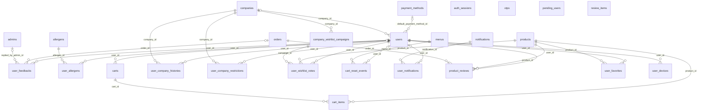
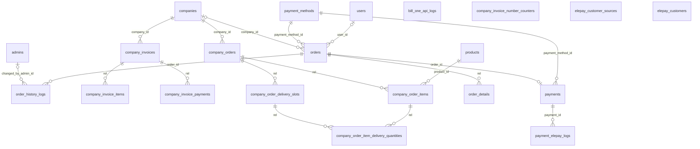
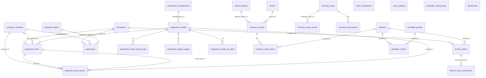
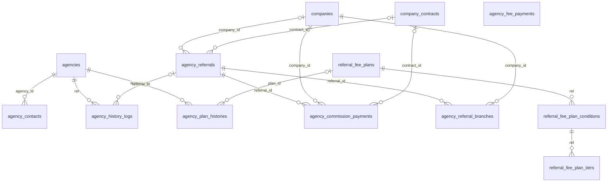
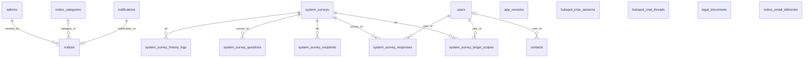
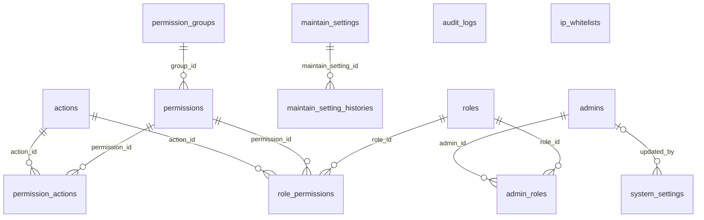

# es-kitchen-api — Entity Relationship Diagram

> Nguồn: `es-kitchen-api@4ca4dcd9` (develop) ngày 2026-10-16 — tổng hợp từ `src/entities/*.entity.ts`.
> **224 entities / 224 bảng** (trước đó 66), PostgreSQL, TypeORM 0.3. PK là `bigint` (trả về dạng `string` trong TypeScript).
> Migration: `database/migrations/` (303 file). Nguồn sự thật = entity hiện tại.
> Diagram sinh tự động từ `@ManyToOne` / `@OneToOne` + `@JoinColumn` / `@ManyToMany`; label = tên cột FK; quan hệ nullable dùng `|o`. Chỉ vẽ FK có khai báo relation (cột `*_id` thuần không có relation thì không có trong diagram).
> Các section chi tiết cũ (66 bảng) được giữ, chỉ thêm dòng "Cột bổ sung"; bảng mới nằm ở phần "bảng mới / đổi tên" cuối mục chi tiết.

---

## Diagram theo domain (Mermaid)

### 1. Company & Contract (công ty, hợp đồng, plan)

Bảng (32): `application_items`, `applications`, `change_request_items`, `change_requests`, `companies`, `company_admins`, `company_bill_one_destinations`, `company_contracts`, `company_history_logs`, `contract_billing_adjustments`, `contract_billing_sections`, `contract_delivery_attachments`, `contract_equipments`, `contract_fee_lines`, `contract_history_logs`, `contract_payment_items`, `contract_route_cycles`, `contract_route_special_days`, `contract_routes`, `contract_service_options`, `discount_values`, `discounts`, `parent_contract_history_logs`, `parent_contract_kind_histories`, `parent_contract_suspensions`, `parent_contracts`, `plan_change_logs`, `plan_course_settings`, `plan_masters`, `plan_prices`, `service_option_masters`, `service_option_plan_limits`

```mermaid
erDiagram
    agencies |o--o{ parent_contracts : agency_id
    applications ||--o{ application_items : application_id
    change_requests ||--o{ change_request_items : rel
    companies |o--o{ application_items : company_id
    companies |o--o{ applications : corporate_company_id
    companies ||--o{ company_admins : company_id
    companies ||--o{ company_bill_one_destinations : company_id
    companies ||--o{ company_contracts : rel
    companies ||--o{ company_history_logs : company_id
    companies ||--o{ parent_contracts : company_id
    company_contracts |o--o{ application_items : contract_id
    company_contracts ||--o{ change_requests : contract_id
    company_contracts ||--o{ contract_billing_adjustments : contract_id
    company_contracts ||--o{ contract_billing_sections : contract_id
    company_contracts ||--o{ contract_delivery_attachments : contract_id
    company_contracts ||--o{ contract_equipments : contract_id
    company_contracts ||--o{ contract_fee_lines : contract_id
    company_contracts ||--o{ contract_history_logs : contract_id
    company_contracts ||--o{ contract_payment_items : contract_id
    company_contracts ||--o{ contract_routes : rel
    company_contracts ||--o{ contract_service_options : rel
    contract_routes ||--o{ contract_route_cycles : rel
    contract_routes ||--o{ contract_route_special_days : rel
    deliverers |o--o{ company_contracts : outsourced_deliverer_master_id
    deliverers |o--o{ contract_routes : carrier1_id
    deliverers |o--o{ contract_routes : carrier2_id
    delivery_cycles ||--o{ contract_route_cycles : cycle_id
    discounts ||--o{ discount_values : discount_id
    parent_contracts ||--o{ company_contracts : rel
    parent_contracts ||--o{ parent_contract_history_logs : parent_contract_id
    parent_contracts ||--o{ parent_contract_kind_histories : parent_contract_id
    parent_contracts ||--o{ parent_contract_suspensions : parent_contract_id
    plan_masters ||--o{ plan_change_logs : plan_master_id
    plan_masters ||--o{ plan_course_settings : rel
    plan_masters ||--o{ plan_prices : plan_master_id
    relay_destinations |o--o{ company_contracts : relay_destination_id
    relay_destinations |o--o{ contract_routes : relay_destination_id
    service_option_masters ||--o{ contract_service_options : option_master_id
    service_option_masters ||--o{ service_option_plan_limits : rel
    warehouses |o--o{ company_contracts : warehouse_id
    warehouses |o--o{ contract_routes : warehouse_id
```

### 2. User & Auth (end user, OTP, session, wishlist, feedback)

Bảng (18): `auth_sessions`, `cart_items`, `cart_reset_events`, `carts`, `company_wishlist_campaigns`, `otps`, `pending_users`, `product_reviews`, `review_items`, `user_allergens`, `user_company_histories`, `user_company_restrictions`, `user_devices`, `user_favorites`, `user_feedbacks`, `user_notifications`, `user_wishlist_votes`, `users`

### 3. Menu & Product

Bảng (24): `ai_suggestion_chats`, `ai_suggestion_jobs`, `allergens`, `categories`, `company_ai_disabled_categories`, `company_ai_preferences`, `material_set_items`, `material_standard_sets`, `materials`, `menu_histories`, `menu_products`, `menu_publish_mail_deliveries`, `menu_publish_mails`, `menus`, `product_allergens`, `product_histories`, `product_images`, `product_ranking_baselines`, `product_ranking_scores`, `product_suppliers`, `product_tags`, `products`, `products_in_stock`, `tax_rates`

```mermaid
erDiagram
    allergens ||--o{ product_allergens : allergen_id
    categories ||--o{ company_ai_disabled_categories : category_id
    companies ||--o{ ai_suggestion_chats : company_id
    companies ||--o{ ai_suggestion_jobs : company_id
    companies ||--o| company_ai_preferences : company_id
    company_ai_preferences ||--o{ company_ai_disabled_categories : rel
    material_standard_sets ||--o{ material_set_items : rel
    materials ||--o{ material_set_items : material_id
    menus ||--o{ menu_products : menu_id
    products ||--o{ menu_products : product_id
    products ||--o{ product_allergens : product_id
    products ||--o{ product_images : rel
    products ||--o| product_ranking_scores : product_id
    products ||--o{ product_suppliers : rel
    suppliers |o--o{ product_suppliers : supplier_id
    menu_histories
    menu_publish_mail_deliveries
    menu_publish_mails
    product_histories
    product_ranking_baselines
    product_tags
    products_in_stock
    tax_rates
```

### 4. Order & Payment (đơn lẻ, đơn tháng, thanh toán, hóa đơn)

Bảng (17): `bill_one_api_logs`, `company_invoice_items`, `company_invoice_number_counters`, `company_invoice_payments`, `company_invoices`, `company_order_delivery_slots`, `company_order_item_delivery_quantities`, `company_order_items`, `company_orders`, `elepay_customer_sources`, `elepay_customers`, `order_details`, `order_history_logs`, `orders`, `payment_elepay_logs`, `payment_methods`, `payments`

### 5. Delivery (giao hàng, vận chuyển, driver, deliverer)

Bảng (51): `batch_job_runs`, `carrier_integration_configs`, `deliverer_change_requests`, `deliverer_contacts`, `deliverer_es_fees`, `deliverer_history_logs`, `deliverers`, `delivery_addresses`, `delivery_block_history_logs`, `delivery_block_private_attachments`, `delivery_block_trouble_actions`, `delivery_blocks`, `delivery_companies`, `delivery_cycle_assignments`, `delivery_cycle_days`, `delivery_cycle_pauses`, `delivery_cycle_runs`, `delivery_cycle_settings`, `delivery_cycles`, `delivery_date_change_requests`, `delivery_holiday_days`, `delivery_overrides`, `delivery_reports`, `delivery_trackings`, `driver_history_logs`, `drivers`, `holidays`, `picking_unavailable_days`, `quotation_request_attachments`, `quotation_request_deliverers`, `quotation_request_reply_logs`, `quotation_requests`, `region_cities`, `region_prefectures`, `region_towns`, `relay_destination_attachments`, `relay_destination_contacts`, `relay_destination_history_logs`, `relay_destinations`, `shipment_cargo_boxes`, `shipment_details`, `shipment_status_histories`, `shipping_plans`, `site_receive_blocks`, `special_delivery_rules`, `thomas_integration_logs`, `thomas_inventory_logs`, `trouble_report_items`, `trouble_reports`, `warehouse_non_picking_days`, `warehouse_non_picking_slots`

```mermaid
erDiagram
    carrier_integration_configs ||--o{ delivery_companies : rel
    carrier_integration_configs ||--o{ delivery_trackings : rel
    companies ||--o{ delivery_addresses : company_id
    companies ||--o{ delivery_blocks : company_id
    companies ||--o{ delivery_cycle_assignments : company_id
    companies ||--o{ delivery_date_change_requests : company_id
    companies ||--o{ picking_unavailable_days : rel
    companies |o--o{ quotation_requests : company_id
    companies |o--o{ shipment_cargo_boxes : destination_company_id
    companies ||--o{ special_delivery_rules : company_id
    company_contracts ||--o{ delivery_blocks : rel
    company_contracts ||--o{ delivery_cycle_assignments : contract_id
    company_contracts ||--o{ delivery_date_change_requests : rel
    company_contracts ||--o{ delivery_overrides : contract_id
    company_contracts ||--o{ picking_unavailable_days : rel
    company_contracts |o--o{ quotation_requests : contract_id
    company_contracts ||--o{ shipping_plans : contract_id
    contract_routes |o--o{ delivery_overrides : route_id
    contract_routes ||--o{ shipping_plans : route_id
    deliverers ||--o{ deliverer_contacts : deliverer_id
    deliverers ||--o{ deliverer_es_fees : deliverer_id
    deliverers ||--o{ deliverer_history_logs : deliverer_id
    deliverers |o--o{ delivery_blocks : deliverer_id
    deliverers |o--o{ drivers : deliverer_id
    deliverers ||--o{ quotation_request_deliverers : deliverer_id
    delivery_addresses ||--o{ delivery_blocks : rel
    delivery_addresses ||--o{ special_delivery_rules : rel
    delivery_blocks ||--o{ delivery_block_history_logs : delivery_block_id
    delivery_blocks ||--o{ delivery_block_private_attachments : delivery_block_id
    delivery_blocks ||--o{ delivery_block_trouble_actions : delivery_block_id
    delivery_blocks |o--o{ delivery_blocks : parent_block_id
    delivery_blocks ||--o{ delivery_date_change_requests : rel
    delivery_blocks ||--o{ delivery_reports : rel
    delivery_blocks ||--o{ delivery_trackings : rel
    delivery_blocks ||--o{ shipment_cargo_boxes : delivery_block_id
    delivery_blocks ||--o{ shipment_details : delivery_block_id
    delivery_blocks ||--o{ shipment_status_histories : delivery_block_id
    delivery_blocks ||--o{ trouble_reports : delivery_block_id
    delivery_companies ||--o{ delivery_blocks : rel
    delivery_cycle_pauses |o--o{ delivery_cycle_pauses : adjust_for_pause_id
    delivery_cycle_runs |o--o{ delivery_overrides : cycle_run_id
    delivery_cycle_runs ||--o{ shipping_plans : cycle_run_id
    delivery_cycle_settings ||--o{ delivery_cycle_pauses : rel
    delivery_cycle_settings ||--o{ delivery_holiday_days : setting_id
    delivery_cycle_settings ||--o{ warehouse_non_picking_days : setting_id
    delivery_cycle_settings ||--o{ warehouse_non_picking_slots : setting_id
    delivery_cycles ||--o{ delivery_blocks : rel
    delivery_cycles ||--o{ delivery_cycle_assignments : rel
    delivery_overrides |o--o{ shipping_plans : override_id
    drivers ||--o{ delivery_blocks : rel
    drivers ||--o{ delivery_reports : driver_id
    drivers ||--o{ driver_history_logs : driver_id
    drivers |o--o{ trouble_reports : driver_id
    products |o--o{ shipment_details : product_id
    quotation_request_deliverers ||--o{ quotation_request_attachments : rel
    quotation_request_deliverers ||--o{ quotation_request_reply_logs : rel
    quotation_requests ||--o{ quotation_request_attachments : rel
    quotation_requests ||--o{ quotation_request_deliverers : rel
    relay_destinations ||--o{ delivery_addresses : rel
    relay_destinations ||--o{ delivery_blocks : rel
    relay_destinations |o--o{ quotation_requests : relay_destination_id
    relay_destinations ||--o{ relay_destination_attachments : relay_destination_id
    relay_destinations ||--o{ relay_destination_contacts : rel
    relay_destinations ||--o{ relay_destination_history_logs : relay_destination_id
    shipment_cargo_boxes |o--o{ shipment_details : cargo_box_id
    shipment_cargo_boxes |o--o{ trouble_report_items : shipment_cargo_box_id
    shipping_plans |o--o{ delivery_date_change_requests : shipping_plan_id
    trouble_reports ||--o{ trouble_report_items : rel
    warehouses |o--o{ delivery_blocks : warehouse_id
    warehouses |o--o{ shipping_plans : warehouse_id
    warehouses ||--o{ warehouse_non_picking_days : warehouse_id
    warehouses ||--o{ warehouse_non_picking_slots : warehouse_id
    batch_job_runs
    deliverer_change_requests
    delivery_cycle_days
    holidays
    region_cities
    region_prefectures
    region_towns
    site_receive_blocks
    thomas_integration_logs
    thomas_inventory_logs
```

### 6. Supplier & Purchasing (nhà cung cấp, đơn mua, nguyên liệu)

Bảng (21): `arrival_confirmations`, `arrival_plan_items`, `arrival_plans`, `disposal_report_items`, `disposal_reports`, `material_deliveries`, `material_equipment_allocations`, `material_order_items`, `material_orders`, `supplier_addresses`, `supplier_change_requests`, `supplier_contacts`, `supplier_history_logs`, `supplier_order_details`, `supplier_order_material_details`, `supplier_orders`, `supplier_purchase_order_desired_days`, `supplier_purchase_order_events`, `supplier_purchase_order_rounds`, `supplier_purchase_orders`, `suppliers`

```mermaid
erDiagram
    arrival_plans ||--o{ arrival_plan_items : arrival_plan_id
    companies |o--o{ disposal_reports : customer_id
    companies ||--o{ material_orders : company_id
    company_contracts |o--o{ disposal_reports : contract_id
    delivery_reports ||--o| disposal_reports : delivery_report_id
    disposal_reports ||--o{ disposal_report_items : disposal_report_id
    equipment_types ||--o{ material_equipment_allocations : rel
    material_orders ||--o{ material_deliveries : rel
    material_orders ||--o{ material_order_items : rel
    material_standard_sets ||--o{ material_equipment_allocations : rel
    materials ||--o{ material_equipment_allocations : material_id
    materials ||--o{ material_order_items : rel
    products |o--o{ disposal_report_items : product_id
    products ||--o{ supplier_order_details : product_id
    supplier_orders ||--o{ supplier_order_details : rel
    supplier_orders ||--o{ supplier_order_material_details : rel
    supplier_purchase_orders ||--o{ supplier_purchase_order_desired_days : rel
    supplier_purchase_orders ||--o{ supplier_purchase_order_events : supplier_purchase_order_id
    supplier_purchase_orders ||--o{ supplier_purchase_order_rounds : rel
    suppliers |o--o{ arrival_plans : supplier_id
    suppliers ||--o{ supplier_addresses : rel
    suppliers ||--o{ supplier_contacts : rel
    suppliers ||--o{ supplier_history_logs : rel
    suppliers ||--o{ supplier_orders : supplier_id
    suppliers ||--o{ supplier_purchase_orders : supplier_id
    warehouses |o--o{ supplier_purchase_orders : warehouse_id
    arrival_confirmations
    supplier_change_requests
```

### 7. Inventory & Equipment (tồn kho, kiểm kê, thiết bị)

Bảng (22): `branch_stock_transactions`, `branch_stocks`, `equipment_loan_moves`, `equipment_loans`, `equipment_manufacturers`, `equipment_model_history_logs`, `equipment_model_images`, `equipment_model_vm_slots`, `equipment_models`, `equipment_types`, `equipments`, `inventory_check_items`, `inventory_checks`, `inventory_items`, `inventory_stock_counts`, `inventory_transactions`, `stock_reservations`, `stock_settings`, `stocktake_closing_lines`, `stocktake_entries`, `stocktake_periods`, `warehouses`

### 8. Agency & Referral (đại lý, hoa hồng)

Bảng (11): `agencies`, `agency_commission_payments`, `agency_contacts`, `agency_fee_payments`, `agency_history_logs`, `agency_plan_histories`, `agency_referral_branches`, `agency_referrals`, `referral_fee_plan_conditions`, `referral_fee_plan_tiers`, `referral_fee_plans`

### 9. Notification, Survey & Content

Bảng (15): `app_versions`, `contacts`, `hubspot_chat_sessions`, `hubspot_chat_threads`, `legal_documents`, `notice_categories`, `notice_email_deliveries`, `notices`, `notifications`, `system_survey_history_logs`, `system_survey_questions`, `system_survey_recipients`, `system_survey_responses`, `system_survey_target_scopes`, `system_surveys`

### 10. RBAC & System (admin, role, cấu hình, audit)

Bảng (13): `actions`, `admin_roles`, `admins`, `audit_logs`, `ip_whitelists`, `maintain_setting_histories`, `maintain_settings`, `permission_actions`, `permission_groups`, `permissions`, `role_permissions`, `roles`, `system_settings`

---

## Entities chi tiết

### `companies` — Công ty

| Column | Type | Ghi chú |
|---|---|---|
| `id` | bigint PK | |
| `company_code` | varchar UNIQUE | |
| `name` | varchar | |
| `name_kana` | varchar NULL | |
| `customer_postal_code` | varchar NULL | |
| `address_prefecture/city/street/building` | varchar NULL | |
| `department` | varchar NULL | |
| `customer_tel` | varchar NULL | |
| `fax` | varchar NULL | |
| `employee_count` | varchar NULL | |
| `installed_machine_count` | int DEFAULT 0 | |
| `is_cash_payment_allowed` | boolean DEFAULT false | Cho phép thanh toán tiền mặt |
| `order_limit` | varchar NULL | |
| `customer_note` | varchar NULL | |
| `status` | int DEFAULT 1 | 1=PROVISIONAL, 2=REGISTERED, 3=DELETED |
| `user_monthly_limit` | int NULL | Giới hạn đặt hàng tháng per user |
| `created_at`, `updated_at`, `deleted_at` | timestamp | Soft delete |

**Cột bổ sung (đồng bộ entity 2026-10-16):** `qr_code` varchar(32), `address_city` varchar NULL, `address_street` varchar NULL, `address_building` varchar NULL, `is_guest_payment_allowed` boolean, `subsidy_type` enum, `subsidy_value` numeric, `parent_id` bigint NULL, `contract_name` varchar(120) NULL, `bill_to_name` varchar(120) NULL, `sales_staff_name` varchar(60) NULL, `sales_staff_user_id` bigint NULL, `internal_note` text NULL, `billing_lead_months` smallint NULL, `invoice_unit` varchar(20) NULL, `pay_method` varchar(20) NULL, `pay_cycle` varchar(20) NULL, `bill_to` varchar(20) NULL, `billing_lead_override` smallint NULL, `due_rule` varchar(12) NULL, `anchor_month` char(7) NULL, `allow_esqr` boolean

---

### `company_admins` — Admin của company (E02 login)

| Column | Type | Ghi chú |
|---|---|---|
| `id` | bigint PK | |
| `company_id` | bigint FK → companies (CASCADE) | |
| `name`, `name_kana` | varchar NULL | |
| `tel`, `email` | varchar NULL | |
| `hashed_refresh_token` | varchar NULL | JWT refresh |
| `role` | varchar DEFAULT 'MAIN' | MAIN \| BILLING \| SUB |
| `status` | varchar | ACTIVE \| INACTIVE |
| `last_login_at` | timestamp NULL | |
| `created_at`, `updated_at`, `deleted_at` | timestamp | Soft delete |

**Cột bổ sung (đồng bộ entity 2026-10-16):** `department` varchar(60) NULL

---

### `company_contracts` — Hợp đồng

| Column | Type | Ghi chú |
|---|---|---|
| `id` | bigint PK | |
| `company_id` | bigint FK → companies (CASCADE) | |
| `contract_plan_id`, `plan`, `menu_type` | varchar NULL | |
| `target_year_month`, `creation_type` | varchar NULL | |
| `management_name` | varchar NULL | |
| `contract_start_period`, `contract_end_period` | varchar NULL | |
| `delivery_*` (nhiều cột) | varchar NULL | Thông tin giao hàng |
| `postal_code`, `prefecture/city/street/building` | varchar NULL | Địa chỉ giao hàng |
| `tel`, `contact_name` | varchar NULL | |
| `payment_method`, `annual_payment`, `billing_notification_day` | varchar NULL | |
| `status` | varchar NULL | |
| `created_at`, `updated_at` | timestamp | |

**Cột bổ sung (đồng bộ entity 2026-10-16):** `delivery_company` varchar NULL, `delivery_type` varchar NULL, `preferred_delivery_time_slot` varchar NULL, `outsourced_delivery_provider` varchar NULL, `relay_destination` varchar NULL, `picking_warehouse` varchar NULL, `delivery_priority` varchar NULL, `plan_name_note` varchar NULL, `delivery_count` varchar NULL, `delivery_count_total` smallint NULL, `delivery_week` varchar NULL, `delivery_lead_time` varchar NULL, `delivery_day` varchar NULL, `delivery_pattern` varchar NULL, `action_on_undeliverable` varchar NULL, `special_delivery_date` varchar NULL, `delivery_note` varchar NULL, `monthly_product_count` varchar NULL, `service_rate` varchar NULL, `service_count` int NULL, `plan_note` varchar NULL, `delivery_name` varchar NULL, `delivery_department` varchar NULL, `unavailable_days` varchar NULL, `application_note` varchar NULL, `cancellation_reason` varchar NULL, `plan_master_id` bigint NULL, `relay_destination_id` bigint NULL, `warehouse_id` bigint NULL, `carrier_id` bigint NULL, `outsourced_deliverer_master_id` bigint NULL, `contract_type` varchar(20), `approval_status` varchar(20) NULL, `trial_started_at` timestamp NULL, `trial_ends_at` timestamp NULL, `delivery_route` varchar(20) NULL, `delivery_file_url` varchar(500) NULL, `base_quantity_pattern` varchar(100) NULL, `terms_agreed_at` timestamp NULL, `desired_delivery_date` date NULL, `equipment_pickup_on` date NULL, `equipment_carry_in_on` date NULL, `equipment_setup_on` date NULL, `course` varchar(20) NULL, `invoice_target` varchar(20) NULL, `options` jsonb NULL, `reviewed_by` bigint NULL, `reviewed_at` timestamp NULL, `review_note` text NULL, `vending_install_note` text NULL, `install_floor` varchar(60) NULL, `short_expiry_handling` varchar(30) NULL, `referral_source_type` varchar(20) NULL, `referral_agency_id` bigint NULL, `referral_company_id` bigint NULL, `suspended_at` timestamp NULL, `application_status` varchar(20), `application_code` varchar(20) NULL, `setup_progress` jsonb NULL, `sales_rep_id` bigint NULL, `internal_memo` text NULL, `material_ship_date` date NULL, `material_arrival_date` date NULL, `parent_contract_id` bigint NULL, `monthly_no` varchar(30) NULL, `cycle_month` varchar(7) NULL, `cycle_start_on` date NULL, `gen_base_date` date NULL, `generated_at` timestamp NULL, `gen_method` varchar(20) NULL, `change_scope` varchar(20) NULL, `pay_method_snapshot` varchar(20) NULL, `pay_cycle_snapshot` varchar(20) NULL, `bill_to_snapshot` varchar(20) NULL, `billing_lead_snapshot` smallint NULL, `advance_billing_month` char(7) NULL, `welfare_enabled` boolean, `price_adj_mode` varchar(10), `price_adj_yen` integer NULL, `price_revision_id` bigint NULL, `subsidy_snapshot` jsonb NULL, `souzai_buyout` boolean, `applied_price_plan` varchar(20) NULL, `deductible_yen` int NULL, `monthly_cap_frozen` int NULL, `monthly_cap_chilled` int NULL

---

### `contract_equipments` — Thiết bị trong hợp đồng

FK: `contract_id` → `company_contracts` (CASCADE)

**Cột bổ sung (đồng bộ entity 2026-10-16):** `category` varchar, `name` varchar, `quantity` integer, `status` varchar NULL, `initial_fee` numeric NULL, `monthly_fee` numeric NULL

---

### `contract_payment_items` — Hạng mục thanh toán hợp đồng

FK: `contract_id` → `company_contracts` (CASCADE)

**Cột bổ sung (đồng bộ entity 2026-10-16):** `fee_type` varchar, `item_name` varchar, `amount` numeric, `billing_month` varchar(7) NULL, `status` varchar, `discount_id` bigint NULL, `note` text NULL

---

### `admins` — System Admin (E03 login)

| Column | Type | Ghi chú |
|---|---|---|
| `id` | bigint PK | |
| `user_name` | varchar | |
| `admin_code` | varchar UNIQUE NULL | |
| `email` | varchar | |
| `password` | varchar NULL | bcrypt |
| `hashed_refresh_token` | varchar NULL | |
| `role` | varchar NULL | Legacy role field (xem RBAC) |
| `is_super_admin` | boolean DEFAULT false | |
| `status` | smallint DEFAULT 1 | |
| `last_login_at` | timestamp NULL | |
| `created_at`, `updated_at`, `deleted_at` | timestamp | Soft delete |

Relation: `admins ||--o{ admin_roles : "adminRoles"`

---

### `users` — End users (Mobile App)

| Column | Type | Ghi chú |
|---|---|---|
| `id` | bigint PK | |
| `company_id` | bigint FK → companies NULL | NULL nếu chưa link |
| `user_code` | varchar UNIQUE | |
| `email` | varchar UNIQUE (partial idx, where deleted_at IS NULL) | |
| `user_name`, `gender`, `birthday`, `employee_id` | varchar/enum NULL | |
| `password`, `hashed_refresh_token` | varchar | bcrypt |
| `link_status` | enum | UNLINKED \| LINKED \| RESTRICTED |
| `linked_at`, `unlinked_at` | timestamp NULL | |
| `account_status` | enum DEFAULT ACTIVE | ACTIVE \| SUSPENDED |
| `unlinked_by` | bigint NULL | Company admin id |
| `cart_confirm_popup_hidden_until` | timestamp NULL | |
| `default_payment_method_id` | bigint FK → payment_methods NULL | |
| `cart_reset_ack_event_id` | bigint NULL | |
| `last_login_at` | timestamp NULL | |
| `created_at`, `updated_at`, `deleted_at` | timestamp | Soft delete |

**Cột bổ sung (đồng bộ entity 2026-10-16):** `type` enum, `notification_enabled` boolean

---

### `menus` — Menu tháng

| Column | Type | Ghi chú |
|---|---|---|
| `id` | bigint PK | |
| `menu_code` | varchar(12) NULL UNIQUE (where deleted_at IS NULL) | |
| `year_month` | varchar(7) | Format: YYYY-MM |
| `publish_status` | enum DEFAULT unpublished | published \| unpublished \| auto_public |
| `auto_pub_date` | timestamp NULL | Dùng khi status = auto_public |
| `pdf_url` | varchar(2048) NULL | |
| `created_at`, `updated_at`, `deleted_at` | timestamp | Soft delete |

**Cột bổ sung (đồng bộ entity 2026-10-16):** `order_close_date` date NULL, `published_at` timestamptz NULL, `auto_publish_blocked_at` timestamptz NULL, `send_notification` boolean

---

### `menu_products` — Sản phẩm trong menu (junction)

| Column | Type | Ghi chú |
|---|---|---|
| `id` | bigint PK | |
| `menu_id` | bigint FK → menus (CASCADE) | |
| `product_id` | bigint FK → products (CASCADE) | |
| UNIQUE | `(menu_id, product_id)` | |
| `selling_price` | decimal(12,2) | Giá bán trong menu |
| `base_order_qty` | int DEFAULT 0 | Số lượng gợi ý |
| `std_order_qty_no_short_expiry` | int DEFAULT 0 | |
| `vending_machine_order_qty` | int DEFAULT 0 | |
| `product_tags` | simple-array NULL | ['NEW', '短賞味期限'] |
| `is_public` | boolean DEFAULT false | |
| `created_at`, `updated_at` | timestamp | |

**Cột bổ sung (đồng bộ entity 2026-10-16):** `is_sample` boolean

---

### `menu_histories` — Lịch sử thay đổi menu

| Column | Type | Ghi chú |
|---|---|---|
| `id` | bigint PK | |
| `menu_id` | bigint | Không FK (snapshot) |
| `action` | varchar(20) | IMPORT \| EDIT |
| `admin_id` | bigint | |
| `admin_name` | varchar(255) | Snapshot tên admin |
| `changed_at` | timestamptz (CreateDateColumn) | |

---

### `products` — Sản phẩm (master data)

| Column | Type | Ghi chú |
|---|---|---|
| `id` | bigint PK | |
| `product_code` | varchar NULL | |
| `jan_code` | varchar UNIQUE NULL | JAN barcode |
| `category` | varchar NULL | |
| `price` | decimal(12,2) NULL | |
| `name` | varchar | |
| `name_kana`, `description` | varchar/text NULL | |
| Nutrition columns | varchar/decimal | energy, protein, fat, carbohydrate, salt_equivalent, etc. |
| `allergen_labeling` | varchar NULL | |
| `raw_material_name` | text NULL | |
| `expiration_date_value`, `expiration_date_unit` | int/varchar NULL | |
| `shipment_bundled_material`, `shipment_special_instruction` | varchar NULL | |
| `short_expiry_type` | varchar NULL | |
| `storage_method_management`, `storage_method_display` | varchar NULL | |
| `vending_machine_column`, `vending_machine_column_notes` | varchar/text NULL | |
| `supplier_website` | varchar NULL | |
| `favorite_count` | int DEFAULT 0 | Denormalized counter |
| `created_at`, `updated_at`, `deleted_at` | timestamp | Soft delete |

**Cột bổ sung (đồng bộ entity 2026-10-16):** `energy_value` decimal NULL, `energy_base_amount` decimal NULL, `energy_base_unit` varchar NULL, `energy_is_estimated` boolean NULL, `other_ingredients` varchar NULL, `equivalent_raw_materials` varchar NULL, `additives` varchar NULL, `contents` varchar NULL, `temp_type` varchar(20), `product_notes` text NULL, `order_forecast_parameter` varchar NULL

---

### `product_suppliers` — Nhà cung cấp sản phẩm

FK: `product_id` → `products` (CASCADE)

**Cột bổ sung (đồng bộ entity 2026-10-16):** `supplier_id` bigint NULL, `supplier_name` varchar, `purchase_price` decimal NULL, `lot` varchar NULL, `purchase_notes` text NULL, `is_main_supplier` boolean

---

### `product_images` — Hình ảnh sản phẩm

FK: `product_id` → `products` (CASCADE)

**Cột bổ sung (đồng bộ entity 2026-10-16):** `url` varchar, `sort_order` int, `is_main` boolean

---

### `orders` — Đơn hàng lẻ (E01 user)

| Column | Type | Ghi chú |
|---|---|---|
| `id` | bigint PK | |
| `order_number` | varchar(12) UNIQUE | |
| `user_id` | bigint FK → users NULL (SET NULL on delete) | |
| `company_id` | bigint NULL | Denormalized, không FK |
| `status` | enum DEFAULT PENDING | PENDING \| PAID \| CANCELLED \| REFUNDED \| etc. |
| `payment_method_id` | bigint FK → payment_methods (RESTRICT) | |
| `subtotal`, `total` | decimal(12,2) DEFAULT 0 | |
| `created_at`, `updated_at` | timestamp | |

**Cột bổ sung (đồng bộ entity 2026-10-16):** `employee_id` varchar NULL, `subsidy_amount` decimal, `subsidy_type` enum NULL, `subsidy_value` numeric NULL, `refund_reason` varchar NULL, `payment_expires_at` timestamptz NULL

---

### `order_details` — Chi tiết đơn hàng

| Column | Type | Ghi chú |
|---|---|---|
| `id` | bigint PK | |
| `order_id` | bigint FK → orders (CASCADE) | |
| `product_id` | bigint NULL | Không FK (snapshot) |
| `product_code`, `product_name` | varchar | Snapshot lúc đặt hàng |
| `price`, `quantity`, `subtotal` | decimal/int | |
| `created_at`, `updated_at` | timestamp | |

**Cột bổ sung (đồng bộ entity 2026-10-16):** `source` varchar(10) NULL, `branch_price` decimal NULL, `branch_subtotal` decimal NULL, `subsidy_amount` decimal NULL

---

### `company_orders` — Đơn tháng của company

> Khác với `orders` (đơn lẻ E01). Mỗi company chỉ có 1 đơn / tháng — sinh tự động bởi cron đầu tháng.

| Column | Type | Ghi chú |
|---|---|---|
| `id` | bigint PK | |
| `company_id` | bigint FK → companies (CASCADE) | |
| `contract_id` | bigint NULL | Snapshot hợp đồng lúc sinh đơn |
| `menu_id` | bigint NULL | Snapshot menu tháng |
| `year_month` | varchar(7) | Format: YYYY-MM |
| `status` | enum DEFAULT DRAFT | DRAFT \| SUBMITTED \| LOCKED \| CONFIRMED \| CANCELLED |
| `deadline_date` | date NULL | Snapshot deadline chỉnh sửa |
| `delivery_schedule` | jsonb NULL | `[{ deliveryDate, pickingDate }]` |
| `submitted_total_item_count` | int DEFAULT 0 | |
| `submitted_total_amount` | decimal(14,2) DEFAULT 0 | |
| `submitted_at` | timestamptz NULL | |
| `locked_at` | timestamptz NULL | |
| `notes` | text NULL | Memo nội bộ |
| `generated_by` | enum DEFAULT CRON | CRON \| MANUAL |
| UNIQUE | `(company_id, year_month)` | |
| `created_at`, `updated_at` | timestamp | |

**Cột bổ sung (đồng bộ entity 2026-10-16):** `submitted_by_type` varchar(10) NULL, `submitted_by_id` bigint NULL, `published_at` timestamptz NULL, `publish_trigger` varchar(24) NULL

---

### `company_order_items` — Chi tiết đơn tháng

| Column | Type | Ghi chú |
|---|---|---|
| `id` | bigint PK | |
| `order_id` | bigint FK → company_orders (CASCADE) | |
| `product_id` | bigint FK → products (CASCADE) | |
| `menu_product_id` | bigint NULL | Snapshot menu_products row |
| `quantity` | int DEFAULT 0 | |
| `unit_price` | decimal(12,2) | Snapshot giá bán gốc |
| `employee_unit_price` | decimal(12,2) | Snapshot giá sau welfare |
| UNIQUE | `(order_id, product_id)` | |
| `created_at`, `updated_at` | timestamp | |

---

### `company_order_delivery_slots` — Lịch giao trong đơn tháng

| Column | Type | Ghi chú |
|---|---|---|
| `id` | bigint PK | |
| `order_id` | bigint FK → company_orders (CASCADE) | |
| `sequence` | int | Thứ tự lần giao trong tháng |
| `delivery_date` | date | |
| `picking_date` | date | Ngày lấy hàng = deliveryDate − leadTime |
| `status` | varchar(20) DEFAULT 'pending' | |
| `notes` | text NULL | |
| UNIQUE | `(order_id, sequence)` | |
| `created_at`, `updated_at` | timestamp | |

**Cột bổ sung (đồng bộ entity 2026-10-16):** `shipping_plan_id` bigint NULL, `temp_type` varchar(20) NULL

---

### `company_order_item_delivery_quantities` — Số lượng mỗi món theo từng lần giao

| Column | Type | Ghi chú |
|---|---|---|
| `id` | bigint PK | |
| `order_item_id` | bigint FK → company_order_items (CASCADE) | |
| `delivery_slot_id` | bigint FK → company_order_delivery_slots (CASCADE) | |
| `quantity` | int DEFAULT 0 | |
| UNIQUE | `(order_item_id, delivery_slot_id)` | |
| `created_at`, `updated_at` | timestamp | |

---

### `materials` — Nguyên liệu (master)

| Column | Type | Ghi chú |
|---|---|---|
| `id` | bigint PK | |
| `name` | varchar(255) | |
| `unit` | varchar(50) | Đơn vị tính |
| `category` | varchar(100) NULL | |
| `unit_price` | decimal(12,2) DEFAULT 0 | |
| `is_active` | boolean DEFAULT true | |
| `created_at`, `updated_at` | timestamp | |

---

### `material_orders` — Đơn đặt nguyên liệu

| Column | Type | Ghi chú |
|---|---|---|
| `id` | bigint PK | |
| `company_id` | bigint FK → companies (CASCADE) | |
| `year_month` | varchar(7) | Format: YYYY-MM |
| `status` | enum DEFAULT DRAFT | DRAFT \| SUBMITTED \| CONFIRMED \| etc. |
| `submitted_at` | timestamptz NULL | |
| `notes` | text NULL | |
| `created_by_company_admin_id` | bigint NULL | |
| UNIQUE | `(company_id, year_month)` | |
| `created_at`, `updated_at` | timestamp | |

---

### `material_order_items` — Chi tiết đơn nguyên liệu

| Column | Type | Ghi chú |
|---|---|---|
| `id` | bigint PK | |
| `order_id` | bigint FK → material_orders (CASCADE) | |
| `material_id` | bigint FK → materials (CASCADE) | |
| `quantity` | int | |
| `unit_price` | decimal(12,2) | |
| UNIQUE | `(order_id, material_id)` | |
| `created_at`, `updated_at` | timestamp | |

---

### `material_deliveries` — Giao hàng nguyên liệu

| Column | Type | Ghi chú |
|---|---|---|
| `id` | bigint PK | |
| `material_order_id` | bigint FK → material_orders (CASCADE) | |
| `status` | enum DEFAULT PENDING | PENDING \| SHIPPED \| DELIVERED \| etc. |
| `tracking_ref` | varchar(200) NULL | |
| `carrier_code` | varchar(50) NULL | |
| `expected_delivery_date` | date NULL | |
| `actual_delivery_date` | date NULL | |
| `raw_response` | jsonb NULL | Raw response từ carrier API |
| `last_synced_at` | timestamptz NULL | |
| `created_at`, `updated_at` | timestamp | |

---

### `suppliers` — Nhà cung cấp (E04 login)

| Column | Type | Ghi chú |
|---|---|---|
| `id` | bigint PK | |
| `supplier_code` | varchar(20) UNIQUE (partial: deleted_at IS NULL) | |
| `supplier_name` | varchar(255) NULL | |
| `supplier_name_kana` | varchar(255) NULL | |
| `registration_status` | enum DEFAULT UNREGISTERED | UNREGISTERED \| REGISTERED |
| `remarks` | text NULL | |
| `status` | varchar(20) DEFAULT 'ACTIVE' | ACTIVE \| INACTIVE |
| `last_login_at` | timestamp NULL | |
| `created_by` | bigint NULL | Admin id |
| `hashed_refresh_token` | varchar NULL | `@Exclude()` |
| `created_at`, `updated_at`, `deleted_at` | timestamp | Soft delete |

**Cột bổ sung (đồng bộ entity 2026-10-16):** `supplier_category` varchar(50) NULL, `reject_reason` text NULL, `rejected_at` timestamp NULL, `rejected_by` bigint NULL, `representative_name` varchar(60) NULL, `saturday_sunday_holiday_working` boolean NULL, `supplier_types` jsonb NULL, `producible_categories` jsonb NULL, `main_products` text NULL, `licenses` varchar(60) NULL, `reception_no` varchar(20) NULL

---

### `supplier_addresses` — Địa chỉ của supplier

| Column | Type | Ghi chú |
|---|---|---|
| `id` | bigint PK | |
| `supplier_id` | bigint FK → suppliers (CASCADE) | |
| `address_types` | enum[] | HEAD_OFFICE \| BRANCH \| DELIVERY \| etc. (array) |
| `postal_code` | varchar(20) | |
| `prefecture`, `city`, `street` | varchar | |
| `building` | varchar NULL | |
| `tel`, `fax` | varchar NULL | |
| `sort_order` | int DEFAULT 0 | |
| `created_at`, `updated_at` | timestamp | |

---

### `supplier_contacts` — Người liên hệ của supplier

| Column | Type | Ghi chú |
|---|---|---|
| `id` | bigint PK | |
| `supplier_id` | bigint FK → suppliers (CASCADE) | |
| `contact_type` | enum | REPRESENTATIVE \| SALES \| etc. |
| `name` | varchar(255) | |
| `name_kana` | varchar(255) NULL | |
| `email` | varchar(255) | |
| `tel` | varchar(50) NULL | |
| `sort_order` | int DEFAULT 0 | |
| `created_at`, `updated_at` | timestamp | |

---

### `supplier_history_logs` — Lịch sử thay đổi supplier master

| Column | Type | Ghi chú |
|---|---|---|
| `id` | bigint PK | |
| `supplier_id` | bigint FK → suppliers (CASCADE) | |
| `content` | text | Nội dung thay đổi |
| `changed_by` | varchar(255) | Tên admin thay đổi |
| `created_at` | timestamptz | |

---

### `supplier_orders` — Đơn nhà cung cấp

| Column | Type | Ghi chú |
|---|---|---|
| `id` | bigint PK | |
| `order_no` | varchar(20) UNIQUE | |
| `order_type` | enum DEFAULT PROVISIONAL | PROVISIONAL \| OFFICIAL |
| `officialized_date` | date NULL | |
| `supplier_id` | bigint FK → suppliers (RESTRICT) | |
| `year_month` | varchar(7) | Format: MM/YYYY (vd: `04/2024`) |
| `desired_delivery_date` | date NULL | |
| `status` | enum DEFAULT WAITING_REPLY | WAITING_REPLY \| PROVISIONAL \| OFFICIAL \| CONFIRMED |
| `expected_ship_date`, `actual_ship_date` | date NULL | |
| `delivery_method` | enum NULL | |
| `carrier_name` | varchar(255) NULL | |
| `created_by_admin_id` | bigint NULL | |
| `created_at`, `updated_at`, `deleted_at` | timestamp | Soft delete |

**Cột bổ sung (đồng bộ entity 2026-10-16):** `payment_method` varchar(30) NULL, `note` text NULL

---

### `supplier_order_details` — Chi tiết dòng đơn supplier

| Column | Type | Ghi chú |
|---|---|---|
| `id` | bigint PK | |
| `order_id` | bigint FK → supplier_orders (CASCADE) | |
| `product_id` | bigint FK → products (RESTRICT) | |
| `product_name` | varchar(255) | Snapshot |
| `quantity` | int | オーダー数 |
| `line_status` | enum DEFAULT UNPROCESSED | UNPROCESSED \| PROVISIONAL_ORDERED \| OFFICIAL_ORDERED |
| `provisional_quantity` | int NULL | 仮発注数 |
| `official_quantity` | int NULL | 本発注数 |
| `logical_required_qty` | int NULL | 論理必要数 (cron fill sau) |
| `stock_qty` | int NULL | 在庫数 |
| `unit` | varchar(50) NULL | |
| `expiry_date` | date NULL | |
| `created_at`, `updated_at`, `deleted_at` | timestamp | Soft delete |

---

### `supplier_order_material_details` — Chi tiết nguyên liệu đơn supplier

> ⚠️ DEFERRED — bảng tồn tại trong schema nhưng chưa được query (cron sinh đơn chưa implement).

| Column | Type | Ghi chú |
|---|---|---|
| `id` | bigint PK | |
| `order_id` | bigint FK → supplier_orders (CASCADE) | |
| `material_id` | bigint NULL | Không FK (chưa có bảng materials link) |
| `material_name` | varchar(255) | |
| `quantity` | int | |
| `unit` | varchar(50) NULL | |
| `expiry_date` | date NULL | |
| `created_at`, `updated_at`, `deleted_at` | timestamp | Soft delete |

---

### `drivers` — Tài xế (E06 login)

| Column | Type | Ghi chú |
|---|---|---|
| `id` | bigint PK | |
| `driver_code` | varchar(20) UNIQUE (partial: deleted_at IS NULL) | |
| `email` | varchar(255) UNIQUE (partial: deleted_at IS NULL) | |
| `driver_name` | varchar(255) NULL | |
| `status` | varchar(20) DEFAULT 'ACTIVE' | ACTIVE \| INACTIVE |
| `last_login_at` | timestamp NULL | |
| `created_by` | bigint NULL | Admin id |
| `hashed_refresh_token` | varchar NULL | `@Exclude()` |
| `created_at`, `updated_at`, `deleted_at` | timestamp | Soft delete |

**Cột bổ sung (đồng bộ entity 2026-10-16):** `license_image_urls` text, `name_kana` varchar(255) NULL, `phone` varchar(50) NULL, `type` varchar(20), `deliverer_id` bigint NULL, `account_issued_at` timestamp NULL

---

### `deliverers` — Nhân viên giao hàng (E05 login)

| Column | Type | Ghi chú |
|---|---|---|
| `id` | bigint PK | |
| `deliverer_code` | varchar(20) UNIQUE (partial: deleted_at IS NULL) | |
| `email` | varchar(255) | |
| `deliverer_name` | varchar(255) NULL | |
| `status` | varchar(20) DEFAULT 'ACTIVE' | ACTIVE \| INACTIVE |
| `last_login_at` | timestamp NULL | |
| `created_by` | bigint NULL | Admin id |
| `hashed_refresh_token` | varchar NULL | `@Exclude()` |
| `created_at`, `updated_at`, `deleted_at` | timestamp | Soft delete |

**Cột bổ sung (đồng bộ entity 2026-10-16):** `representative_name` varchar(255) NULL, `transport_types` text, `contract_start_date` date NULL, `service_areas` text, `deliverer_name_kana` varchar(255) NULL, `postal_code` varchar(20) NULL, `prefecture` varchar(100) NULL, `city` varchar(255) NULL, `street` varchar(255) NULL, `building` varchar(255) NULL, `tel` varchar(50) NULL, `fax` varchar(50) NULL, `remarks` text NULL, `achievement_areas` text, `owned_vehicles` text, `single_delivery_fee` varchar(50) NULL, `payment_terms` varchar(255) NULL, `negative_factors` text NULL, `note` text NULL, `unavailable_weekdays` text, `service_area_note` text NULL, `frozen_box_rental_required` boolean NULL, `chilled_box_rental_required` boolean NULL, `has_cold_storage_space` boolean NULL, `equipment_note` text NULL, `terms_agreed_at` timestamp NULL, `notify_emails` jsonb, `reject_reason` text NULL, `rejected_at` timestamp NULL, `rejected_by` bigint NULL

---

### `roles` — Vai trò RBAC

| Column | Type | Ghi chú |
|---|---|---|
| `id` | bigint PK | |
| `name` | varchar(255) UNIQUE | |
| `description` | text NULL | |
| `status` | varchar(20) DEFAULT 'active' | |
| `created_at`, `updated_at` | timestamp | |

---

### `admin_roles` — Mapping admin ↔ role (junction)

| Column | Type | Ghi chú |
|---|---|---|
| `admin_id` | bigint PK FK → admins (CASCADE) | Composite PK |
| `role_id` | bigint PK FK → roles (CASCADE) | Composite PK |

---

### `permission_groups` — Nhóm permissions

| Column | Type | Ghi chú |
|---|---|---|
| `id` | bigint PK | |
| `code` | varchar(100) UNIQUE | |
| `name` | varchar(255) | |
| `sort_order` | int DEFAULT 0 | |
| `created_at` | timestamp | |

---

### `permissions` — Permissions

| Column | Type | Ghi chú |
|---|---|---|
| `id` | bigint PK | |
| `group_id` | bigint FK → permission_groups | |
| `code` | varchar(100) UNIQUE | Vd: `account.admin.view` |
| `name` | varchar(255) | |
| `description` | text NULL | |
| `sort_order` | int DEFAULT 0 | |
| `created_at` | timestamp | |

---

### `actions` — Actions cho permission (READ/WRITE/DELETE...)

| Column | Type | Ghi chú |
|---|---|---|
| `id` | bigint PK | |
| `code` | varchar(50) UNIQUE | Vd: `VIEW`, `CREATE`, `EDIT`, `DELETE` |
| `name` | varchar(100) | |

---

### `permission_actions` — Mapping permission ↔ action (junction)

| Column | Type | Ghi chú |
|---|---|---|
| `permission_id` | bigint PK FK → permissions | Composite PK |
| `action_id` | bigint PK FK → actions | Composite PK |

---

### `role_permissions` — Mapping role ↔ permission ↔ action

| Column | Type | Ghi chú |
|---|---|---|
| `role_id` | bigint PK FK → roles | Composite PK (3 cột) |
| `permission_id` | bigint PK FK → permissions | Composite PK |
| `action_id` | bigint PK FK → actions | Composite PK |

---

### `ip_whitelists` — Danh sách IP được phép

| Column | Type | Ghi chú |
|---|---|---|
| `id` | bigint PK | |
| `title` | varchar(255) | |
| `ip_address` | varchar(45) UNIQUE (partial: deleted_at IS NULL) | IPv4 |
| `created_at`, `updated_at`, `deleted_at` | timestamptz | Soft delete |

---

### `maintain_settings` — Cấu hình maintain mode

| Column | Type | Ghi chú |
|---|---|---|
| `id` | bigint PK | |
| `platform` | varchar(50) UNIQUE | Vd: `ios`, `android` |
| `is_maintain` | boolean DEFAULT false | |
| `title` | varchar(255) NULL | Tiêu đề popup |
| `content` | text NULL | Nội dung popup |
| `created_at`, `updated_at` | timestamptz | |

---

### `maintain_setting_histories` — Lịch sử thay đổi maintain

| Column | Type | Ghi chú |
|---|---|---|
| `id` | bigint PK | |
| `maintain_setting_id` | bigint FK → maintain_settings (CASCADE) | |
| `platform` | varchar(50) | |
| `is_maintain` | boolean | |
| `title` | varchar(255) NULL | |
| `content` | text NULL | |
| `end_at` | timestamptz NULL | Thời điểm kết thúc maintain |
| `created_at` | timestamptz | |

---

### `payments` — Thanh toán

| Column | Type | Ghi chú |
|---|---|---|
| `id` | bigint PK | |
| `order_id` | bigint FK → orders (CASCADE) UNIQUE | OneToOne |
| `payment_method_id` | bigint FK → payment_methods (RESTRICT) | |
| `status` | enum DEFAULT PENDING | PENDING \| PAID \| FAILED \| REFUNDED |
| `amount` | decimal(12,2) | |
| `transaction_id` | varchar NULL | Elepay transaction ID |
| `code_id` | varchar NULL | Elepay EasyQR code ID |
| `paid_at` | timestamp NULL | |
| `context` | varchar(50) DEFAULT CHECKOUT | CHECKOUT \| HISTORY |
| `metadata` | jsonb NULL | Raw provider response |
| `reminder_count` | int DEFAULT 0 | |
| `created_at`, `updated_at` | timestamp | |

---

### `payment_methods` — Phương thức thanh toán (master)

| Column | Type | Ghi chú |
|---|---|---|
| `id` | bigint PK | |
| `code` | varchar UNIQUE | CREDIT_CARD, CASH, ALIPAY, WECHAT, etc. |
| `name` | varchar | |
| `description` | text NULL | |
| `is_active` | boolean DEFAULT true | |
| `is_default` | boolean DEFAULT false | |
| `sort_order` | int DEFAULT 0 | |
| `image_url` | varchar NULL | |
| `created_at`, `updated_at`, `deleted_at` | timestamp | Soft delete |

**Cột bổ sung (đồng bộ entity 2026-10-16):** `is_visible_mobile` boolean, `is_visible_web` boolean

---

### `carts` — Giỏ hàng (1 user = 1 cart)

| Column | Type | Ghi chú |
|---|---|---|
| `id` | bigint PK | |
| `user_id` | bigint FK → users (CASCADE) UNIQUE | |
| `created_at`, `updated_at` | timestamp | |

---

### `cart_items` — Item trong giỏ hàng

| Column | Type | Ghi chú |
|---|---|---|
| `id` | bigint PK | |
| `cart_id` | bigint FK → carts (CASCADE) | |
| `product_id` | bigint FK → products (CASCADE) | eager: true |
| UNIQUE | `(cart_id, product_id)` | |
| `quantity` | int DEFAULT 1 | |
| `created_at`, `updated_at` | timestamp | |

**Cột bổ sung (đồng bộ entity 2026-10-16):** `source` varchar(10)

---

### `notifications` — Thông báo hệ thống

| Column | Type | Ghi chú |
|---|---|---|
| `id` | bigint PK | |
| `title`, `content` | varchar/text | |
| `type` | enum | MENU_PUBLISH \| ORDER_UPDATE \| etc. |
| `body` | jsonb NULL | `{ link?, preViewLink?, orderId? }` |
| `created_at` | timestamp | |

**Cột bổ sung (đồng bộ entity 2026-10-16):** `menu_id` bigint NULL

---

### `user_notifications` — Notification gửi tới user

| Column | Type | Ghi chú |
|---|---|---|
| `id` | bigint PK | |
| `notification_id` | bigint FK → notifications | |
| `user_id` | bigint FK → users | |
| INDEX | `(user_id, is_read, created_at)` | |
| `is_read` | boolean DEFAULT false | |
| `read_at` | timestamp NULL | |
| `created_at` | timestamp | |

**Cột bổ sung (đồng bộ entity 2026-10-16):** `recipient_type` varchar(20) NULL, `recipient_id` bigint NULL, `email` varchar(255) NULL, `email_sent` boolean, `email_error` text NULL

---

### `user_favorites` — Sản phẩm yêu thích

FK: `user_id` → users (CASCADE), `product_id` → products (CASCADE). UNIQUE `(user_id, product_id)`.

---

### `user_devices` — FCM device tokens

| Column | Type | Ghi chú |
|---|---|---|
| `id` | bigint PK | |
| `user_id` | bigint FK → users (CASCADE) INDEX | |
| `token_device` | varchar(1024) UNIQUE | FCM token |
| `platform` | enum | IOS \| ANDROID |
| `ip`, `user_agent` | varchar NULL | |
| `last_active_at` | timestamptz NULL | |

---

### `elepay_customers` — Elepay customer mapping

| Column | Type | Ghi chú |
|---|---|---|
| `id` | bigint PK | |
| `user_id` | bigint FK → users | |
| `elepay_customer_id` | varchar | ID từ Elepay API |
| `name` | varchar NULL | |

**Cột bổ sung (đồng bộ entity 2026-10-16):** `email` varchar NULL, `phone` varchar NULL

---

### `elepay_customer_sources` — Thẻ tín dụng lưu trong Elepay

| Column | Type | Ghi chú |
|---|---|---|
| `id` | bigint PK | |
| `elepay_customer_id` | varchar FK → elepay_customers | |
| `elepay_source_id` | varchar | ID từ Elepay API |
| `payment_method` | varchar | CREDIT_CARD |
| `status` | enum | PENDING \| ACTIVE \| INACTIVE |
| `is_default` | boolean | |

**Cột bổ sung (đồng bộ entity 2026-10-16):** `bank_branch_name` varchar NULL, `brand` varchar NULL, `exp_month` int NULL, `exp_year` int NULL, `name` varchar NULL, `last4` varchar NULL

---

---

### Domain 1 — Company & Contract (công ty, hợp đồng, plan): bảng mới / đổi tên

#### `application_items` — `ApplicationItem`

| Column | Type | Ghi chú |
|---|---|---|
| `id` | bigint | PK |
| `application_id` | bigint | FK → applications (CASCADE) |
| `company_id` | bigint | NULL, FK → companies (CASCADE) |
| `contract_id` | bigint | NULL, FK → company_contracts (SET NULL) |
| `payload` | jsonb | NULL |
| `start_month` | char(7) | NULL |
| `status` | varchar(20) | DEFAULT ApplicationStatus.RECEIVING |
| `setup_progress` | jsonb | NULL |
| `decided_by` | bigint | NULL |
| `decided_at` | timestamp | NULL |
| `reject_reason` | varchar(50) | NULL |
| `reject_note` | text | NULL |
| `withdrawn_at` | timestamp | NULL |
| `created_at` | timestamp |  |
| `updated_at` | timestamp |  |

#### `applications` — `Application`

| Column | Type | Ghi chú |
|---|---|---|
| `id` | bigint | PK |
| `application_no` | varchar(30) |  |
| `kind` | varchar(30) |  |
| `contract_type` | varchar(20) |  |
| `corporate_company_id` | bigint | NULL, FK → companies (CASCADE) |
| `corporate_payload` | jsonb | NULL |
| `intake_channel` | varchar(20) | DEFAULT ApplicationIntakeChannel.WEB |
| `entered_by_admin_id` | bigint | NULL |
| `received_on` | date | NULL |
| `sales_staff_user_id` | bigint | NULL |
| `issue_account` | boolean | DEFAULT true |
| `trial_months` | smallint | NULL |
| `applicant_contact_id` | bigint | NULL |
| `ops` | jsonb | NULL |
| `status` | varchar(20) | DEFAULT ApplicationStatus.RECEIVING |
| `applied_at` | timestamp |  |
| `applicant_name` | varchar(255) | NULL |
| `applicant_email` | varchar(255) | NULL |
| `applicant_tel` | varchar(50) | NULL |
| `applied_by_company_id` | bigint | NULL |
| `terms_agreed_at` | timestamp | NULL |
| `setup_progress` | jsonb | NULL |
| `created_at` | timestamp |  |
| `updated_at` | timestamp |  |

#### `change_request_items` — `ChangeRequestItem`

| Column | Type | Ghi chú |
|---|---|---|
| `id` | bigint | PK |
| `request_id` | bigint |  |
| `target_entity` | varchar(20) |  |
| `field_key` | varchar(64) |  |
| `field_label` | varchar(255) | NULL |
| `old_value` | jsonb | NULL |
| `new_value` | jsonb | NULL |
| `decision` | varchar(20) | DEFAULT ChangeRequestItemDecision.PENDING |
| `decided_by` | bigint | NULL |
| `decided_at` | timestamp | NULL |
| `decision_note` | text | NULL |
| `created_at` | timestamp |  |
| `updated_at` | timestamp |  |

#### `change_requests` — `ChangeRequest`

| Column | Type | Ghi chú |
|---|---|---|
| `id` | bigint | PK |
| `contract_id` | bigint | FK → company_contracts (CASCADE) |
| `company_id` | bigint |  |
| `request_type` | varchar(20) |  |
| `status` | varchar(20) | DEFAULT ChangeRequestStatus.PENDING |
| `reason` | text | NULL |
| `effective_date` | date | NULL |
| `requested_by_type` | varchar(10) | DEFAULT ChangeRequestActorType.COMPANY |
| `requested_by` | bigint | NULL |
| `requested_by_name` | varchar(255) | NULL |
| `reviewed_by` | bigint | NULL |
| `reviewed_at` | timestamp | NULL |
| `review_note` | text | NULL |
| `created_at` | timestamp |  |
| `updated_at` | timestamp |  |

#### `company_bill_one_destinations` — `CompanyBillOneDestination`

| Column | Type | Ghi chú |
|---|---|---|
| `id` | bigint | PK |
| `company_id` | bigint | FK → companies (CASCADE) |
| `invoice_destination_uuid` | uuid | NULL |
| `external_id` | varchar(100) |  |
| `organization_name` | varchar(255) | NULL |
| `destination_name` | varchar(255) | NULL |
| `destination_email` | varchar(255) | NULL |
| `last_synced_at` | timestamp | NULL |
| `last_sync_error` | text | NULL |
| `created_at` | timestamp |  |
| `updated_at` | timestamp |  |
| `deleted_at` | timestamp | soft delete |

#### `company_history_logs` — `CompanyHistoryLog`

| Column | Type | Ghi chú |
|---|---|---|
| `id` | bigint | PK |
| `company_id` | bigint | FK → companies (CASCADE) |
| `content` | text |  |
| `changed_by` | varchar(255) |  |
| `created_at` | timestamp |  |

#### `contract_billing_adjustments` — `ContractBillingAdjustment`

| Column | Type | Ghi chú |
|---|---|---|
| `id` | bigint | PK |
| `contract_id` | bigint | FK → company_contracts (CASCADE) |
| `kind` | varchar(20) |  |
| `original_invoice_id` | bigint | NULL |
| `original_cycle_month` | char(7) | NULL |
| `reason` | text |  |
| `amount` | integer |  |
| `tax_rate` | smallint |  |
| `posted_invoice_id` | bigint | NULL |
| `posted_at` | timestamp | NULL |
| `created_by` | varchar(255) |  |
| `created_at` | timestamp |  |

#### `contract_billing_sections` — `ContractBillingSection`

| Column | Type | Ghi chú |
|---|---|---|
| `id` | bigint | PK |
| `contract_id` | bigint | FK → company_contracts (CASCADE) |
| `section` | varchar(10) |  |
| `status` | varchar(20) |  |
| `confirmed_by` | varchar(255) | NULL |
| `confirmed_at` | timestamp | NULL |
| `invoice_id` | bigint | NULL |
| `posted_at` | timestamp | NULL |
| `created_at` | timestamp |  |
| `updated_at` | timestamp |  |

#### `contract_delivery_attachments` — `ContractDeliveryAttachment`

| Column | Type | Ghi chú |
|---|---|---|
| `id` | bigint | PK |
| `contract_id` | bigint | FK → company_contracts (CASCADE) |
| `url` | varchar(500) |  |
| `file_name` | varchar(255) | NULL |
| `mime_type` | varchar(100) | NULL |
| `file_size` | bigint | NULL |
| `sort_order` | int | DEFAULT 0 |
| `created_by` | bigint | NULL |
| `created_at` | timestamp |  |
| `updated_at` | timestamp |  |
| `deleted_at` | timestamp | NULL, soft delete |

#### `contract_fee_lines` — `ContractFeeLine`

| Column | Type | Ghi chú |
|---|---|---|
| `id` | bigint | PK |
| `contract_id` | bigint | FK → company_contracts (CASCADE) |
| `section` | varchar(10) |  |
| `seq` | integer |  |
| `name` | varchar(60) |  |
| `kind` | varchar(20) |  |
| `target_from` | date |  |
| `target_to` | date |  |
| `amount` | integer |  |
| `tax_rate` | smallint |  |
| `source` | varchar(10) |  |
| `source_id` | bigint | NULL |
| `auto_key` | varchar(40) | NULL |
| `company_invoice_id` | bigint | NULL |
| `posted_at` | timestamp | NULL |
| `created_at` | timestamp |  |
| `updated_at` | timestamp |  |

#### `contract_history_logs` — `ContractHistoryLog`

| Column | Type | Ghi chú |
|---|---|---|
| `id` | bigint | PK |
| `contract_id` | bigint | FK → company_contracts (CASCADE) |
| `content` | text |  |
| `changed_by` | varchar(255) |  |
| `created_at` | timestamp |  |

#### `contract_route_cycles` — `ContractRouteCycle`

| Column | Type | Ghi chú |
|---|---|---|
| `id` | bigint | PK |
| `route_id` | bigint |  |
| `cycle_id` | bigint | FK → delivery_cycles (RESTRICT) |
| `sort_order` | smallint | DEFAULT 0 |
| `created_at` | timestamp |  |

#### `contract_route_special_days` — `ContractRouteSpecialDay`

| Column | Type | Ghi chú |
|---|---|---|
| `id` | bigint | PK |
| `route_id` | bigint |  |
| `day_code` | varchar(8) |  |
| `sort_order` | smallint | DEFAULT 0 |
| `created_at` | timestamp |  |

#### `contract_routes` — `ContractRoute`

| Column | Type | Ghi chú |
|---|---|---|
| `id` | bigint | PK |
| `contract_id` | bigint |  |
| `delivery_kind` | varchar(20) |  |
| `warehouse_id` | bigint | NULL, FK → warehouses (SET NULL) |
| `carrier1_id` | bigint | NULL, FK → deliverers (SET NULL) |
| `relay_destination_id` | bigint | NULL, FK → relay_destinations (SET NULL) |
| `carrier2_id` | bigint | NULL, FK → deliverers (SET NULL) |
| `lead_time_days` | smallint | NULL |
| `delivery_pattern` | varchar(20) | NULL |
| `delivery_count` | smallint | NULL |
| `tracking_url` | varchar(255) | NULL |
| `sort_order` | smallint | DEFAULT 0 |
| `created_at` | timestamp |  |
| `updated_at` | timestamp |  |

#### `contract_service_options` — `ContractServiceOption`

| Column | Type | Ghi chú |
|---|---|---|
| `id` | bigint | PK |
| `contract_id` | bigint |  |
| `option_master_id` | bigint | FK → service_option_masters (SET NULL) |
| `desired_quantity` | int | NULL |
| `desired_content` | varchar(255) | NULL |
| `note` | text | NULL |
| `fee_snapshot` | numeric | NULL |
| `created_at` | timestamp |  |
| `deleted_at` | timestamp | NULL, soft delete |

#### `discount_values` — `DiscountValue`

| Column | Type | Ghi chú |
|---|---|---|
| `id` | bigint | PK |
| `discount_id` | bigint | FK → discounts (CASCADE) |
| `is_active` | boolean | DEFAULT false |
| `value_name` | varchar(255) | NULL |
| `value` | numeric |  |
| `start_period` | date |  |
| `end_period` | date | NULL |
| `created_at` | timestamp |  |
| `updated_at` | timestamp |  |
| `deleted_at` | timestamp | NULL, soft delete |

#### `discounts` — `Discount`

| Column | Type | Ghi chú |
|---|---|---|
| `id` | bigint | PK |
| `code` | varchar(20) |  |
| `name` | varchar |  |
| `kind` | varchar(100) | NULL |
| `target_fee` | varchar(20) |  |
| `method` | varchar(20) |  |
| `combinable` | boolean | DEFAULT false |
| `status` | varchar(20) | DEFAULT DiscountStatus.ACTIVE |
| `created_at` | timestamp |  |
| `updated_at` | timestamp |  |
| `deleted_at` | timestamp | NULL, soft delete |

#### `parent_contract_history_logs` — `ParentContractHistoryLog`

| Column | Type | Ghi chú |
|---|---|---|
| `id` | bigint | PK |
| `parent_contract_id` | bigint | FK → parent_contracts (CASCADE) |
| `content` | text |  |
| `changed_by` | varchar(255) |  |
| `created_at` | timestamp |  |

#### `parent_contract_kind_histories` — `ParentContractKindHistory`

| Column | Type | Ghi chú |
|---|---|---|
| `id` | bigint | PK |
| `parent_contract_id` | bigint | FK → parent_contracts (CASCADE) |
| `kind` | varchar(20) |  |
| `started_on` | date |  |
| `ended_on` | date | NULL |
| `created_at` | timestamp |  |

#### `parent_contract_suspensions` — `ParentContractSuspension`

| Column | Type | Ghi chú |
|---|---|---|
| `id` | bigint | PK |
| `parent_contract_id` | bigint | FK → parent_contracts (CASCADE) |
| `status` | varchar(20) |  |
| `start_month` | char(7) |  |
| `end_month` | char(7) |  |
| `resume_month` | char(7) | NULL |
| `reason` | text | NULL |
| `equipment_mode` | varchar(10) | DEFAULT ParentContractSuspensionEquipmentMode.PULL_OUT |
| `created_at` | timestamp |  |
| `updated_at` | timestamp |  |

#### `parent_contracts` — `ParentContract`

| Column | Type | Ghi chú |
|---|---|---|
| `id` | bigint | PK |
| `contract_no` | varchar(20) |  |
| `company_id` | bigint | FK → companies (CASCADE) |
| `kind` | varchar(20) |  |
| `status` | varchar(20) |  |
| `start_on` | date | NULL |
| `start_cycle_month` | varchar(7) | NULL |
| `billing_note_internal` | text | NULL |
| `end_on` | date | NULL |
| `trial_months` | smallint | NULL |
| `agency_id` | bigint | NULL, FK → agencies (SET NULL) |
| `switched_from_contract_id` | bigint | NULL |
| `switched_to_contract_id` | bigint | NULL |
| `created_at` | timestamp |  |
| `updated_at` | timestamp |  |

#### `plan_change_logs` — `PlanChangeLog`

| Column | Type | Ghi chú |
|---|---|---|
| `id` | bigint | PK |
| `plan_master_id` | bigint | FK → plan_masters (CASCADE) |
| `changed_at` | timestamp |  |
| `content` | text |  |
| `changed_by` | varchar(255) | NULL |

#### `plan_course_settings` — `PlanCourseSetting`

| Column | Type | Ghi chú |
|---|---|---|
| `id` | bigint | PK |
| `plan_master_id` | bigint |  |
| `course` | varchar(20) |  |
| `frozen_upper` | int | NULL |
| `frozen_lower` | int | NULL |
| `chilled_ambient_upper` | int |  |
| `chilled_ambient_lower` | int |  |
| `remarks` | varchar(255) | NULL |
| `low_stock_rate` | numeric | DEFAULT 20 |

#### `plan_masters` — `PlanMaster`

| Column | Type | Ghi chú |
|---|---|---|
| `id` | bigint | PK |
| `plan_code` | varchar(20) |  |
| `public_plan_name` | varchar(255) |  |
| `management_plan_name` | varchar(255) |  |
| `publication_status` | varchar(20) | DEFAULT PlanPublicationStatus.PRIVATE |
| `monthly_supply_limit_total` | int |  |
| `basic_ratio_multiplier` | numeric | NULL |
| `shipment_count` | int | NULL |
| `management_loss_threshold_amount` | numeric | NULL |
| `subsidy_per_meal` | int | DEFAULT 100 |
| `subsidy_tax_rate_id` | bigint | NULL |
| `base_tax_rate_id` | bigint | NULL |
| `created_at` | timestamp |  |
| `updated_at` | timestamp |  |
| `deleted_at` | timestamp | NULL, soft delete |

#### `plan_prices` — `PlanPrice`

| Column | Type | Ghi chú |
|---|---|---|
| `id` | bigint | PK |
| `plan_master_id` | bigint | FK → plan_masters (CASCADE) |
| `course` | varchar(20) |  |
| `is_public` | boolean | DEFAULT false |
| `price_plan_name` | varchar(255) |  |
| `start_period` | date |  |
| `end_period` | date | NULL |
| `price_cool` | int |  |
| `price_es` | int |  |
| `created_at` | timestamp |  |
| `updated_at` | timestamp |  |
| `deleted_at` | timestamp | NULL, soft delete |

#### `service_option_masters` — `ServiceOptionMaster`

| Column | Type | Ghi chú |
|---|---|---|
| `id` | bigint | PK |
| `category` | varchar(20) |  |
| `code` | varchar(50) |  |
| `name` | varchar(255) |  |
| `fee_type` | varchar(20) |  |
| `price` | numeric |  |
| `choice_prices` | jsonb | NULL |
| `billing_unit` | varchar(50) | NULL |
| `content_type` | varchar(20) | DEFAULT ServiceOptionContentType.NONE |
| `content_choices` | jsonb | NULL |
| `content_label` | varchar(100) | NULL |
| `max_quantity` | int | NULL |
| `display_order` | int | DEFAULT 0 |
| `is_active` | boolean | DEFAULT true |
| `form_visible` | boolean | DEFAULT true |
| `has_plan_limit` | boolean | DEFAULT false |
| `created_at` | timestamp |  |
| `updated_at` | timestamp |  |
| `deleted_at` | timestamp | NULL, soft delete |

#### `service_option_plan_limits` — `ServiceOptionPlanLimit`

| Column | Type | Ghi chú |
|---|---|---|
| `id` | bigint | PK |
| `option_master_id` | bigint |  |
| `plan_master_id` | bigint |  |
| `course` | varchar(20) |  |
| `delivery_type` | varchar(20) |  |
| `free_quota` | int | DEFAULT 0 |
| `overage_price` | numeric | DEFAULT 0 |
| `created_at` | timestamp |  |
| `updated_at` | timestamp |  |

### Domain 2 — User & Auth (end user, OTP, session, wishlist, feedback): bảng mới / đổi tên

#### `auth_sessions` — `AuthSession`

| Column | Type | Ghi chú |
|---|---|---|
| `id` | bigint | PK |
| `side` | varchar(20) |  |
| `account_id` | bigint |  |
| `absolute_expires_at` | timestamptz |  |
| `last_activity_at` | timestamptz |  |
| `status` | varchar(10) | DEFAULT SessionStatus.ACTIVE |
| `ended_reason` | varchar(20) | NULL |
| `ended_at` | timestamptz | NULL |
| `created_at` | timestamp |  |
| `updated_at` | timestamp |  |

#### `cart_reset_events` — `CartResetEvent`

| Column | Type | Ghi chú |
|---|---|---|
| `id` | bigint | PK |
| `menu_id` | bigint | FK → menus (CASCADE) |
| `user_id` | bigint | NULL, FK → users (CASCADE) |
| `created_at` | timestamp |  |

#### `company_wishlist_campaigns` — `WishlistCampaign`

| Column | Type | Ghi chú |
|---|---|---|
| `id` | bigint | PK |
| `company_id` | bigint | FK → companies (CASCADE) |
| `target_year_month` | varchar(7) |  |
| `open_at` | timestamp with time zone |  |
| `close_at` | timestamp with time zone |  |
| `status` | varchar(20) | DEFAULT WishlistCampaignStatus.OPEN |
| `created_by` | bigint |  |
| `created_at` | timestamp |  |
| `updated_at` | timestamp |  |

#### `otps` — `Otp`

| Column | Type | Ghi chú |
|---|---|---|
| `id` | bigint | PK |
| `company_code` | varchar |  |
| `email` | varchar |  |
| `otp` | varchar |  |
| `expires_at` | timestamp |  |
| `is_used` | boolean | DEFAULT false |
| `created_at` | timestamp |  |

#### `pending_users` — `PendingUser`

| Column | Type | Ghi chú |
|---|---|---|
| `id` | bigint | PK |
| `email` | varchar | UNIQUE |
| `user_name` | varchar | NULL |
| `gender` | enum | NULL, enum |
| `birthday` | date | NULL |
| `company_id` | bigint | NULL |
| `employee_id` | varchar | NULL |
| `created_at` | timestamp |  |
| `updated_at` | timestamp |  |

#### `product_reviews` — `ProductReview`

| Column | Type | Ghi chú |
|---|---|---|
| `id` | bigint | PK |
| `product_id` | bigint | FK → products (CASCADE) |
| `user_id` | bigint | FK → users (CASCADE) |
| `order_id` | bigint | FK → orders (CASCADE) |
| `rating` | int |  |
| `tags` | jsonb | NULL |
| `created_at` | timestamp |  |

#### `review_items` — `ReviewItem`

| Column | Type | Ghi chú |
|---|---|---|
| `id` | bigint | PK |
| `kind` | varchar(40) |  |
| `target_type` | varchar(20) |  |
| `target_id` | bigint |  |
| `business_date` | date | NULL |
| `detail_json` | jsonb | NULL |
| `status` | varchar(10) | DEFAULT ReviewItemStatus.OPEN |
| `first_detected_at` | timestamptz | DEFAULT () => 'now()' |
| `last_detected_at` | timestamptz | DEFAULT () => 'now()' |
| `resolved_by` | bigint | NULL |
| `resolved_at` | timestamptz | NULL |
| `resolution_note` | text | NULL |

#### `user_allergens` — `UserAllergen`

| Column | Type | Ghi chú |
|---|---|---|
| `id` | bigint | PK |
| `user_id` | bigint | FK → users (CASCADE) |
| `allergen_id` | bigint | FK → allergens (CASCADE) |
| `created_at` | timestamp |  |

#### `user_company_histories` — `UserCompanyHistory`

| Column | Type | Ghi chú |
|---|---|---|
| `id` | bigint | PK |
| `user_id` | bigint | FK → users (CASCADE) |
| `company_id` | bigint | FK → companies (CASCADE) |
| `assigned_at` | timestamp |  |
| `removed_at` | timestamp | NULL |

#### `user_company_restrictions` — `UserCompanyRestriction`

| Column | Type | Ghi chú |
|---|---|---|
| `id` | bigint | PK |
| `user_id` | bigint | FK → users (CASCADE) |
| `company_id` | bigint | FK → companies (CASCADE) |
| `is_restricted` | boolean | DEFAULT false |
| `created_at` | timestamp |  |
| `updated_at` | timestamp |  |

#### `user_feedbacks` — `UserFeedback`

| Column | Type | Ghi chú |
|---|---|---|
| `id` | bigint | PK |
| `user_id` | bigint | NULL, FK → users (SET NULL) |
| `order_id` | bigint | NULL, FK → orders (SET NULL) |
| `email` | varchar |  |
| `content` | text |  |
| `status` | varchar(20) | DEFAULT FeedbackStatus.PENDING |
| `reply_content` | text | NULL |
| `replied_at` | timestamp with time zone | NULL |
| `replied_by_admin_id` | bigint | NULL, FK → admins (SET NULL) |
| `created_at` | timestamp |  |
| `updated_at` | timestamp |  |

#### `user_wishlist_votes` — `WishlistVote`

| Column | Type | Ghi chú |
|---|---|---|
| `id` | bigint | PK |
| `campaign_id` | bigint | FK → company_wishlist_campaigns (CASCADE) |
| `user_id` | bigint | FK → users (CASCADE) |
| `product_id` | bigint | FK → products (CASCADE) |
| `score` | int |  |
| `created_at` | timestamp |  |

### Domain 3 — Menu & Product: bảng mới / đổi tên

#### `ai_suggestion_chats` — `AiSuggestionChat`

| Column | Type | Ghi chú |
|---|---|---|
| `id` | bigint | PK |
| `chat_id` | varchar(64) |  |
| `company_id` | bigint | FK → companies (CASCADE) |
| `mode2_job_id` | varchar(64) |  |
| `year_month` | varchar(7) |  |
| `last_status` | varchar(32) | NULL |
| `has_active_preview` | boolean | DEFAULT false |
| `created_by` | bigint | NULL |
| `created_at` | timestamp |  |
| `updated_at` | timestamp |  |

#### `ai_suggestion_jobs` — `AiSuggestionJob`

| Column | Type | Ghi chú |
|---|---|---|
| `id` | bigint | PK |
| `job_id` | varchar(64) |  |
| `company_id` | bigint | FK → companies (CASCADE) |
| `mode` | smallint |  |
| `year_month` | varchar(7) |  |
| `chat_id` | varchar(64) | NULL |
| `created_by` | bigint | NULL |
| `created_at` | timestamp |  |
| `updated_at` | timestamp |  |

#### `allergens` — `Allergen`

| Column | Type | Ghi chú |
|---|---|---|
| `id` | bigint | PK |
| `name` | varchar |  |
| `image_url` | varchar | NULL |
| `sort` | int | DEFAULT 0 |
| `allergen_type` | varchar | DEFAULT 'specified' |
| `sub_group` | varchar(30) | NULL |
| `created_at` | timestamp |  |
| `updated_at` | timestamp |  |

#### `categories` — `Category`

| Column | Type | Ghi chú |
|---|---|---|
| `id` | bigint | PK |
| `name` | varchar |  |
| `image` | varchar | NULL |
| `sort` | int | DEFAULT 0 |
| `display_order` | int | DEFAULT 0 |
| `is_all` | boolean | DEFAULT false |
| `is_public` | boolean | DEFAULT true |
| `created_at` | timestamp |  |
| `updated_at` | timestamp |  |
| `deleted_at` | timestamp | NULL, soft delete |

#### `company_ai_disabled_categories` — `CompanyAiDisabledCategory`

| Column | Type | Ghi chú |
|---|---|---|
| `id` | bigint | PK |
| `company_ai_preference_id` | bigint |  |
| `category_id` | bigint | FK → categories (CASCADE) |
| `created_at` | timestamp |  |

#### `company_ai_preferences` — `CompanyAiPreference`

| Column | Type | Ghi chú |
|---|---|---|
| `id` | bigint | PK |
| `company_id` | bigint | FK → companies (CASCADE) |
| `allow_short_expiry` | boolean | DEFAULT false |
| `self_ordering` | boolean | DEFAULT true |
| `category_filter_enabled` | boolean | DEFAULT true |
| `include_uncategorized` | boolean | DEFAULT false |
| `amount_condition_mode` | varchar(10) | DEFAULT AmountConditionMode.NONE |
| `amount_min` | int | NULL |
| `amount_max` | int | NULL |
| `initial_quantity_source` | varchar(20) | DEFAULT InitialQuantitySource.OPERATOR_BASE |
| `created_at` | timestamp |  |
| `updated_at` | timestamp |  |

#### `material_set_items` — `MaterialSetItem`

| Column | Type | Ghi chú |
|---|---|---|
| `id` | bigint | PK |
| `set_id` | bigint |  |
| `material_id` | bigint | FK → materials (CASCADE) |
| `quantity` | int |  |
| `created_at` | timestamp |  |
| `updated_at` | timestamp |  |

#### `material_standard_sets` — `MaterialStandardSet`

| Column | Type | Ghi chú |
|---|---|---|
| `id` | bigint | PK |
| `set_code` | varchar(50) | UNIQUE |
| `name` | varchar(255) |  |
| `description` | text | NULL |
| `is_active` | boolean | DEFAULT true |
| `created_at` | timestamp |  |
| `updated_at` | timestamp |  |

#### `menu_publish_mail_deliveries` — `MenuPublishMailDelivery`

| Column | Type | Ghi chú |
|---|---|---|
| `id` | bigint | PK |
| `menu_publish_mail_id` | bigint |  |
| `company_id` | bigint |  |
| `company_admin_id` | bigint |  |
| `email` | varchar |  |
| `company_name` | varchar | DEFAULT '' |
| `status` | varchar(20) |  |
| `attempts` | smallint | DEFAULT 0 |
| `error` | text | NULL |
| `sent_at` | timestamptz | NULL |
| `created_at` | timestamp |  |
| `updated_at` | timestamp |  |

#### `menu_publish_mails` — `MenuPublishMail`

| Column | Type | Ghi chú |
|---|---|---|
| `id` | bigint | PK |
| `menu_id` | bigint |  |
| `year_month` | varchar(7) |  |
| `pdf_url` | text | NULL |
| `is_correction` | boolean | DEFAULT false |
| `trigger` | varchar(20) |  |
| `status` | varchar(20) |  |
| `sending_at` | timestamptz | NULL |
| `next_retry_at` | timestamptz | NULL |
| `attempt` | smallint | DEFAULT 0 |
| `total_count` | int | DEFAULT 0 |
| `sent_count` | int | DEFAULT 0 |
| `failed_count` | int | DEFAULT 0 |
| `completed_at` | timestamptz | NULL |
| `created_at` | timestamp |  |
| `updated_at` | timestamp |  |

#### `product_allergens` — `ProductAllergen`

| Column | Type | Ghi chú |
|---|---|---|
| `id` | bigint | PK |
| `product_id` | bigint | FK → products (CASCADE) |
| `allergen_id` | bigint | FK → allergens (CASCADE) |
| `labeling_type` | varchar | DEFAULT ProductAllergenLabelingType.CONTAINS |
| `created_at` | timestamp |  |

#### `product_histories` — `ProductHistory`

| Column | Type | Ghi chú |
|---|---|---|
| `id` | bigint | PK |
| `product_id` | bigint |  |
| `action` | varchar(20) |  |
| `changed_by` | varchar(255) |  |
| `changed_by_type` | varchar(20) |  |
| `change_summary` | text |  |
| `diff_data` | json | NULL |
| `changed_at` | timestamp |  |

#### `product_ranking_baselines` — `ProductRankingBaseline`

| Column | Type | Ghi chú |
|---|---|---|
| `tab` | varchar(20) |  |
| `mean` | double precision |  |
| `prior_weight` | double precision |  |
| `computed_at` | timestamp with time zone |  |

#### `product_ranking_scores` — `ProductRankingScore`

| Column | Type | Ghi chú |
|---|---|---|
| `product_id` | bigint | FK → products (CASCADE) |
| `menu_appearances` | int | DEFAULT 0 |
| `order_count` | int | DEFAULT 0 |
| `favorite_count` | int | DEFAULT 0 |
| `repeat_buyers` | int | DEFAULT 0 |
| `review_count` | int | DEFAULT 0 |
| `review_sum` | int | DEFAULT 0 |
| `score_best_selling` | double precision | DEFAULT 0 |
| `score_favorites` | double precision | DEFAULT 0 |
| `score_highly_rated` | double precision | DEFAULT 0 |
| `computed_at` | timestamp with time zone |  |

#### `product_tags` — `ProductTag`

| Column | Type | Ghi chú |
|---|---|---|
| `id` | bigint | PK |
| `name` | varchar(50) |  |
| `color` | varchar(20) | NULL |
| `display_order` | int | DEFAULT 0 |
| `is_active` | boolean | DEFAULT true |
| `is_system` | boolean | DEFAULT false |
| `created_at` | timestamp |  |
| `updated_at` | timestamp |  |
| `deleted_at` | timestamp | NULL, soft delete |

#### `products_in_stock` — `ProductInStock`

| Column | Type | Ghi chú |
|---|---|---|

#### `tax_rates` — `TaxRate`

| Column | Type | Ghi chú |
|---|---|---|
| `id` | bigint | PK |
| `name` | varchar(40) |  |
| `rate` | smallint |  |
| `valid_from` | date |  |
| `valid_to` | date | NULL |
| `sort_no` | smallint | DEFAULT 0 |
| `status` | varchar(12) | DEFAULT TaxRateStatus.ACTIVE |
| `created_at` | timestamp |  |
| `updated_at` | timestamp |  |

### Domain 4 — Order & Payment (đơn lẻ, đơn tháng, thanh toán, hóa đơn): bảng mới / đổi tên

#### `bill_one_api_logs` — `BillOneApiLog`

| Column | Type | Ghi chú |
|---|---|---|
| `id` | bigint | PK |
| `correlation_id` | uuid |  |
| `company_invoice_id` | bigint | NULL |
| `attempt_no` | smallint | DEFAULT 1 |
| `environment` | varchar(10) |  |
| `operation` | varchar(100) |  |
| `http_method` | varchar(10) |  |
| `endpoint` | varchar(500) |  |
| `request_payload` | jsonb | NULL |
| `response_status` | int | NULL |
| `response_payload` | jsonb | NULL |
| `success` | boolean |  |
| `duration_ms` | int |  |
| `error_name` | varchar(100) | NULL |
| `error_message` | text | NULL |
| `created_at` | timestamp |  |

#### `company_invoice_items` — `CompanyInvoiceItem`

| Column | Type | Ghi chú |
|---|---|---|
| `id` | bigint | PK |
| `company_invoice_id` | bigint |  |
| `line_no` | int |  |
| `item_name` | varchar(100) |  |
| `remarks` | varchar(100) | NULL |
| `quantity` | numeric | DEFAULT 1 |
| `unit_label` | varchar(12) | NULL |
| `unit_price` | numeric | DEFAULT 0 |
| `amount` | numeric | DEFAULT 0 |
| `tax_rate` | varchar(4) |  |
| `tax_amount` | numeric | DEFAULT 0 |
| `source_type` | varchar(30) |  |
| `source_id` | bigint | NULL |
| `created_at` | timestamp |  |

#### `company_invoice_number_counters` — `CompanyInvoiceNumberCounter`

| Column | Type | Ghi chú |
|---|---|---|
| `billing_month` | varchar(7) |  |
| `last_seq` | int | DEFAULT 0 |
| `updated_at` | timestamp |  |

#### `company_invoice_payments` — `CompanyInvoicePayment`

| Column | Type | Ghi chú |
|---|---|---|
| `id` | bigint | PK |
| `company_invoice_id` | bigint |  |
| `bill_one_clearing_id` | uuid |  |
| `bill_one_receivable_id` | uuid |  |
| `bill_one_deposit_id` | uuid | NULL |
| `deposit_date` | date | NULL |
| `sender_account_name` | varchar(255) | NULL |
| `deposit_channel` | varchar(30) | NULL |
| `clearing_trigger` | varchar(30) | NULL |
| `operated_at` | timestamp | NULL |
| `receivable_amount` | decimal | DEFAULT 0 |
| `paid_amount` | decimal | DEFAULT 0 |
| `written_off_amount` | decimal | DEFAULT 0 |
| `remaining_amount` | decimal | DEFAULT 0 |
| `difference_processings` | varchar(200) | NULL |
| `created_at` | timestamp |  |

#### `company_invoices` — `CompanyInvoice`

| Column | Type | Ghi chú |
|---|---|---|
| `id` | bigint | PK |
| `company_id` | bigint | FK → companies (CASCADE) |
| `contract_id` | bigint | NULL |
| `invoice_number` | varchar(15) |  |
| `billing_month` | varchar(7) |  |
| `payment_due_date` | date | NULL |
| `subtotal_amount` | numeric | DEFAULT 0 |
| `tax_amount` | numeric | DEFAULT 0 |
| `total_amount` | numeric | DEFAULT 0 |
| `status` | varchar(20) | DEFAULT CompanyInvoiceStatus.DRAFT |
| `bill_one_status` | varchar(20) | DEFAULT BillOneSubmitStatus.NOT_SENT |
| `bill_one_invoice_uuid` | uuid | NULL |
| `bill_one_error_message` | text | NULL |
| `bill_one_abandoned_copies` | jsonb | DEFAULT () => "'[]'::jsonb" |
| `bill_one_sent_at` | timestamp | NULL |
| `bill_one_registration_status` | varchar(30) | NULL |
| `bill_one_dispatch_status` | varchar(20) | NULL |
| `bill_one_sending_status` | varchar(20) | NULL |
| `bill_one_withdrawal_status` | varchar(20) | NULL |
| `bill_one_dispatched_at` | timestamp | NULL |
| `bill_one_synced_at` | timestamp | NULL |
| `issued_date` | date | NULL |
| `paid_amount` | decimal | DEFAULT 0 |
| `written_off_amount` | decimal | DEFAULT 0 |
| `paid_at` | date | NULL |
| `reconciled_at` | timestamp | NULL |
| `created_by` | bigint | NULL |
| `created_at` | timestamp |  |
| `updated_at` | timestamp |  |
| `deleted_at` | timestamp | soft delete |

#### `order_history_logs` — `OrderHistoryLog`

| Column | Type | Ghi chú |
|---|---|---|
| `id` | bigint | PK |
| `order_id` | bigint | FK → orders (CASCADE) |
| `type` | varchar(50) |  |
| `content` | text |  |
| `reason` | text | NULL |
| `changed_by` | varchar(255) |  |
| `changed_by_admin_id` | bigint | NULL, FK → admins (SET NULL) |
| `created_at` | timestamp |  |

#### `payment_elepay_logs` — `PaymentElepayLog`

| Column | Type | Ghi chú |
|---|---|---|
| `id` | bigint | PK |
| `payment_id` | bigint | FK → payments (CASCADE) |
| `source` | varchar(30) |  |
| `action` | varchar(50) |  |
| `elepay_object_id` | varchar(100) | NULL |
| `elepay_status` | varchar(50) | NULL |
| `payload` | jsonb | NULL |
| `error` | text | NULL |
| `created_at` | timestamp |  |

### Domain 5 — Delivery (giao hàng, vận chuyển, driver, deliverer): bảng mới / đổi tên

#### `batch_job_runs` — `BatchJobRun`

| Column | Type | Ghi chú |
|---|---|---|
| `id` | bigint | PK |
| `job_name` | varchar(50) |  |
| `trigger` | varchar(10) |  |
| `business_date` | date |  |
| `status` | varchar(10) |  |
| `started_at` | timestamptz |  |
| `finished_at` | timestamptz | NULL |
| `duration_ms` | int | NULL |
| `target_count` | int | DEFAULT 0 |
| `success_count` | int | DEFAULT 0 |
| `failed_count` | int | DEFAULT 0 |
| `skipped_count` | int | DEFAULT 0 |
| `attempts` | smallint | DEFAULT 1 |
| `error_summary` | text | NULL |
| `detail_json` | jsonb | NULL |

#### `carrier_integration_configs` — `CarrierIntegrationConfig`

| Column | Type | Ghi chú |
|---|---|---|
| `id` | bigint | PK |
| `carrier_code` | varchar(50) |  |
| `name` | varchar(255) |  |
| `api_base_url` | varchar(500) | NULL |
| `auth_type` | varchar(30) | NULL |
| `credential_ref` | varchar(255) | NULL |
| `config` | jsonb | NULL |
| `is_active` | boolean | DEFAULT true |
| `created_at` | timestamp |  |
| `updated_at` | timestamp |  |

#### `deliverer_change_requests` — `DelivererChangeRequest`

| Column | Type | Ghi chú |
|---|---|---|
| `id` | bigint | PK |
| `deliverer_id` | bigint | NULL |
| `request_type` | varchar(20) |  |
| `status` | varchar(20) | DEFAULT DelivererChangeRequestStatus.PENDING |
| `payload` | jsonb |  |
| `submitted_at` | timestamp | NULL |
| `reviewed_by` | bigint | NULL |
| `reviewed_at` | timestamp | NULL |
| `reject_reason` | text | NULL |
| `created_at` | timestamp |  |
| `updated_at` | timestamp |  |

#### `deliverer_contacts` — `DelivererContact`

| Column | Type | Ghi chú |
|---|---|---|
| `id` | bigint | PK |
| `deliverer_id` | bigint | FK → deliverers (CASCADE) |
| `contact_type` | enum | DEFAULT SupplierContactType.SUB, enum |
| `name` | varchar(255) |  |
| `name_kana` | varchar(255) | NULL |
| `email` | varchar(255) | NULL |
| `tel` | varchar(50) | NULL |
| `department` | varchar(255) | NULL |
| `remarks` | text | NULL |
| `sort_order` | int | DEFAULT 0 |
| `created_at` | timestamp |  |
| `updated_at` | timestamp |  |
| `deleted_at` | timestamp | NULL, soft delete |

#### `deliverer_es_fees` — `DelivererEsFee`

| Column | Type | Ghi chú |
|---|---|---|
| `id` | bigint | PK |
| `deliverer_id` | bigint | FK → deliverers (CASCADE) |
| `prefecture` | varchar(20) |  |
| `city` | varchar(50) |  |
| `town` | varchar(50) | NULL |
| `has_similar_address` | boolean | DEFAULT false |
| `base_fee` | int |  |
| `plan50_surcharge` | int | NULL |
| `plan100_600_surcharge` | int | NULL |
| `customer_billing` | int |  |
| `note` | text | NULL |
| `sort_order` | int | DEFAULT 0 |
| `created_at` | timestamp |  |
| `updated_at` | timestamp |  |

#### `deliverer_history_logs` — `DelivererHistoryLog`

| Column | Type | Ghi chú |
|---|---|---|
| `id` | bigint | PK |
| `deliverer_id` | bigint | FK → deliverers (CASCADE) |
| `content` | text |  |
| `changed_by` | varchar(255) |  |
| `created_at` | timestamp |  |

#### `delivery_addresses` — `DeliveryAddress`

| Column | Type | Ghi chú |
|---|---|---|
| `id` | bigint | PK |
| `company_id` | bigint | FK → companies (CASCADE) |
| `label` | varchar(255) | NULL |
| `postal_code` | varchar(20) | NULL |
| `address` | varchar(500) |  |
| `lat` | decimal | NULL |
| `lng` | decimal | NULL |
| `relay_destination_id` | bigint | NULL |
| `is_default` | boolean | DEFAULT false |
| `is_active` | boolean | DEFAULT true |
| `created_at` | timestamp |  |
| `updated_at` | timestamp |  |

#### `delivery_block_history_logs` — `DeliveryBlockHistoryLog`

| Column | Type | Ghi chú |
|---|---|---|
| `id` | bigint | PK |
| `delivery_block_id` | bigint | FK → delivery_blocks (CASCADE) |
| `event_type` | varchar(40) |  |
| `action` | varchar(40) |  |
| `payload` | jsonb | NULL |
| `schema_version` | smallint | DEFAULT 1 |
| `content` | text | NULL |
| `actor_type` | varchar(20) |  |
| `actor_id` | bigint | NULL |
| `changed_by` | varchar(255) |  |
| `source` | varchar(20) | NULL |
| `correlation_id` | uuid | NULL |
| `occurred_at` | timestamptz | DEFAULT () => 'now()' |
| `created_at` | timestamp |  |

#### `delivery_block_private_attachments` — `DeliveryBlockPrivateAttachment`

| Column | Type | Ghi chú |
|---|---|---|
| `id` | bigint | PK |
| `delivery_block_id` | bigint | FK → delivery_blocks (CASCADE) |
| `file_url` | varchar(500) |  |
| `file_name` | varchar(255) | NULL |
| `mime_type` | varchar(100) | NULL |
| `file_size` | bigint | NULL |
| `sort_order` | int | DEFAULT 0 |
| `uploaded_by_type` | varchar(20) |  |
| `uploaded_by_id` | bigint | NULL |
| `created_at` | timestamp |  |
| `updated_at` | timestamp |  |
| `deleted_at` | timestamp | NULL, soft delete |

#### `delivery_block_trouble_actions` — `DeliveryBlockTroubleAction`

| Column | Type | Ghi chú |
|---|---|---|
| `id` | bigint | PK |
| `delivery_block_id` | bigint | FK → delivery_blocks (CASCADE) |
| `action` | varchar(20) |  |
| `reason` | varchar(50) |  |
| `note` | text | NULL |
| `delivered_quantity` | int | NULL |
| `child_block_id` | bigint | NULL |
| `handled_by_admin_id` | bigint | NULL |
| `handled_by` | varchar(255) |  |
| `created_at` | timestamp |  |

#### `delivery_blocks` — `DeliveryBlock`

| Column | Type | Ghi chú |
|---|---|---|
| `id` | bigint | PK |
| `shipment_no` | varchar(20) | UNIQUE |
| `export_code` | varchar(50) | NULL |
| `shipping_slip_number` | varchar(60) | NULL |
| `tracking_no` | varchar(100) | NULL |
| `deliverer_id` | bigint | NULL, FK → deliverers |
| `driver_id` | bigint | NULL |
| `delivery_mode` | varchar(30) | DEFAULT DeliveryMode.INTERNAL_DRIVER |
| `delivery_type` | varchar(20) | NULL |
| `cargo_type` | varchar(20) | NULL |
| `cooler_type` | varchar(20) | NULL |
| `cargo_name` | varchar(255) | NULL |
| `delivery_company_id` | bigint | NULL |
| `carrier_name` | varchar(255) | NULL |
| `contract_id` | bigint | NULL |
| `company_id` | bigint | FK → companies (CASCADE) |
| `delivery_address_id` | bigint | NULL |
| `source_order_type` | varchar(20) | NULL |
| `source_order_id` | bigint | NULL |
| `shipping_plan_id` | bigint | NULL |
| `planned_qty` | int | NULL |
| `planned_qty_source` | varchar(16) | NULL |
| `quantity_confirmed` | boolean | DEFAULT false |
| `creation_source` | varchar(20) | NULL |
| `cycle_id` | bigint | NULL |
| `relay_destination_id` | bigint | NULL |
| `origin_supplier_master_id` | bigint | NULL |
| `warehouse_address_snapshot` | text | NULL |
| `warehouse_id` | bigint | NULL, FK → warehouses (SET NULL) |
| `warehouse_code` | varchar(50) | NULL |
| `shipper_name` | varchar(255) | NULL |
| `shipper_tel` | varchar(50) | NULL |
| `shipper_address` | text | NULL |
| `picking_date` | date | NULL |
| `picking_date_source` | varchar(10) | DEFAULT PickingDateSource.AUTO |
| `delivery_date_source` | varchar(10) | DEFAULT PickingDateSource.AUTO |
| `scheduled_send_date` | date | NULL |
| `scheduled_delivery_date` | date | NULL |
| `actual_delivery_date` | date | NULL |
| `lead_time_days` | smallint | DEFAULT 0 |
| `expected_collection_amount` | numeric | NULL |
| `expected_box_count` | int | DEFAULT 1 |
| `actual_box_count` | int | NULL |
| `status` | varchar(30) | DEFAULT ShipmentStatus.PENDING |
| `parent_block_id` | bigint | NULL, FK → delivery_blocks (SET NULL) |
| `branch_no` | smallint | NULL |
| `admin_completed_at` | timestamptz | NULL |
| `admin_delivered_quantity` | int | NULL |
| `admin_result_note` | text | NULL |
| `source` | varchar(20) | DEFAULT ShipmentSource.MANUAL |
| `notes` | text | NULL |
| `created_by` | bigint | NULL |
| `stock_shipped_at` | timestamptz | NULL |
| `stock_delivered_at` | timestamptz | NULL |
| `created_at` | timestamp |  |
| `updated_at` | timestamp |  |
| `deleted_at` | timestamp | NULL, soft delete |

#### `delivery_companies` — `DeliveryCompany`

| Column | Type | Ghi chú |
|---|---|---|
| `id` | bigint | PK |
| `code` | varchar(50) |  |
| `name` | varchar(255) |  |
| `postal_code` | varchar(20) | NULL |
| `address` | varchar(500) | NULL |
| `lat` | decimal | NULL |
| `lng` | decimal | NULL |
| `warehouse_compatibility` | jsonb | NULL |
| `reliability_score` | decimal | DEFAULT 0 |
| `contact_name` | varchar(255) | NULL |
| `contact_phone` | varchar(50) | NULL |
| `contact_email` | varchar(255) | NULL |
| `carrier_integration_id` | bigint | NULL |
| `is_active` | boolean | DEFAULT true |
| `created_at` | timestamp |  |
| `updated_at` | timestamp |  |

#### `delivery_cycle_assignments` — `DeliveryCycleAssignment`

| Column | Type | Ghi chú |
|---|---|---|
| `id` | bigint | PK |
| `cycle_id` | bigint |  |
| `contract_id` | bigint | FK → company_contracts (CASCADE) |
| `company_id` | bigint | FK → companies (CASCADE) |
| `delivery_count` | varchar | NULL |
| `delivery_pattern` | varchar | NULL |
| `delivery_priority` | varchar | NULL |
| `delivery_lead_time` | varchar | NULL |
| `preferred_delivery_time_slot` | varchar | NULL |
| `effective_from` | date |  |
| `effective_to` | date | NULL |
| `created_at` | timestamp |  |
| `updated_at` | timestamp |  |

#### `delivery_cycle_days` — `DeliveryCycleDay`

| Column | Type | Ghi chú |
|---|---|---|
| `date` | date |  |
| `cycle_no` | int |  |
| `cycle_label` | varchar(50) |  |
| `slot_code` | varchar(2) | NULL |
| `week` | varchar(1) | NULL |
| `is_first` | boolean | DEFAULT false |
| `is_pause` | boolean | DEFAULT false |

#### `delivery_cycle_pauses` — `DeliveryCyclePause`

| Column | Type | Ghi chú |
|---|---|---|
| `id` | bigint | PK |
| `setting_id` | bigint |  |
| `name` | varchar(255) |  |
| `start_date` | date |  |
| `end_date` | date |  |
| `kind` | varchar(20) | DEFAULT DeliveryCyclePauseKind.NORMAL |
| `adjust_for_pause_id` | bigint | NULL, FK → delivery_cycle_pauses (CASCADE) |
| `created_at` | timestamp |  |

#### `delivery_cycle_runs` — `DeliveryCycleRun`

| Column | Type | Ghi chú |
|---|---|---|
| `id` | bigint | PK |
| `cycle_no` | int |  |
| `cycle_month` | varchar(7) |  |
| `a1_date` | date |  |
| `b7_date` | date |  |
| `d7_date` | date |  |
| `menu_open_date` | date | NULL |
| `order_start_date` | date | NULL |
| `order_close_date` | date | NULL |
| `marker_source` | varchar(20) | DEFAULT DeliveryCycleMarkerSource.PROVISIONAL |
| `marker_copied_at` | timestamptz | NULL |
| `created_at` | timestamp |  |
| `updated_at` | timestamp |  |

#### `delivery_cycle_settings` — `DeliveryCycleSetting`

| Column | Type | Ghi chú |
|---|---|---|
| `id` | bigint | PK |
| `first_a1_date` | date |  |
| `range_from` | date |  |
| `range_to` | date |  |
| `fixed_through` | date | NULL |
| `operation_start` | date | NULL |
| `note` | text | NULL |
| `saved_at` | timestamptz | NULL |
| `saved_by` | bigint | NULL |
| `created_at` | timestamp |  |
| `updated_at` | timestamp |  |

#### `delivery_cycles` — `DeliveryCycle`

| Column | Type | Ghi chú |
|---|---|---|
| `id` | bigint | PK |
| `week_label` | varchar(1) |  |
| `group_no` | smallint |  |
| `name` | varchar(100) | NULL |
| `default_weekday` | smallint | NULL |
| `description` | text | NULL |
| `is_active` | boolean | DEFAULT true |
| `created_at` | timestamp |  |
| `updated_at` | timestamp |  |

#### `delivery_date_change_requests` — `DeliveryDateChangeRequest`

| Column | Type | Ghi chú |
|---|---|---|
| `id` | bigint | PK |
| `request_no` | varchar(20) |  |
| `company_id` | bigint | FK → companies (CASCADE) |
| `contract_id` | bigint | NULL |
| `delivery_block_id` | bigint | NULL |
| `shipping_plan_id` | bigint | NULL, FK → shipping_plans (SET NULL) |
| `request_type` | varchar(20) | DEFAULT DeliveryDateChangeRequestType.RESCHEDULE |
| `original_date` | date |  |
| `requested_date` | date | NULL |
| `requested_date_2` | date | NULL |
| `reason` | text |  |
| `status` | varchar(20) | DEFAULT DeliveryDateChangeRequestStatus.PENDING |
| `reviewed_by` | bigint | NULL |
| `reviewed_at` | timestamptz | NULL |
| `review_note` | text | NULL |
| `decision_reason` | text | NULL |
| `proposed_date` | date | NULL |
| `proposed_at` | timestamptz | NULL |
| `proposed_by` | bigint | NULL |
| `proposal_declined_at` | timestamptz | NULL |
| `created_by` | bigint | NULL |
| `created_at` | timestamp |  |
| `updated_at` | timestamp |  |

#### `delivery_holiday_days` — `DeliveryHolidayDay`

| Column | Type | Ghi chú |
|---|---|---|
| `id` | bigint | PK |
| `setting_id` | bigint | FK → delivery_cycle_settings (CASCADE) |
| `date` | date |  |
| `is_delivery_holiday` | boolean | DEFAULT true |
| `is_picking_closed` | boolean | DEFAULT false |
| `source` | varchar(20) |  |
| `name` | varchar(255) |  |
| `created_at` | timestamp |  |

#### `delivery_overrides` — `DeliveryOverride`

| Column | Type | Ghi chú |
|---|---|---|
| `id` | bigint | PK |
| `contract_id` | bigint | FK → company_contracts (CASCADE) |
| `route_id` | bigint | NULL, FK → contract_routes (CASCADE) |
| `cycle_run_id` | bigint | NULL, FK → delivery_cycle_runs (CASCADE) |
| `occurrence_key` | varchar(10) | NULL |
| `override_type` | varchar(20) |  |
| `delivery_date` | date | NULL |
| `anchor_delivery_date` | date | NULL |
| `anchor_seed_date` | date | NULL |
| `unapplied_reason` | varchar(30) | NULL |
| `snapshot_json` | jsonb | NULL |
| `requested_by_type` | varchar(10) | DEFAULT DeliveryOverrideRequester.OPS |
| `reason` | text | NULL |
| `last_verified_at` | timestamptz | NULL |
| `source_request_id` | bigint | NULL |
| `approved_by` | bigint | NULL |
| `approved_at` | timestamptz |  |
| `status` | varchar(20) | DEFAULT DeliveryOverrideStatus.APPLIED |
| `cancelled_by` | bigint | NULL |
| `cancelled_at` | timestamptz | NULL |
| `cancel_reason` | text | NULL |
| `created_at` | timestamp |  |
| `updated_at` | timestamp |  |

#### `delivery_reports` — `DeliveryReport`

| Column | Type | Ghi chú |
|---|---|---|
| `id` | bigint | PK |
| `driver_id` | bigint | FK → drivers |
| `submitted_at` | timestamptz | NULL |
| `company_rep_name` | varchar(255) | NULL |
| `pre_display_photo_urls` | jsonb | NULL |
| `post_display_photo_urls` | jsonb | NULL |
| `remarks` | text | NULL |
| `collected_amount` | numeric | NULL |
| `expected_amount` | numeric | NULL |
| `difference` | numeric | NULL |
| `parking_fee` | numeric | NULL |
| `parking_fee_receipt_photo_urls` | jsonb | NULL |
| `deliverer_note` | text | NULL |
| `is_partially_delivered` | boolean | NULL |
| `es_kitchen_contacted` | boolean | NULL |
| `delivery_block_id` | bigint | NULL |
| `disposed_items` | jsonb | NULL |
| `fridge_photo_urls` | jsonb | NULL |
| `report_note` | text | NULL |
| `reported_at` | timestamptz | NULL |
| `created_at` | timestamp |  |
| `updated_at` | timestamp |  |
| `deleted_at` | timestamp | NULL, soft delete |

#### `delivery_trackings` — `DeliveryTracking`

| Column | Type | Ghi chú |
|---|---|---|
| `id` | bigint | PK |
| `delivery_block_id` | bigint |  |
| `carrier_integration_id` | bigint | NULL |
| `carrier_code` | varchar(50) | NULL |
| `tracking_ref` | varchar(200) | NULL |
| `status` | varchar(30) | DEFAULT 'pending' |
| `expected_delivery_at` | timestamptz | NULL |
| `actual_delivery_at` | timestamptz | NULL |
| `raw_response` | jsonb | NULL |
| `last_synced_at` | timestamptz | NULL |
| `created_at` | timestamp |  |
| `updated_at` | timestamp |  |

#### `driver_history_logs` — `DriverHistoryLog`

| Column | Type | Ghi chú |
|---|---|---|
| `id` | bigint | PK |
| `driver_id` | bigint | FK → drivers (CASCADE) |
| `content` | text |  |
| `changed_by` | varchar(255) |  |
| `created_at` | timestamp |  |

#### `holidays` — `Holiday`

| Column | Type | Ghi chú |
|---|---|---|
| `date` | date |  |
| `name` | varchar(255) |  |
| `created_at` | timestamp |  |
| `updated_at` | timestamp |  |

#### `picking_unavailable_days` — `PickingUnavailableDay`

| Column | Type | Ghi chú |
|---|---|---|
| `id` | bigint | PK |
| `unavailable_date` | date |  |
| `scope` | enum | DEFAULT PickingUnavailableScope.GLOBAL, enum |
| `company_id` | bigint | NULL |
| `contract_id` | bigint | NULL |
| `reason` | varchar(255) | NULL |
| `source` | enum | enum |
| `created_by` | bigint | NULL |
| `created_at` | timestamp |  |

#### `quotation_request_attachments` — `QuotationRequestAttachment`

| Column | Type | Ghi chú |
|---|---|---|
| `id` | bigint | PK |
| `quotation_request_id` | bigint |  |
| `quotation_request_deliverer_id` | bigint |  |
| `file_name` | varchar(255) |  |
| `file_url` | varchar(1000) |  |
| `file_size` | bigint | NULL |
| `created_at` | timestamp |  |
| `updated_at` | timestamp |  |
| `deleted_at` | timestamp | NULL, soft delete |

#### `quotation_request_deliverers` — `QuotationRequestDeliverer`

| Column | Type | Ghi chú |
|---|---|---|
| `id` | bigint | PK |
| `quotation_request_id` | bigint |  |
| `deliverer_id` | bigint | FK → deliverers (CASCADE) |
| `status` | varchar(30) | DEFAULT QuotationRequestDelivererStatus.SENT |
| `viewed_at` | timestamp | NULL |
| `replied_at` | timestamp | NULL |
| `can_deliver` | boolean | NULL |
| `quoted_fee` | numeric | NULL |
| `reply_note` | varchar(100) | NULL |
| `created_at` | timestamp |  |
| `updated_at` | timestamp |  |
| `deleted_at` | timestamp | NULL, soft delete |

#### `quotation_request_reply_logs` — `QuotationRequestReplyLog`

| Column | Type | Ghi chú |
|---|---|---|
| `id` | bigint | PK |
| `quotation_request_deliverer_id` | bigint |  |
| `can_deliver` | boolean |  |
| `quoted_fee` | numeric | NULL |
| `reply_note` | varchar(100) | NULL |
| `attachments` | jsonb | NULL |
| `replied_at` | timestamp |  |
| `created_at` | timestamp |  |

#### `quotation_requests` — `QuotationRequest`

| Column | Type | Ghi chú |
|---|---|---|
| `id` | bigint | PK |
| `request_no` | varchar(30) |  |
| `company_id` | bigint | NULL, FK → companies (CASCADE) |
| `customer_name` | varchar(255) | NULL |
| `contract_id` | bigint | NULL, FK → company_contracts (SET NULL) |
| `branch_name` | varchar(255) | NULL |
| `delivery_address` | varchar(500) | NULL |
| `warehouse_type` | varchar(20) | NULL |
| `picking_warehouse` | varchar(255) | NULL |
| `relay_destination_id` | bigint | NULL, FK → relay_destinations (SET NULL) |
| `instruction_file_name` | varchar(255) | NULL |
| `instruction_file_url` | varchar(1000) | NULL |
| `plan_summary` | varchar(500) | NULL |
| `desired_delivery_date` | date | NULL |
| `cargo_type` | varchar(20) | NULL |
| `vending_machine_type` | varchar(255) | NULL |
| `admin_note` | varchar(100) | NULL |
| `status` | varchar(20) | DEFAULT QuotationRequestStatus.DRAFT |
| `selected_deliverer_row_id` | bigint | NULL |
| `is_force_selected` | boolean | DEFAULT false |
| `force_select_reason` | varchar(255) | NULL |
| `sent_at` | timestamp | NULL |
| `closed_at` | timestamp | NULL |
| `archived_at` | timestamp | NULL |
| `archived_by_request_id` | bigint | NULL |
| `created_at` | timestamp |  |
| `updated_at` | timestamp |  |
| `deleted_at` | timestamp | NULL, soft delete |

#### `region_cities` — `RegionCity`

| Column | Type | Ghi chú |
|---|---|---|
| `id` | bigint | PK |
| `prefecture_code` | varchar(2) |  |
| `name` | varchar(255) |  |
| `sort_order` | int | DEFAULT 0 |
| `created_at` | timestamp |  |

#### `region_prefectures` — `RegionPrefecture`

| Column | Type | Ghi chú |
|---|---|---|
| `id` | bigint | PK |
| `code` | varchar(2) |  |
| `name` | varchar(100) |  |
| `sort_order` | int | DEFAULT 0 |
| `created_at` | timestamp |  |

#### `region_towns` — `RegionTown`

| Column | Type | Ghi chú |
|---|---|---|
| `id` | bigint | PK |
| `prefecture_code` | varchar(2) |  |
| `city_name` | varchar(255) |  |
| `name` | varchar(255) |  |
| `sort_order` | int | DEFAULT 0 |
| `created_at` | timestamp |  |

#### `relay_destination_attachments` — `RelayDestinationAttachment`

| Column | Type | Ghi chú |
|---|---|---|
| `id` | bigint | PK |
| `relay_destination_id` | bigint | FK → relay_destinations (CASCADE) |
| `url` | varchar(500) |  |
| `file_name` | varchar(255) | NULL |
| `mime_type` | varchar(100) | NULL |
| `file_size` | bigint | NULL |
| `sort_order` | int | DEFAULT 0 |
| `created_by` | bigint | NULL |
| `created_at` | timestamp |  |
| `updated_at` | timestamp |  |
| `deleted_at` | timestamp | NULL, soft delete |

#### `relay_destination_contacts` — `RelayDestinationContact`

| Column | Type | Ghi chú |
|---|---|---|
| `id` | bigint | PK |
| `relay_destination_id` | bigint |  |
| `contact_type` | varchar(20) | DEFAULT RelayContactType.SUB |
| `name` | varchar(255) |  |
| `name_kana` | varchar(255) | NULL |
| `email` | varchar(256) | NULL |
| `tel` | varchar(50) | NULL |
| `sort_order` | int | DEFAULT 0 |
| `created_at` | timestamp |  |
| `updated_at` | timestamp |  |

#### `relay_destination_history_logs` — `RelayDestinationHistoryLog`

| Column | Type | Ghi chú |
|---|---|---|
| `id` | bigint | PK |
| `relay_destination_id` | bigint | FK → relay_destinations (CASCADE) |
| `content` | text |  |
| `changed_by` | varchar(255) |  |
| `created_at` | timestamp |  |

#### `relay_destinations` — `RelayDestination`

| Column | Type | Ghi chú |
|---|---|---|
| `id` | bigint | PK |
| `code` | varchar(50) |  |
| `name` | varchar(255) |  |
| `name_slip` | varchar(255) | NULL |
| `name_kana` | varchar(255) | NULL |
| `department` | varchar(255) | NULL |
| `status` | varchar(20) | DEFAULT RelayDestinationStatus.FORMAL |
| `office_code` | varchar(255) | NULL |
| `postal_code` | varchar(20) | NULL |
| `address` | varchar(500) | NULL |
| `prefecture` | varchar(100) | NULL |
| `city` | varchar(255) | NULL |
| `street` | varchar(255) | NULL |
| `building` | varchar(255) | NULL |
| `phone` | varchar(50) | NULL |
| `fax` | varchar(50) | NULL |
| `lat` | decimal | NULL |
| `lng` | decimal | NULL |
| `capacity` | int | NULL |
| `type` | varchar(50) | NULL |
| `contact_name` | varchar(255) | NULL |
| `contact_phone` | varchar(50) | NULL |
| `notes` | text | NULL |
| `is_active` | boolean | DEFAULT true |
| `created_at` | timestamp |  |
| `updated_at` | timestamp |  |

#### `shipment_cargo_boxes` — `ShipmentCargoBox`

| Column | Type | Ghi chú |
|---|---|---|
| `id` | bigint | PK |
| `delivery_block_id` | bigint | FK → delivery_blocks (CASCADE) |
| `code` | varchar(20) |  |
| `tracking_no` | varchar(100) | NULL |
| `tracking_source` | varchar(10) | NULL |
| `tracking_registered_at` | timestamptz | NULL |
| `barcode` | varchar(100) | NULL |
| `box_number` | varchar(20) | NULL |
| `weight_kg` | numeric | NULL |
| `dimensions` | varchar(50) | NULL |
| `destination_company_id` | bigint | NULL, FK → companies |
| `carrier_id` | bigint | NULL |
| `status` | varchar(30) | DEFAULT CargoBoxStatus.PENDING |
| `carrier_status_raw` | varchar(100) | NULL |
| `carrier_status_at` | timestamptz | NULL |
| `tracking_url` | varchar(500) | NULL |
| `inspection_status` | varchar(20) | DEFAULT BoxInspectionStatus.PENDING |
| `picked_up_at` | timestamptz | NULL |
| `picked_up_lat` | numeric | NULL |
| `picked_up_lng` | numeric | NULL |
| `delivered_at` | timestamptz | NULL |
| `delivered_lat` | numeric | NULL |
| `delivered_lng` | numeric | NULL |
| `notes` | text | NULL |
| `created_at` | timestamp |  |
| `updated_at` | timestamp |  |
| `deleted_at` | timestamp | NULL, soft delete |

#### `shipment_details` — `ShipmentDetail`

| Column | Type | Ghi chú |
|---|---|---|
| `id` | bigint | PK |
| `delivery_block_id` | bigint | FK → delivery_blocks (CASCADE) |
| `product_id` | bigint | NULL, FK → products |
| `product_name` | varchar(255) | NULL |
| `quantity` | int |  |
| `prepared_quantity` | int | NULL |
| `cargo_box_id` | bigint | NULL, FK → shipment_cargo_boxes (SET NULL) |
| `actual_quantity` | int | NULL |
| `unit` | varchar(50) | NULL |
| `inspection_status` | varchar(20) | NULL |
| `created_at` | timestamp |  |
| `updated_at` | timestamp |  |

#### `shipment_status_histories` — `ShipmentStatusHistory`

| Column | Type | Ghi chú |
|---|---|---|
| `id` | bigint | PK |
| `delivery_block_id` | bigint | FK → delivery_blocks (CASCADE) |
| `status` | varchar(30) |  |
| `source` | varchar(20) | DEFAULT ShipmentHistorySource.DRIVER_APP |
| `latitude` | numeric | NULL |
| `longitude` | numeric | NULL |
| `accuracy_meters` | numeric | NULL |
| `occurred_at` | timestamptz | DEFAULT () => 'now()' |
| `received_at` | timestamptz | DEFAULT () => 'now()' |
| `note` | text | NULL |
| `created_at` | timestamp |  |

#### `shipping_plans` — `ShippingPlan`

| Column | Type | Ghi chú |
|---|---|---|
| `id` | bigint | PK |
| `contract_id` | bigint | FK → company_contracts (CASCADE) |
| `route_id` | bigint | FK → contract_routes (CASCADE) |
| `cycle_run_id` | bigint | FK → delivery_cycle_runs (CASCADE) |
| `occurrence_key` | varchar(10) |  |
| `cycle_no` | int |  |
| `cycle_label` | varchar(50) |  |
| `slot_code` | varchar(2) | NULL |
| `seed_date` | date |  |
| `delivery_date` | date | NULL |
| `delivery_shift_days` | smallint | DEFAULT 0 |
| `raw_pick_date` | date | NULL |
| `picking_date` | date | NULL |
| `pick_shift_days` | smallint | DEFAULT 0 |
| `lead_time` | smallint | NULL |
| `actual_lead_time` | smallint | NULL |
| `estimated_qty` | int | DEFAULT 0 |
| `lifecycle` | varchar(20) | DEFAULT ShippingPlanLifecycle.DRAFT |
| `date_judgement` | varchar(20) |  |
| `ungeneratable_reason` | varchar(50) | NULL |
| `override_id` | bigint | NULL, FK → delivery_overrides (SET NULL) |
| `delivery_block_id` | bigint | NULL |
| `temp_type` | varchar(20) |  |
| `warehouse_id` | bigint | NULL, FK → warehouses (SET NULL) |
| `carrier_id` | bigint | NULL |
| `manual_moved` | boolean | DEFAULT false |
| `shift_reversed` | boolean | DEFAULT false |
| `shift_reasons` | jsonb | DEFAULT () => "'[]'" |
| `route_snapshot_source` | varchar(20) | DEFAULT RouteSnapshotSource.CONTRACT |
| `generated_at` | timestamptz |  |
| `created_at` | timestamp |  |
| `updated_at` | timestamp |  |

#### `site_receive_blocks` — `SiteReceiveBlock`

| Column | Type | Ghi chú |
|---|---|---|
| `id` | bigint | PK |
| `company_id` | bigint |  |
| `block_type` | varchar(10) |  |
| `date_from` | date | NULL |
| `date_to` | date | NULL |
| `dow_mask` | smallint | NULL |
| `repeat` | varchar(10) | DEFAULT SiteReceiveBlockRepeat.NONE |
| `effective_from` | date | NULL |
| `reason` | varchar(200) | NULL |
| `source` | varchar(10) | DEFAULT SiteReceiveBlockSource.OPS |
| `status` | varchar(10) | DEFAULT SiteReceiveBlockStatus.ACTIVE |
| `created_by` | bigint | NULL |
| `cancelled_by` | bigint | NULL |
| `cancelled_at` | timestamptz | NULL |
| `created_at` | timestamp |  |
| `updated_at` | timestamp |  |

#### `special_delivery_rules` — `SpecialDeliveryRule`

| Column | Type | Ghi chú |
|---|---|---|
| `id` | bigint | PK |
| `company_id` | bigint | FK → companies (CASCADE) |
| `delivery_address_id` | bigint | NULL |
| `rule_type` | varchar(50) | NULL |
| `title` | varchar(255) |  |
| `instruction` | text |  |
| `is_active` | boolean | DEFAULT true |
| `created_by` | bigint | NULL |
| `created_at` | timestamp |  |
| `updated_at` | timestamp |  |

#### `thomas_integration_logs` — `ThomasIntegrationLog`

| Column | Type | Ghi chú |
|---|---|---|
| `id` | bigint | PK |
| `direction` | varchar(20) |  |
| `file_url` | varchar(500) | NULL |
| `record_count` | int | DEFAULT 0 |
| `status` | varchar(20) | DEFAULT ThomasIntegrationStatus.PENDING |
| `error_detail` | jsonb | NULL |
| `processed_by` | bigint | NULL |
| `created_at` | timestamp |  |

#### `thomas_inventory_logs` — `ThomasInventoryLog`

| Column | Type | Ghi chú |
|---|---|---|
| `id` | bigint | PK |
| `operation_type` | varchar(50) |  |
| `file_name` | varchar(255) | NULL |
| `file_url` | varchar(500) | NULL |
| `record_count` | int | DEFAULT 0 |
| `success_count` | int | DEFAULT 0 |
| `error_count` | int | DEFAULT 0 |
| `status` | varchar(20) | DEFAULT ThomasInventoryStatus.PENDING |
| `error_detail` | jsonb | NULL |
| `processed_by` | bigint | NULL |
| `processed_at` | timestamptz | DEFAULT () => 'now()' |
| `created_at` | timestamp |  |

#### `trouble_report_items` — `TroubleReportItem`

| Column | Type | Ghi chú |
|---|---|---|
| `id` | bigint | PK |
| `trouble_report_id` | bigint |  |
| `shipment_cargo_box_id` | bigint | NULL, FK → shipment_cargo_boxes (SET NULL) |
| `tracking_no_snapshot` | varchar(100) | NULL |
| `product_name_snapshot` | varchar(255) | NULL |
| `quantity_affected` | int | NULL |
| `created_at` | timestamp |  |

#### `trouble_reports` — `TroubleReport`

| Column | Type | Ghi chú |
|---|---|---|
| `id` | bigint | PK |
| `report_no` | varchar(20) | UNIQUE |
| `delivery_block_id` | bigint | FK → delivery_blocks (CASCADE) |
| `target_type` | varchar(30) | DEFAULT TroubleTargetType.DELIVERY |
| `driver_id` | bigint | NULL, FK → drivers |
| `type` | varchar(20) |  |
| `reason` | varchar(20) |  |
| `description` | text | NULL |
| `photo_urls` | jsonb | NULL |
| `es_kitchen_contacted` | boolean | DEFAULT false |
| `status` | varchar(20) | DEFAULT TroubleReportStatus.PENDING |
| `resolved_at` | timestamptz | NULL |
| `resolved_by_admin_id` | bigint | NULL |
| `admin_note` | text | NULL |
| `submitted_at` | timestamptz | DEFAULT () => 'now()' |
| `created_at` | timestamp |  |
| `updated_at` | timestamp |  |
| `deleted_at` | timestamp | NULL, soft delete |

#### `warehouse_non_picking_days` — `WarehouseNonPickingDay`

| Column | Type | Ghi chú |
|---|---|---|
| `id` | bigint | PK |
| `setting_id` | bigint | FK → delivery_cycle_settings (CASCADE) |
| `warehouse_id` | bigint | FK → warehouses (CASCADE) |
| `date_from` | date |  |
| `date_to` | date |  |
| `type` | varchar(30) | DEFAULT WarehouseNonPickingDayType.MANUAL_CLOSED |
| `reason` | varchar(255) | NULL |
| `created_at` | timestamp |  |

#### `warehouse_non_picking_slots` — `WarehouseNonPickingSlot`

| Column | Type | Ghi chú |
|---|---|---|
| `id` | bigint | PK |
| `setting_id` | bigint | FK → delivery_cycle_settings (CASCADE) |
| `warehouse_id` | bigint | FK → warehouses (CASCADE) |
| `slot_code` | varchar(2) |  |
| `created_at` | timestamp |  |

### Domain 6 — Supplier & Purchasing (nhà cung cấp, đơn mua, nguyên liệu): bảng mới / đổi tên

#### `arrival_confirmations` — `ArrivalConfirmation`

| Column | Type | Ghi chú |
|---|---|---|
| `id` | bigint | PK |
| `arrival_plan_id` | bigint |  |
| `confirmed_by` | bigint | NULL |
| `confirmed_at` | timestamptz | DEFAULT () => 'now()' |
| `confirmation_note` | text | NULL |
| `actual_items` | jsonb |  |
| `file_name` | varchar(255) | NULL |
| `row_total` | int | DEFAULT 0 |
| `row_applied` | int | DEFAULT 0 |
| `row_skipped` | int | DEFAULT 0 |
| `created_at` | timestamp |  |

#### `arrival_plan_items` — `ArrivalPlanItem`

| Column | Type | Ghi chú |
|---|---|---|
| `id` | bigint | PK |
| `arrival_plan_id` | bigint | FK → arrival_plans (CASCADE) |
| `ref_id` | bigint |  |
| `ref_type` | varchar(30) |  |
| `supplier_order_detail_id` | bigint | NULL |
| `planned_quantity` | int |  |
| `confirmed_quantity` | int | NULL |
| `lot_number` | varchar(100) | NULL |
| `expiry_date` | date | NULL |
| `warehouse_note` | text | NULL |
| `created_at` | timestamp |  |
| `updated_at` | timestamp |  |

#### `arrival_plans` — `ArrivalPlan`

| Column | Type | Ghi chú |
|---|---|---|
| `id` | bigint | PK |
| `plan_code` | varchar(100) | UNIQUE |
| `source_type` | varchar(30) |  |
| `source_ref_id` | bigint | NULL |
| `supplier_id` | bigint | NULL, FK → suppliers (SET NULL) |
| `storage_location` | varchar(255) |  |
| `expected_date` | date |  |
| `status` | varchar(20) | DEFAULT ArrivalPlanStatus.PENDING |
| `notes` | text | NULL |
| `admin_note` | text | NULL |
| `created_by` | bigint | NULL |
| `created_at` | timestamp |  |
| `updated_at` | timestamp |  |

#### `disposal_report_items` — `DisposalReportItem`

| Column | Type | Ghi chú |
|---|---|---|
| `id` | bigint | PK |
| `disposal_report_id` | bigint | FK → disposal_reports (CASCADE) |
| `product_id` | bigint | NULL, FK → products |
| `product_name` | varchar(255) |  |
| `quantity` | int |  |
| `unit` | varchar(50) | NULL |
| `expiry_date` | date | NULL |
| `created_at` | timestamp |  |
| `updated_at` | timestamp |  |

#### `disposal_reports` — `DisposalReport`

| Column | Type | Ghi chú |
|---|---|---|
| `id` | bigint | PK |
| `delivery_report_id` | bigint | UNIQUE, FK → delivery_reports |
| `contract_id` | bigint | NULL, FK → company_contracts |
| `customer_id` | bigint | NULL, FK → companies |
| `delivery_month` | varchar(7) | NULL |
| `disposal_menu_year_month` | varchar(7) | NULL |
| `disposal_total_quantity` | int | NULL |
| `status` | varchar(20) | DEFAULT DisposalReportStatus.NOT_ENTERED |
| `stock_applied_at` | timestamptz | NULL |
| `created_at` | timestamp |  |
| `updated_at` | timestamp |  |
| `deleted_at` | timestamp | NULL, soft delete |

#### `material_equipment_allocations` — `MaterialEquipmentAllocation`

| Column | Type | Ghi chú |
|---|---|---|
| `id` | bigint | PK |
| `material_id` | bigint | FK → materials (CASCADE) |
| `equipment_type_id` | bigint |  |
| `equipment_size` | varchar(50) |  |
| `set_id` | bigint | NULL |
| `quantity` | int |  |
| `notes` | text | NULL |
| `created_at` | timestamp |  |
| `updated_at` | timestamp |  |

#### `supplier_change_requests` — `SupplierChangeRequest`

| Column | Type | Ghi chú |
|---|---|---|
| `id` | bigint | PK |
| `supplier_id` | bigint | NULL |
| `request_type` | varchar(20) |  |
| `status` | varchar(20) | DEFAULT SupplierChangeRequestStatus.PENDING |
| `payload` | jsonb |  |
| `submitted_at` | timestamp | NULL |
| `reviewed_by` | bigint | NULL |
| `reviewed_at` | timestamp | NULL |
| `reject_reason` | text | NULL |
| `created_at` | timestamp |  |
| `updated_at` | timestamp |  |

#### `supplier_purchase_order_desired_days` — `SupplierPurchaseOrderDesiredDay`

| Column | Type | Ghi chú |
|---|---|---|
| `id` | bigint | PK |
| `supplier_purchase_order_id` | bigint |  |
| `desired_date` | date |  |
| `quantity` | int |  |
| `created_at` | timestamp |  |

#### `supplier_purchase_order_events` — `SupplierPurchaseOrderEvent`

| Column | Type | Ghi chú |
|---|---|---|
| `id` | bigint | PK |
| `supplier_purchase_order_id` | bigint | FK → supplier_purchase_orders (CASCADE) |
| `event_type` | varchar(40) |  |
| `actor_type` | varchar(20) |  |
| `actor_id` | bigint | NULL |
| `actor_name` | varchar(255) | NULL |
| `summary` | text | NULL |
| `detail` | jsonb | NULL |
| `created_at` | timestamp |  |

#### `supplier_purchase_order_rounds` — `SupplierPurchaseOrderRound`

| Column | Type | Ghi chú |
|---|---|---|
| `id` | bigint | PK |
| `supplier_purchase_order_id` | bigint |  |
| `round_no` | int |  |
| `quantity` | int |  |
| `planned_ship_date` | date | NULL |
| `delivery_date` | date | NULL |
| `box_count` | int | NULL |
| `approval_expiry_date` | date | NULL |
| `ship_status` | varchar(20) | DEFAULT SupplierPurchaseOrderRoundShipStatus.PENDING |
| `shipped_date` | date | NULL |
| `delivery_method` | varchar(30) | NULL |
| `carrier_code` | varchar(40) | NULL |
| `carrier_name` | varchar(255) | NULL |
| `tracking_no` | varchar(20) | NULL |
| `ship_expiry_date` | date | NULL |
| `ship_note` | text | NULL |
| `shipped_at` | timestamptz | NULL |
| `arrival_status` | varchar(20) | DEFAULT SupplierPurchaseOrderArrivalStatus.NOT_ARRIVED |
| `arrived_date` | date | NULL |
| `arrived_quantity` | int | NULL |
| `arrived_box_count` | int | NULL |
| `defect_quantity` | int | NULL |
| `issue_status` | varchar(20) | NULL |
| `created_at` | timestamp |  |
| `updated_at` | timestamp |  |

#### `supplier_purchase_orders` — `SupplierPurchaseOrder`

| Column | Type | Ghi chú |
|---|---|---|
| `id` | bigint | PK |
| `po_no` | varchar(40) |  |
| `supplier_id` | bigint | FK → suppliers (RESTRICT) |
| `warehouse_id` | bigint | NULL, FK → warehouses (RESTRICT) |
| `delivery_place_name` | varchar(255) | NULL |
| `item_type` | varchar(20) |  |
| `product_id` | bigint | NULL |
| `material_id` | bigint | NULL |
| `item_code` | varchar(50) | NULL |
| `item_name` | varchar(255) |  |
| `unit` | varchar(20) | NULL |
| `kind` | varchar(20) |  |
| `lot_size` | int | NULL |
| `target_year_month` | varchar(7) |  |
| `provisional_quantity` | int | NULL |
| `official_quantity` | int | NULL |
| `quantity_change_from` | int | NULL |
| `quantity_change_to` | int | NULL |
| `quantity_change_stage` | varchar(20) | NULL |
| `is_additional` | boolean | DEFAULT false |
| `additional_reason` | text | NULL |
| `desired_expiry_date` | date | NULL |
| `status` | varchar(30) |  |
| `ordered_at` | timestamptz |  |
| `official_ordered_at` | timestamptz | NULL |
| `replied_at` | timestamptz | NULL |
| `reply_comment` | text | NULL |
| `official_approved_at` | timestamptz | NULL |
| `declined_at` | timestamptz | NULL |
| `decline_stage` | varchar(20) | NULL |
| `decline_reason` | varchar(30) | NULL |
| `decline_comment` | text | NULL |
| `cancelled_at` | timestamptz | NULL |
| `cancel_reason` | text | NULL |
| `alert_count` | int | DEFAULT 0 |
| `last_alert_at` | timestamptz | NULL |
| `official_notice_sent_at` | timestamptz | NULL |
| `ops_changed_at` | timestamptz | DEFAULT () => 'CURRENT_TIMESTAMP' |
| `supplier_seen_at` | timestamptz | NULL |
| `created_by_admin_id` | bigint | NULL |
| `created_at` | timestamp |  |
| `updated_at` | timestamp |  |
| `deleted_at` | timestamp | NULL, soft delete |

### Domain 7 — Inventory & Equipment (tồn kho, kiểm kê, thiết bị): bảng mới / đổi tên

#### `branch_stock_transactions` — `BranchStockTransaction`

| Column | Type | Ghi chú |
|---|---|---|
| `id` | bigint | PK |
| `branch_stock_id` | bigint | FK → branch_stocks (CASCADE) |
| `company_id` | bigint |  |
| `product_id` | bigint |  |
| `txn_type` | varchar(30) |  |
| `quantity` | int |  |
| `qty_before` | int |  |
| `qty_after` | int |  |
| `ref_type` | varchar(30) | NULL |
| `ref_id` | bigint | NULL |
| `reason_code` | varchar(50) | NULL |
| `note` | text | NULL |
| `actor_type` | varchar(20) |  |
| `created_by` | bigint | NULL |
| `created_at` | timestamp |  |

#### `branch_stocks` — `BranchStock`

| Column | Type | Ghi chú |
|---|---|---|
| `id` | bigint | PK |
| `company_id` | bigint | FK → companies (CASCADE) |
| `product_id` | bigint | FK → products (CASCADE) |
| `theoretical_qty` | int | DEFAULT 0 |
| `reserved_qty` | int | DEFAULT 0 |
| `last_stocktake_at` | timestamptz | NULL |
| `created_at` | timestamp |  |
| `updated_at` | timestamp |  |

#### `equipment_loan_moves` — `EquipmentLoanMove`

| Column | Type | Ghi chú |
|---|---|---|
| `id` | bigint | PK |
| `contract_id` | bigint | FK → company_contracts (CASCADE) |
| `kind` | varchar(20) |  |
| `loan_id` | bigint | FK → equipment_loans (RESTRICT) |
| `new_loan_id` | bigint | NULL, FK → equipment_loans (RESTRICT) |
| `model_id` | bigint | FK → equipment_models (RESTRICT) |
| `serial_no` | varchar(40) | NULL |
| `qty` | smallint |  |
| `planned_on` | date |  |
| `done_on` | date | NULL |
| `reason` | varchar(20) | NULL |
| `note` | text | NULL |
| `created_by` | varchar(255) | NULL |
| `created_at` | timestamp |  |
| `updated_at` | timestamp |  |

#### `equipment_loans` — `EquipmentLoan`

| Column | Type | Ghi chú |
|---|---|---|
| `id` | bigint | PK |
| `loan_no` | varchar(20) |  |
| `company_id` | bigint | FK → companies (RESTRICT) |
| `model_id` | bigint | FK → equipment_models (RESTRICT) |
| `serial_no` | varchar(40) | NULL |
| `qty_out` | smallint |  |
| `qty_returned` | smallint | DEFAULT 0 |
| `lent_on` | date | NULL |
| `term_start_on` | date | NULL |
| `due_on` | date | NULL |
| `returned_on` | date | NULL |
| `status` | varchar(20) |  |
| `reason` | varchar(20) | NULL |
| `note` | text | NULL |
| `last_contract_id` | bigint | NULL, FK → company_contracts (SET NULL) |
| `created_at` | timestamp |  |
| `updated_at` | timestamp |  |

#### `equipment_manufacturers` — `EquipmentManufacturer`

| Column | Type | Ghi chú |
|---|---|---|
| `id` | bigint | PK |
| `name` | varchar(100) |  |
| `categories` | text | DEFAULT () => "'{ |
| `is_active` | boolean | DEFAULT true |
| `created_at` | timestamp |  |
| `updated_at` | timestamp |  |
| `deleted_at` | timestamp | NULL, soft delete |

#### `equipment_model_history_logs` — `EquipmentModelHistoryLog`

| Column | Type | Ghi chú |
|---|---|---|
| `id` | bigint | PK |
| `equipment_model_id` | bigint |  |
| `content` | text |  |
| `changed_by` | varchar(255) |  |
| `created_at` | timestamp |  |

#### `equipment_model_images` — `EquipmentModelImage`

| Column | Type | Ghi chú |
|---|---|---|
| `id` | bigint | PK |
| `equipment_model_id` | bigint |  |
| `url` | varchar(1000) |  |
| `sort_order` | int | DEFAULT 0 |
| `is_default` | boolean | DEFAULT false |
| `created_at` | timestamp |  |
| `updated_at` | timestamp |  |

#### `equipment_model_vm_slots` — `EquipmentModelVmSlot`

| Column | Type | Ghi chú |
|---|---|---|
| `id` | bigint | PK |
| `equipment_model_id` | bigint |  |
| `row_index` | int |  |
| `start_column` | int |  |
| `preset` | varchar(20) |  |
| `is_enabled` | boolean | DEFAULT true |
| `created_at` | timestamp |  |
| `updated_at` | timestamp |  |

#### `equipment_models` — `EquipmentModel`

| Column | Type | Ghi chú |
|---|---|---|
| `id` | bigint | PK |
| `code` | varchar(20) |  |
| `name` | varchar(50) |  |
| `name_kana` | varchar(50) |  |
| `is_active` | boolean | DEFAULT true |
| `note` | varchar(255) | NULL |
| `width_mm` | int |  |
| `depth_mm` | int |  |
| `height_mm` | int |  |
| `weight_kg` | numeric |  |
| `capacity_l` | numeric | NULL |
| `power_supply_v` | varchar(15) | NULL |
| `power_consumption_w` | int | NULL |
| `initial_fee` | numeric |  |
| `monthly_fee` | numeric |  |
| `cancellation_recovery_fee` | numeric | NULL |
| `minimum_usage_months` | int | NULL |
| `light_free_threshold` | int | NULL |
| `standard_free_threshold` | int | NULL |
| `form_visible` | boolean | DEFAULT true |
| `form_max_qty` | smallint | NULL |
| `category` | varchar(30) |  |
| `manufacturer_id` | bigint | FK → equipment_manufacturers (RESTRICT) |
| `shelf_count` | int | NULL |
| `max_storage_count` | int | NULL |
| `cashless_supported` | boolean | NULL |
| `row_count` | int | NULL |
| `column_count` | int | NULL |
| `output_w` | int | NULL |
| `inner_capacity_l` | numeric | NULL |
| `keep_warm_temperature` | numeric | NULL |
| `tier_count` | int | NULL |
| `created_at` | timestamp |  |
| `updated_at` | timestamp |  |
| `deleted_at` | timestamp | NULL, soft delete |

#### `equipment_types` — `EquipmentType`

| Column | Type | Ghi chú |
|---|---|---|
| `id` | bigint | PK |
| `code` | varchar(50) | UNIQUE |
| `name` | varchar(255) |  |
| `description` | text | NULL |
| `is_active` | boolean | DEFAULT true |
| `created_at` | timestamp |  |
| `updated_at` | timestamp |  |

#### `equipments` — `Equipment`

| Column | Type | Ghi chú |
|---|---|---|
| `id` | bigint | PK |
| `equipment_code` | varchar(100) | UNIQUE |
| `serial_number` | varchar(255) | UNIQUE |
| `equipment_type_id` | bigint | FK → equipment_types |
| `size` | varchar(50) | NULL |
| `company_id` | bigint | NULL, FK → companies (SET NULL) |
| `contract_id` | bigint | NULL, FK → company_contracts (SET NULL) |
| `install_location` | varchar(500) | NULL |
| `rental_start_date` | date | NULL |
| `rental_end_date` | date | NULL |
| `qr_code_url` | varchar(500) | NULL |
| `setup_fee` | numeric | NULL |
| `monthly_fee` | numeric | NULL |
| `penalty_fee` | numeric | NULL |
| `status` | varchar(30) | DEFAULT EquipmentStatus.ACTIVE |
| `notes` | text | NULL |
| `is_active` | boolean | DEFAULT true |
| `created_by` | bigint | NULL |
| `created_at` | timestamp |  |
| `updated_at` | timestamp |  |

#### `inventory_check_items` — `InventoryCheckItem`

| Column | Type | Ghi chú |
|---|---|---|
| `id` | bigint | PK |
| `inventory_check_id` | bigint |  |
| `product_id` | bigint | NULL, FK → products |
| `product_name` | varchar(255) | NULL |
| `logical_stock` | int | NULL |
| `actual_stock` | int | NULL |
| `difference` | int | NULL |
| `unit` | varchar(50) | NULL |
| `scanned_barcode` | varchar(50) | NULL |
| `disposal_qty` | int | NULL |
| `reason_code` | varchar(50) | NULL |
| `note` | varchar(255) | NULL |
| `created_at` | timestamp |  |
| `updated_at` | timestamp |  |

#### `inventory_checks` — `InventoryCheck`

| Column | Type | Ghi chú |
|---|---|---|
| `id` | bigint | PK |
| `delivery_block_id` | bigint | UNIQUE, FK → delivery_blocks (CASCADE) |
| `driver_id` | bigint | FK → drivers |
| `menu_year_month` | varchar(7) | NULL |
| `submitted_at` | timestamptz | NULL |
| `remarks` | text | NULL |
| `status` | varchar(20) | DEFAULT InventoryCheckStatus.DRAFT |
| `confirmed_at` | timestamptz | NULL |
| `created_at` | timestamp |  |
| `updated_at` | timestamp |  |
| `deleted_at` | timestamp | NULL, soft delete |

#### `inventory_items` — `InventoryItem`

| Column | Type | Ghi chú |
|---|---|---|
| `id` | bigint | PK |
| `item_type` | varchar(30) |  |
| `ref_id` | bigint |  |
| `ref_type` | varchar(30) |  |
| `storage_location` | varchar(255) |  |
| `current_quantity` | int | DEFAULT 0 |
| `unit` | varchar(50) | NULL |
| `min_threshold` | int | NULL |
| `notes` | text | NULL |
| `is_active` | boolean | DEFAULT true |
| `created_by` | bigint | NULL |
| `created_at` | timestamp |  |
| `updated_at` | timestamp |  |

#### `inventory_stock_counts` — `InventoryStockCount`

| Column | Type | Ghi chú |
|---|---|---|
| `id` | bigint | PK |
| `inventory_item_id` | bigint | FK → inventory_items (CASCADE) |
| `count_date` | date |  |
| `opening_qty` | int | DEFAULT 0 |
| `actual_in_qty` | int | DEFAULT 0 |
| `actual_out_qty` | int | DEFAULT 0 |
| `theoretical_qty` | int | DEFAULT 0 |
| `actual_checked_qty` | int |  |
| `difference` | int |  |
| `note` | varchar(255) | NULL |
| `created_by` | bigint | NULL |
| `created_at` | timestamp |  |
| `updated_at` | timestamp |  |
| `deleted_at` | timestamp | NULL, soft delete |

#### `inventory_transactions` — `InventoryTransaction`

| Column | Type | Ghi chú |
|---|---|---|
| `id` | bigint | PK |
| `inventory_item_id` | bigint |  |
| `transaction_type` | varchar(30) |  |
| `quantity` | int |  |
| `quantity_before` | int |  |
| `quantity_after` | int |  |
| `reference_type` | varchar(50) | NULL |
| `reference_id` | bigint | NULL |
| `lot_number` | varchar(100) | NULL |
| `expiry_date` | date | NULL |
| `note` | text | NULL |
| `created_by` | bigint | NULL |
| `created_at` | timestamp |  |

#### `stock_reservations` — `StockReservation`

| Column | Type | Ghi chú |
|---|---|---|
| `id` | bigint | PK |
| `order_id` | bigint |  |
| `company_id` | bigint |  |
| `product_id` | bigint |  |
| `quantity` | int |  |
| `status` | varchar(20) | DEFAULT StockReservationStatus.HELD |
| `expires_at` | timestamptz |  |
| `release_reason` | varchar(30) | NULL |
| `created_at` | timestamp |  |
| `committed_at` | timestamptz | NULL |
| `released_at` | timestamptz | NULL |

#### `stock_settings` — `StockSetting`

| Column | Type | Ghi chú |
|---|---|---|
| `id` | smallint |  |
| `reservation_ttl_minutes` | int | DEFAULT 30 |
| `payment_reminder_interval_min` | int | DEFAULT 15 |
| `stocktake_start_day` | smallint | DEFAULT 21 |
| `stocktake_end_day` | smallint | DEFAULT 20 |
| `stocktake_closing_day` | smallint | DEFAULT 25 |
| `no_stocktake_penalty_amount` | decimal | DEFAULT 3000 |
| `waste_rate_warning_percent` | decimal | DEFAULT 3 |
| `diff_review_threshold_percent` | decimal | DEFAULT 10 |
| `low_stock_badge_plan_ceiling` | int | DEFAULT 100 |
| `default_low_stock_rate` | decimal | DEFAULT 20 |
| `updated_by` | bigint | NULL |
| `updated_at` | timestamp |  |

#### `stocktake_closing_lines` — `StocktakeClosingLine`

| Column | Type | Ghi chú |
|---|---|---|
| `id` | bigint | PK |
| `period_id` | bigint |  |
| `company_id` | bigint |  |
| `product_id` | bigint |  |
| `counted_qty` | int |  |
| `theoretical_qty` | int |  |
| `difference` | int |  |
| `submitted_at` | timestamptz |  |
| `closed_at` | timestamptz |  |

#### `stocktake_entries` — `StocktakeEntry`

| Column | Type | Ghi chú |
|---|---|---|
| `id` | bigint | PK |
| `period_id` | bigint | FK → stocktake_periods (CASCADE) |
| `company_id` | bigint | NULL |
| `product_id` | bigint | FK → products (CASCADE) |
| `opening_qty` | int | DEFAULT 0 |
| `theoretical_qty` | int | NULL |
| `actual_qty` | int | NULL |
| `disposal_qty` | int | NULL |
| `difference` | int | NULL |
| `difference_rate` | numeric | NULL |
| `reason_code` | varchar(50) | NULL |
| `note` | varchar(255) | NULL |
| `unit_price` | numeric | NULL |
| `status` | varchar(20) | DEFAULT StocktakeEntryStatus.NOT_COUNTED |
| `counted_by_type` | varchar(20) | NULL |
| `counted_by_id` | bigint | NULL |
| `counted_at` | timestamptz | NULL |
| `loss_qty` | int | NULL |
| `loss_amount` | numeric | NULL |
| `is_billable` | boolean | DEFAULT false |
| `created_at` | timestamp |  |
| `updated_at` | timestamp |  |

#### `stocktake_periods` — `StocktakePeriod`

| Column | Type | Ghi chú |
|---|---|---|
| `id` | bigint | PK |
| `scope` | varchar(10) |  |
| `company_id` | bigint | NULL |
| `period_ym` | varchar(7) |  |
| `start_date` | date |  |
| `end_date` | date |  |
| `closing_date` | date |  |
| `status` | varchar(20) | DEFAULT StocktakePeriodStatus.OPEN |
| `closed_at` | timestamptz | NULL |
| `closed_by` | bigint | NULL |
| `submitted_at` | timestamptz | NULL |
| `first_submitted_at` | timestamptz | NULL |
| `submitted_by_type` | varchar(20) | NULL |
| `submitted_by_id` | bigint | NULL |
| `reminded_at` | timestamptz | NULL |
| `created_at` | timestamp |  |
| `updated_at` | timestamp |  |

#### `warehouses` — `Warehouse`

| Column | Type | Ghi chú |
|---|---|---|
| `id` | bigint | PK |
| `code` | varchar(50) |  |
| `name` | varchar(255) |  |
| `name_kana` | varchar(255) | NULL |
| `status` | varchar(20) | DEFAULT WarehouseStatus.FORMAL |
| `postal_code` | varchar(20) | NULL |
| `prefecture` | varchar(100) | NULL |
| `city` | varchar(255) | NULL |
| `street` | varchar(255) | NULL |
| `building` | varchar(255) | NULL |
| `address` | varchar(500) | NULL |
| `phone` | varchar(50) | NULL |
| `notes` | text | NULL |
| `pick_count_threshold` | int | DEFAULT 300 |
| `ship_order_lead_days` | int | DEFAULT 3 |
| `is_active` | boolean | DEFAULT true |
| `created_at` | timestamp |  |
| `updated_at` | timestamp |  |

### Domain 8 — Agency & Referral (đại lý, hoa hồng): bảng mới / đổi tên

#### `agencies` — `Agency`

| Column | Type | Ghi chú |
|---|---|---|
| `id` | bigint | PK |
| `agency_code` | varchar(20) | UNIQUE |
| `name` | varchar(255) |  |
| `name_kana` | varchar(255) | NULL |
| `status` | varchar(20) | DEFAULT AgencyStatus.ACTIVE |
| `agency_type` | varchar(20) | DEFAULT AgencyType.NORMAL |
| `contact_name` | varchar(255) | NULL |
| `email` | varchar(255) | NULL |
| `tel` | varchar(50) | NULL |
| `fax` | varchar(50) | NULL |
| `address` | varchar(500) | NULL |
| `postal_code` | varchar(20) | NULL |
| `prefecture` | varchar(100) | NULL |
| `city` | varchar(255) | NULL |
| `street` | varchar(255) | NULL |
| `building` | varchar(255) | NULL |
| `internal_note` | text | NULL |
| `created_by` | varchar(255) | NULL |
| `updated_by` | varchar(255) | NULL |
| `created_at` | timestamp |  |
| `updated_at` | timestamp |  |
| `deleted_at` | timestamp | soft delete |

#### `agency_commission_payments` — `AgencyCommissionPayment`

| Column | Type | Ghi chú |
|---|---|---|
| `id` | bigint | PK |
| `payment_code` | varchar(30) | NULL |
| `referral_id` | bigint | FK → agency_referrals (CASCADE) |
| `referrer_type` | varchar(20) |  |
| `referrer_id` | bigint |  |
| `company_id` | bigint | NULL, FK → companies (SET NULL) |
| `referred_company_name` | varchar(255) | NULL |
| `contract_id` | bigint | NULL, FK → company_contracts (SET NULL) |
| `commission_type` | varchar(20) |  |
| `plan_type` | varchar(20) |  |
| `plan_name` | varchar(255) | NULL |
| `calc_method` | varchar(20) | NULL |
| `period_no` | integer | NULL |
| `total_periods` | integer | NULL |
| `billing_month` | varchar(7) |  |
| `invoice_month` | varchar(7) | NULL |
| `base_revenue` | numeric | DEFAULT 0 |
| `fixed_amount` | numeric | NULL |
| `target_branch_count` | integer | NULL |
| `target_quantity` | integer | NULL |
| `commission_rate` | numeric | NULL |
| `commission_amount` | numeric | DEFAULT 0 |
| `adjustment_amount` | numeric | DEFAULT 0 |
| `is_tax_included` | boolean | DEFAULT false |
| `payment_status` | varchar(20) | DEFAULT CommissionPaymentStatus.UNPAID |
| `payment_due_date` | date | NULL |
| `paid_date` | date | NULL |
| `transferred_date` | date | NULL |
| `calculated_at` | timestamp | NULL |
| `batch_id` | varchar(50) | NULL |
| `note` | text | NULL |
| `created_at` | timestamp |  |
| `updated_at` | timestamp |  |

#### `agency_contacts` — `AgencyContact`

| Column | Type | Ghi chú |
|---|---|---|
| `id` | bigint | PK |
| `agency_id` | bigint | FK → agencies (CASCADE) |
| `contact_type` | varchar(20) | DEFAULT AgencyContactType.SUB |
| `name` | varchar(255) |  |
| `name_kana` | varchar(255) | NULL |
| `department` | varchar(255) | NULL |
| `position` | varchar(255) | NULL |
| `tel` | varchar(50) | NULL |
| `email` | varchar(255) | NULL |
| `note` | text | NULL |
| `display_order` | integer | DEFAULT 0 |
| `created_at` | timestamp |  |
| `updated_at` | timestamp |  |
| `deleted_at` | timestamp | soft delete |

#### `agency_fee_payments` — `AgencyFeePayment`

| Column | Type | Ghi chú |
|---|---|---|
| `id` | bigint | PK |
| `payment_code` | varchar(30) |  |
| `billing_month` | varchar(7) |  |
| `referrer_type` | varchar(20) |  |
| `referrer_id` | bigint |  |
| `payment_status` | varchar(20) | DEFAULT CommissionPaymentStatus.UNPAID |
| `paid_date` | date | NULL |
| `process_method` | varchar(30) | NULL |
| `note` | text | NULL |
| `created_at` | timestamp |  |
| `updated_at` | timestamp |  |
| `deleted_at` | timestamp | soft delete |

#### `agency_history_logs` — `AgencyHistoryLog`

| Column | Type | Ghi chú |
|---|---|---|
| `id` | bigint | PK |
| `agency_id` | bigint | NULL |
| `referral_id` | bigint | NULL, FK → agency_referrals (CASCADE) |
| `payment_id` | bigint | NULL |
| `fee_plan_id` | bigint | NULL |
| `target_type` | varchar(20) | NULL |
| `target_id` | bigint | NULL |
| `field_name` | varchar(255) | NULL |
| `old_value` | text | NULL |
| `new_value` | text | NULL |
| `effective_date` | date | NULL |
| `content` | text |  |
| `reason` | text | NULL |
| `changed_by` | varchar(255) |  |
| `created_at` | timestamp |  |

#### `agency_plan_histories` — `AgencyPlanHistory`

| Column | Type | Ghi chú |
|---|---|---|
| `id` | bigint | PK |
| `agency_id` | bigint | FK → agencies (CASCADE) |
| `plan_id` | bigint | NULL, FK → referral_fee_plans (SET NULL) |
| `plan_code` | varchar(10) |  |
| `start_date` | date |  |
| `end_date` | date | NULL |
| `change_reason` | text | NULL |
| `created_by` | varchar(255) | NULL |
| `created_at` | timestamp |  |
| `updated_at` | timestamp |  |

#### `agency_referral_branches` — `AgencyReferralBranch`

| Column | Type | Ghi chú |
|---|---|---|
| `id` | bigint | PK |
| `referral_id` | bigint | FK → agency_referrals (CASCADE) |
| `company_id` | bigint | FK → companies (CASCADE) |
| `is_target` | boolean | DEFAULT true |
| `target_start_date` | date | NULL |
| `target_end_date` | date | NULL |
| `excluded_reason` | text | NULL |
| `created_at` | timestamp |  |
| `updated_at` | timestamp |  |

#### `agency_referrals` — `AgencyReferral`

| Column | Type | Ghi chú |
|---|---|---|
| `id` | bigint | PK |
| `referral_code` | varchar(20) | NULL |
| `referrer_type` | varchar(20) |  |
| `referrer_id` | bigint |  |
| `referred_company_name` | varchar(255) | NULL |
| `company_id` | bigint | NULL, FK → companies (CASCADE) |
| `contract_start_month` | varchar(7) | NULL |
| `referral_date` | date | NULL |
| `contract_id` | bigint | NULL, FK → company_contracts (SET NULL) |
| `registration_channel` | varchar(20) | DEFAULT RegistrationChannel.MANUAL |
| `status` | varchar(20) | DEFAULT ReferralStatus.ACTIVE |
| `plan_type` | varchar(20) |  |
| `plan_name` | varchar(255) | NULL |
| `commission_type` | varchar(20) | NULL |
| `calc_method` | varchar(20) | NULL |
| `target_unit` | varchar(20) | NULL |
| `fee_amount` | numeric | NULL |
| `fee_rate` | numeric | NULL |
| `is_tax_included` | boolean | DEFAULT false |
| `max_months` | integer | NULL |
| `plan_applied_date` | date | NULL |
| `payment_start_date` | date | NULL |
| `payment_end_date` | date | NULL |
| `deactivated_at` | date | NULL |
| `deactivated_reason` | text | NULL |
| `internal_note` | text | NULL |
| `created_by` | varchar(255) | NULL |
| `updated_by` | varchar(255) | NULL |
| `created_at` | timestamp |  |
| `updated_at` | timestamp |  |
| `deleted_at` | timestamp | soft delete |

#### `referral_fee_plan_conditions` — `ReferralFeePlanCondition`

| Column | Type | Ghi chú |
|---|---|---|
| `id` | bigint | PK |
| `plan_id` | bigint |  |
| `fixed_amount` | numeric | NULL |
| `fee_rate` | numeric | NULL |
| `max_months` | integer | NULL |
| `is_tax_included` | boolean | DEFAULT false |
| `rounding` | varchar(20) | DEFAULT RoundingMode.FLOOR |
| `start_date` | date |  |
| `end_date` | date | NULL |
| `note` | text | NULL |
| `created_at` | timestamp |  |
| `updated_at` | timestamp |  |
| `deleted_at` | timestamp | soft delete |

#### `referral_fee_plan_tiers` — `ReferralFeePlanTier`

| Column | Type | Ghi chú |
|---|---|---|
| `id` | bigint | PK |
| `condition_id` | bigint |  |
| `min_quantity` | integer |  |
| `max_quantity` | integer | NULL |
| `amount` | numeric |  |
| `created_at` | timestamp |  |
| `updated_at` | timestamp |  |
| `deleted_at` | timestamp | soft delete |

#### `referral_fee_plans` — `ReferralFeePlan`

| Column | Type | Ghi chú |
|---|---|---|
| `id` | bigint | PK |
| `plan_code` | varchar(20) | UNIQUE |
| `name` | varchar(255) |  |
| `referrer_type` | varchar(20) |  |
| `commission_type` | varchar(20) |  |
| `calc_method` | varchar(20) |  |
| `target_unit` | varchar(20) |  |
| `status` | varchar(20) | DEFAULT FeePlanStatus.ACTIVE |
| `note` | text | NULL |
| `display_order` | integer | DEFAULT 0 |
| `created_at` | timestamp |  |
| `updated_at` | timestamp |  |
| `deleted_at` | timestamp | soft delete |

### Domain 9 — Notification, Survey & Content: bảng mới / đổi tên

#### `app_versions` — `AppVersion`

| Column | Type | Ghi chú |
|---|---|---|
| `id` | bigint | PK |
| `platform` | varchar(20) |  |
| `version_name` | varchar(20) |  |
| `download_url` | varchar(500) |  |
| `description` | text | NULL |
| `force_update` | boolean | DEFAULT false |
| `created_at` | timestamp |  |
| `updated_at` | timestamp |  |
| `deleted_at` | timestamp | NULL, soft delete |

#### `contacts` — `Contact`

| Column | Type | Ghi chú |
|---|---|---|
| `id` | bigint | PK |
| `email` | varchar |  |
| `description` | text |  |
| `user_id` | bigint | NULL, FK → users (SET NULL) |
| `created_at` | timestamp |  |

#### `hubspot_chat_sessions` — `HubspotChatSession`

| Column | Type | Ghi chú |
|---|---|---|
| `id` | bigint | PK |
| `auth_session_id` | bigint |  |
| `company_id` | bigint |  |
| `hubspot_contact_id` | varchar(32) |  |
| `expires_at` | timestamptz |  |
| `created_at` | timestamp |  |
| `updated_at` | timestamp |  |

#### `hubspot_chat_threads` — `HubspotChatThread`

| Column | Type | Ghi chú |
|---|---|---|
| `id` | bigint | PK |
| `thread_id` | varchar(32) |  |
| `company_id` | bigint |  |
| `hubspot_contact_id` | varchar(32) |  |
| `comment_posted_at` | timestamptz | NULL |
| `created_at` | timestamp |  |
| `updated_at` | timestamp |  |

#### `legal_documents` — `LegalDocument`

| Column | Type | Ghi chú |
|---|---|---|
| `id` | bigint | PK |
| `type` | enum | enum |
| `title` | varchar(255) |  |
| `content` | text |  |
| `version` | varchar(50) | DEFAULT '1.0' |
| `is_active` | boolean | DEFAULT true |
| `created_at` | timestamp |  |
| `updated_at` | timestamp |  |

#### `notice_categories` — `NoticeCategory`

| Column | Type | Ghi chú |
|---|---|---|
| `id` | bigint | PK |
| `name` | varchar(20) |  |
| `created_at` | timestamp |  |
| `updated_at` | timestamp |  |
| `deleted_at` | timestamp | NULL, soft delete |

#### `notice_email_deliveries` — `NoticeEmailDelivery`

| Column | Type | Ghi chú |
|---|---|---|
| `id` | bigint | PK |
| `notice_id` | bigint |  |
| `recipient_type` | varchar(20) |  |
| `recipient_id` | bigint |  |
| `emails` | text | NULL |
| `status` | varchar(20) |  |
| `error` | text | NULL |
| `sent_at` | timestamptz | NULL |
| `created_at` | timestamp |  |
| `updated_at` | timestamp |  |

#### `notices` — `Notice`

| Column | Type | Ghi chú |
|---|---|---|
| `id` | bigint | PK |
| `notification_id` | bigint | UNIQUE, FK → notifications |
| `status` | varchar(20) | DEFAULT NoticeStatus.DRAFT |
| `send_email` | boolean | DEFAULT false |
| `include_sub_contact` | boolean | DEFAULT false |
| `recipient_types` | jsonb | NULL |
| `recipient_config` | jsonb | NULL |
| `recipients` | jsonb | NULL |
| `category_id` | bigint | NULL, FK → notice_categories |
| `display_start_at` | timestamptz | NULL |
| `display_end_at` | timestamptz | NULL |
| `email_subject` | varchar(100) | NULL |
| `email_body` | text | NULL |
| `email_send_at` | timestamptz | NULL |
| `email_status` | varchar(20) | NULL |
| `email_sending_at` | timestamptz | NULL |
| `email_sent_at` | timestamptz | NULL |
| `email_no_address_count` | int | DEFAULT 0 |
| `in_app_status` | varchar(20) | NULL |
| `stopped_at` | timestamptz | NULL |
| `display_at` | timestamptz | NULL |
| `published_at` | timestamptz | NULL |
| `total_recipients` | int | DEFAULT 0 |
| `email_sent_count` | int | DEFAULT 0 |
| `email_failed_count` | int | DEFAULT 0 |
| `created_by` | bigint | FK → admins |
| `created_at` | timestamp |  |
| `updated_at` | timestamp |  |
| `deleted_at` | timestamp | NULL, soft delete |

#### `system_survey_history_logs` — `SurveyHistoryLog`

| Column | Type | Ghi chú |
|---|---|---|
| `id` | bigint | PK |
| `survey_id` | bigint |  |
| `action` | varchar(30) |  |
| `target` | varchar(255) | NULL |
| `content` | text |  |
| `changed_by` | varchar(255) |  |
| `created_at` | timestamp |  |

#### `system_survey_questions` — `SurveyQuestion`

| Column | Type | Ghi chú |
|---|---|---|
| `id` | bigint | PK |
| `survey_id` | bigint | FK → system_surveys (CASCADE) |
| `display_order` | integer | DEFAULT 1 |
| `question_text` | text |  |
| `question_type` | varchar(50) |  |
| `options` | jsonb | NULL |
| `is_required` | boolean | DEFAULT false |

#### `system_survey_recipients` — `SurveyRecipient`

| Column | Type | Ghi chú |
|---|---|---|
| `id` | bigint | PK |
| `survey_id` | bigint |  |
| `user_id` | bigint |  |
| `source` | varchar(10) |  |
| `fixed_at` | timestamp with time zone |  |
| `notified_at` | timestamp with time zone | NULL |
| `reminded_at` | timestamp with time zone | NULL |

#### `system_survey_responses` — `SurveyResponse`

| Column | Type | Ghi chú |
|---|---|---|
| `id` | bigint | PK |
| `survey_id` | bigint | FK → system_surveys (CASCADE) |
| `user_id` | bigint | FK → users (CASCADE) |
| `answers` | jsonb |  |
| `created_at` | timestamp |  |
| `updated_at` | timestamp with time zone | NULL |

#### `system_survey_target_scopes` — `SurveyTargetScope`

| Column | Type | Ghi chú |
|---|---|---|
| `id` | bigint | PK |
| `survey_id` | bigint |  |
| `user_id` | bigint | FK → users (CASCADE) |
| `created_at` | timestamp |  |

#### `system_surveys` — `Survey`

| Column | Type | Ghi chú |
|---|---|---|
| `id` | bigint | PK |
| `survey_code` | varchar(20) |  |
| `title` | varchar(255) |  |
| `description` | text | NULL |
| `internal_note` | text | NULL |
| `start_date` | timestamp with time zone |  |
| `end_date` | timestamp with time zone |  |
| `status` | varchar(20) | DEFAULT SurveyStatus.DRAFT |
| `target_type` | varchar(20) | DEFAULT SurveyTargetType.ALL_USERS |
| `created_via` | varchar(10) | DEFAULT SurveyCreatedVia.MANUAL |
| `remind_enabled` | boolean | DEFAULT false |
| `remind_days_before` | integer | NULL |
| `remind_sent_at` | timestamp with time zone | NULL |
| `published_at` | timestamp with time zone | NULL |
| `suspended_at` | timestamp with time zone | NULL |
| `created_by_admin_id` | bigint |  |
| `updated_by_admin_id` | bigint | NULL |
| `target_count` | integer | NULL |
| `created_at` | timestamp |  |
| `updated_at` | timestamp |  |
| `deleted_at` | timestamp | NULL, soft delete |

### Domain 10 — RBAC & System (admin, role, cấu hình, audit): bảng mới / đổi tên

#### `audit_logs` — `AuditLog`

| Column | Type | Ghi chú |
|---|---|---|
| `id` | bigint | PK |
| `target_type` | varchar(50) |  |
| `target_id` | varchar(50) |  |
| `action` | varchar(50) |  |
| `before_json` | jsonb | NULL |
| `after_json` | jsonb | NULL |
| `reason` | text | NULL |
| `actor_type` | varchar(20) |  |
| `actor_id` | bigint | NULL |
| `correlation_id` | varchar(100) | NULL |
| `created_at` | timestamp |  |

#### `system_settings` — `SystemSetting`

| Column | Type | Ghi chú |
|---|---|---|
| `id` | bigint | PK |
| `setting_key` | varchar(100) | UNIQUE |
| `value` | text | NULL |
| `updated_by` | bigint | NULL, FK → admins (SET NULL) |
| `created_at` | timestamp |  |
| `updated_at` | timestamp |  |

---

### Các entities phụ trợ (bản cũ — một số đã đổi tên)

| Entity cũ | Table cũ | Trạng thái 2026-10-16 |
|---|---|---|
| `ProductHistory` | `product_history` | Đổi tên → `product_histories` |
| `ProductInStock` | `product_in_stock` | Đổi tên → `products_in_stock` |
| `UserCompanyHistory` | `user_company_history` | Đổi tên → `user_company_histories` |
| `OrderDeadlineConfig` | `order_deadline_configs` | Đã bỏ khỏi entity (migration vẫn tạo; xem lưu ý) |
| `Allergen`, `Category`, `LegalDocument`, `AppVersion`, `Contact`, `Otp`, `PendingUser`, `CompanyHistoryLog`, `ContractHistoryLog`, `UserCompanyRestriction`, `CartResetEvent` | `allergens`, `categories`, `legal_documents`, `app_versions`, `contacts`, `otps`, `pending_users`, `company_history_logs`, `contract_history_logs`, `user_company_restrictions`, `cart_reset_events` | Giữ nguyên |

---

## Naming conventions

| Convention | Quy tắc |
|---|---|
| Table name | snake_case số nhiều: `users`, `company_contracts`, `order_details` |
| Column name | snake_case: `company_id`, `created_at`, `is_active` |
| PK | `id` bigint (TypeScript string) |
| FK column | `<entity>_id` — ví dụ: `company_id`, `user_id` |
| Soft delete | `deleted_at timestamptz NULL` — `@DeleteDateColumn` |
| Timestamps | `created_at`, `updated_at` — `@CreateDateColumn`, `@UpdateDateColumn` |
| Unique partial index | Dùng cho soft-delete: `WHERE deleted_at IS NULL` |
| Enum column | `enumName` explicit để tránh conflict TypeORM |

---

## Lưu ý lệch entity ↔ migration (phân tích tĩnh, chưa verify trên DB thật)

> Đối chiếu bằng script trên `src/entities` và `database/migrations` (phần `up()`), có giải các hằng số tên bảng. Không kết nối DB. `synchronize: false` (`config/database.config.ts`), schema chỉ đến từ migration.

- **Entity không có bảng: 1 cái.** `ProductInStock` (`src/entities/product-in-stock.entity.ts`) là stub rỗng, không cột, không PK, không migration, không nơi nào import. 223/224 entity có migration tạo bảng. (Bản ghi chú trước ghi "22 bảng không thấy CREATE TABLE" là sai: migration dùng hằng số cho tên bảng nên regex đơn giản không thấy.)
- **Đổi tên entity/bảng không có `renameTable`:** `product_history`→`product_histories`, `user_company_history`→`user_company_histories`: migration tạo bảng tên mới, không có bảng tên cũ.
- **Bảng có trong migration, không còn entity, không còn code dùng:** `company_wishlist_selected_products`; `service_option_prices` và `equipment_model_prices` (migration `1792031798011` ghi "no longer read or written"). `socket_io_attachments` hợp lệ (adapter socket.io).
- **Đã DROP rõ ràng bằng migration:** `order_deadline_configs`, `contract_contacts`, `public_holidays`, `delivery_block_companies`, `carriers`, `service_option_choices`, `system_survey_company_targets`; `app_versions` bị drop rồi tạo lại trong `1779251633225` (xoá dữ liệu cũ).
- **Cột bỏ khỏi entity so với bản docs cũ:** `menus.menu_type`, `suppliers.email`, `supplier_orders.provisional_order_id`.
- **Cột chưa thấy nơi dùng (chưa loại trừ ghi qua spread/`create(dto)`):** `shipment_cargo_boxes.picked_up_lat/lng`, `shipment_status_histories.accuracy_meters`, `shipping_plans.route_snapshot_source`, `user_feedbacks.reply_content/replied_by_admin_id`, `users.unlinked_by`, `delivery_cycle_settings.operation_start`.
- **`database/db.dbml` đã cũ** (118 bảng, còn `carriers`), không dùng làm nguồn.
- Số file migration thực tế: 303.

## Danh sách đầy đủ Entity | Table | Domain (224)

| Entity | Table | Domain |
|---|---|---|
| `ApplicationItem` | `application_items` | 1. Company & Contract |
| `Application` | `applications` | 1. Company & Contract |
| `ChangeRequestItem` | `change_request_items` | 1. Company & Contract |
| `ChangeRequest` | `change_requests` | 1. Company & Contract |
| `Company` | `companies` | 1. Company & Contract |
| `CompanyAdmin` | `company_admins` | 1. Company & Contract |
| `CompanyBillOneDestination` | `company_bill_one_destinations` | 1. Company & Contract |
| `CompanyContract` | `company_contracts` | 1. Company & Contract |
| `CompanyHistoryLog` | `company_history_logs` | 1. Company & Contract |
| `ContractBillingAdjustment` | `contract_billing_adjustments` | 1. Company & Contract |
| `ContractBillingSection` | `contract_billing_sections` | 1. Company & Contract |
| `ContractDeliveryAttachment` | `contract_delivery_attachments` | 1. Company & Contract |
| `ContractEquipment` | `contract_equipments` | 1. Company & Contract |
| `ContractFeeLine` | `contract_fee_lines` | 1. Company & Contract |
| `ContractHistoryLog` | `contract_history_logs` | 1. Company & Contract |
| `ContractPaymentItem` | `contract_payment_items` | 1. Company & Contract |
| `ContractRouteCycle` | `contract_route_cycles` | 1. Company & Contract |
| `ContractRouteSpecialDay` | `contract_route_special_days` | 1. Company & Contract |
| `ContractRoute` | `contract_routes` | 1. Company & Contract |
| `ContractServiceOption` | `contract_service_options` | 1. Company & Contract |
| `DiscountValue` | `discount_values` | 1. Company & Contract |
| `Discount` | `discounts` | 1. Company & Contract |
| `ParentContractHistoryLog` | `parent_contract_history_logs` | 1. Company & Contract |
| `ParentContractKindHistory` | `parent_contract_kind_histories` | 1. Company & Contract |
| `ParentContractSuspension` | `parent_contract_suspensions` | 1. Company & Contract |
| `ParentContract` | `parent_contracts` | 1. Company & Contract |
| `PlanChangeLog` | `plan_change_logs` | 1. Company & Contract |
| `PlanCourseSetting` | `plan_course_settings` | 1. Company & Contract |
| `PlanMaster` | `plan_masters` | 1. Company & Contract |
| `PlanPrice` | `plan_prices` | 1. Company & Contract |
| `ServiceOptionMaster` | `service_option_masters` | 1. Company & Contract |
| `ServiceOptionPlanLimit` | `service_option_plan_limits` | 1. Company & Contract |
| `AuthSession` | `auth_sessions` | 2. User & Auth |
| `CartItem` | `cart_items` | 2. User & Auth |
| `CartResetEvent` | `cart_reset_events` | 2. User & Auth |
| `Cart` | `carts` | 2. User & Auth |
| `WishlistCampaign` | `company_wishlist_campaigns` | 2. User & Auth |
| `Otp` | `otps` | 2. User & Auth |
| `PendingUser` | `pending_users` | 2. User & Auth |
| `ProductReview` | `product_reviews` | 2. User & Auth |
| `ReviewItem` | `review_items` | 2. User & Auth |
| `UserAllergen` | `user_allergens` | 2. User & Auth |
| `UserCompanyHistory` | `user_company_histories` | 2. User & Auth |
| `UserCompanyRestriction` | `user_company_restrictions` | 2. User & Auth |
| `UserDevice` | `user_devices` | 2. User & Auth |
| `UserFavorite` | `user_favorites` | 2. User & Auth |
| `UserFeedback` | `user_feedbacks` | 2. User & Auth |
| `UserNotification` | `user_notifications` | 2. User & Auth |
| `WishlistVote` | `user_wishlist_votes` | 2. User & Auth |
| `User` | `users` | 2. User & Auth |
| `AiSuggestionChat` | `ai_suggestion_chats` | 3. Menu & Product |
| `AiSuggestionJob` | `ai_suggestion_jobs` | 3. Menu & Product |
| `Allergen` | `allergens` | 3. Menu & Product |
| `Category` | `categories` | 3. Menu & Product |
| `CompanyAiDisabledCategory` | `company_ai_disabled_categories` | 3. Menu & Product |
| `CompanyAiPreference` | `company_ai_preferences` | 3. Menu & Product |
| `MaterialSetItem` | `material_set_items` | 3. Menu & Product |
| `MaterialStandardSet` | `material_standard_sets` | 3. Menu & Product |
| `Material` | `materials` | 3. Menu & Product |
| `MenuHistory` | `menu_histories` | 3. Menu & Product |
| `MenuProduct` | `menu_products` | 3. Menu & Product |
| `MenuPublishMailDelivery` | `menu_publish_mail_deliveries` | 3. Menu & Product |
| `MenuPublishMail` | `menu_publish_mails` | 3. Menu & Product |
| `Menu` | `menus` | 3. Menu & Product |
| `ProductAllergen` | `product_allergens` | 3. Menu & Product |
| `ProductHistory` | `product_histories` | 3. Menu & Product |
| `ProductImage` | `product_images` | 3. Menu & Product |
| `ProductRankingBaseline` | `product_ranking_baselines` | 3. Menu & Product |
| `ProductRankingScore` | `product_ranking_scores` | 3. Menu & Product |
| `ProductSupplier` | `product_suppliers` | 3. Menu & Product |
| `ProductTag` | `product_tags` | 3. Menu & Product |
| `Product` | `products` | 3. Menu & Product |
| `ProductInStock` | `products_in_stock` | 3. Menu & Product |
| `TaxRate` | `tax_rates` | 3. Menu & Product |
| `BillOneApiLog` | `bill_one_api_logs` | 4. Order & Payment |
| `CompanyInvoiceItem` | `company_invoice_items` | 4. Order & Payment |
| `CompanyInvoiceNumberCounter` | `company_invoice_number_counters` | 4. Order & Payment |
| `CompanyInvoicePayment` | `company_invoice_payments` | 4. Order & Payment |
| `CompanyInvoice` | `company_invoices` | 4. Order & Payment |
| `CompanyOrderDeliverySlot` | `company_order_delivery_slots` | 4. Order & Payment |
| `CompanyOrderItemDeliveryQuantity` | `company_order_item_delivery_quantities` | 4. Order & Payment |
| `CompanyOrderItem` | `company_order_items` | 4. Order & Payment |
| `CompanyOrder` | `company_orders` | 4. Order & Payment |
| `ElepayCustomerSource` | `elepay_customer_sources` | 4. Order & Payment |
| `ElepayCustomer` | `elepay_customers` | 4. Order & Payment |
| `OrderDetail` | `order_details` | 4. Order & Payment |
| `OrderHistoryLog` | `order_history_logs` | 4. Order & Payment |
| `Order` | `orders` | 4. Order & Payment |
| `PaymentElepayLog` | `payment_elepay_logs` | 4. Order & Payment |
| `PaymentMethod` | `payment_methods` | 4. Order & Payment |
| `Payment` | `payments` | 4. Order & Payment |
| `BatchJobRun` | `batch_job_runs` | 5. Delivery |
| `CarrierIntegrationConfig` | `carrier_integration_configs` | 5. Delivery |
| `DelivererChangeRequest` | `deliverer_change_requests` | 5. Delivery |
| `DelivererContact` | `deliverer_contacts` | 5. Delivery |
| `DelivererEsFee` | `deliverer_es_fees` | 5. Delivery |
| `DelivererHistoryLog` | `deliverer_history_logs` | 5. Delivery |
| `Deliverer` | `deliverers` | 5. Delivery |
| `DeliveryAddress` | `delivery_addresses` | 5. Delivery |
| `DeliveryBlockHistoryLog` | `delivery_block_history_logs` | 5. Delivery |
| `DeliveryBlockPrivateAttachment` | `delivery_block_private_attachments` | 5. Delivery |
| `DeliveryBlockTroubleAction` | `delivery_block_trouble_actions` | 5. Delivery |
| `DeliveryBlock` | `delivery_blocks` | 5. Delivery |
| `DeliveryCompany` | `delivery_companies` | 5. Delivery |
| `DeliveryCycleAssignment` | `delivery_cycle_assignments` | 5. Delivery |
| `DeliveryCycleDay` | `delivery_cycle_days` | 5. Delivery |
| `DeliveryCyclePause` | `delivery_cycle_pauses` | 5. Delivery |
| `DeliveryCycleRun` | `delivery_cycle_runs` | 5. Delivery |
| `DeliveryCycleSetting` | `delivery_cycle_settings` | 5. Delivery |
| `DeliveryCycle` | `delivery_cycles` | 5. Delivery |
| `DeliveryDateChangeRequest` | `delivery_date_change_requests` | 5. Delivery |
| `DeliveryHolidayDay` | `delivery_holiday_days` | 5. Delivery |
| `DeliveryOverride` | `delivery_overrides` | 5. Delivery |
| `DeliveryReport` | `delivery_reports` | 5. Delivery |
| `DeliveryTracking` | `delivery_trackings` | 5. Delivery |
| `DriverHistoryLog` | `driver_history_logs` | 5. Delivery |
| `Driver` | `drivers` | 5. Delivery |
| `Holiday` | `holidays` | 5. Delivery |
| `PickingUnavailableDay` | `picking_unavailable_days` | 5. Delivery |
| `QuotationRequestAttachment` | `quotation_request_attachments` | 5. Delivery |
| `QuotationRequestDeliverer` | `quotation_request_deliverers` | 5. Delivery |
| `QuotationRequestReplyLog` | `quotation_request_reply_logs` | 5. Delivery |
| `QuotationRequest` | `quotation_requests` | 5. Delivery |
| `RegionCity` | `region_cities` | 5. Delivery |
| `RegionPrefecture` | `region_prefectures` | 5. Delivery |
| `RegionTown` | `region_towns` | 5. Delivery |
| `RelayDestinationAttachment` | `relay_destination_attachments` | 5. Delivery |
| `RelayDestinationContact` | `relay_destination_contacts` | 5. Delivery |
| `RelayDestinationHistoryLog` | `relay_destination_history_logs` | 5. Delivery |
| `RelayDestination` | `relay_destinations` | 5. Delivery |
| `ShipmentCargoBox` | `shipment_cargo_boxes` | 5. Delivery |
| `ShipmentDetail` | `shipment_details` | 5. Delivery |
| `ShipmentStatusHistory` | `shipment_status_histories` | 5. Delivery |
| `ShippingPlan` | `shipping_plans` | 5. Delivery |
| `SiteReceiveBlock` | `site_receive_blocks` | 5. Delivery |
| `SpecialDeliveryRule` | `special_delivery_rules` | 5. Delivery |
| `ThomasIntegrationLog` | `thomas_integration_logs` | 5. Delivery |
| `ThomasInventoryLog` | `thomas_inventory_logs` | 5. Delivery |
| `TroubleReportItem` | `trouble_report_items` | 5. Delivery |
| `TroubleReport` | `trouble_reports` | 5. Delivery |
| `WarehouseNonPickingDay` | `warehouse_non_picking_days` | 5. Delivery |
| `WarehouseNonPickingSlot` | `warehouse_non_picking_slots` | 5. Delivery |
| `ArrivalConfirmation` | `arrival_confirmations` | 6. Supplier & Purchasing |
| `ArrivalPlanItem` | `arrival_plan_items` | 6. Supplier & Purchasing |
| `ArrivalPlan` | `arrival_plans` | 6. Supplier & Purchasing |
| `DisposalReportItem` | `disposal_report_items` | 6. Supplier & Purchasing |
| `DisposalReport` | `disposal_reports` | 6. Supplier & Purchasing |
| `MaterialDelivery` | `material_deliveries` | 6. Supplier & Purchasing |
| `MaterialEquipmentAllocation` | `material_equipment_allocations` | 6. Supplier & Purchasing |
| `MaterialOrderItem` | `material_order_items` | 6. Supplier & Purchasing |
| `MaterialOrder` | `material_orders` | 6. Supplier & Purchasing |
| `SupplierAddress` | `supplier_addresses` | 6. Supplier & Purchasing |
| `SupplierChangeRequest` | `supplier_change_requests` | 6. Supplier & Purchasing |
| `SupplierContact` | `supplier_contacts` | 6. Supplier & Purchasing |
| `SupplierHistoryLog` | `supplier_history_logs` | 6. Supplier & Purchasing |
| `SupplierOrderDetail` | `supplier_order_details` | 6. Supplier & Purchasing |
| `SupplierOrderMaterialDetail` | `supplier_order_material_details` | 6. Supplier & Purchasing |
| `SupplierOrder` | `supplier_orders` | 6. Supplier & Purchasing |
| `SupplierPurchaseOrderDesiredDay` | `supplier_purchase_order_desired_days` | 6. Supplier & Purchasing |
| `SupplierPurchaseOrderEvent` | `supplier_purchase_order_events` | 6. Supplier & Purchasing |
| `SupplierPurchaseOrderRound` | `supplier_purchase_order_rounds` | 6. Supplier & Purchasing |
| `SupplierPurchaseOrder` | `supplier_purchase_orders` | 6. Supplier & Purchasing |
| `Supplier` | `suppliers` | 6. Supplier & Purchasing |
| `BranchStockTransaction` | `branch_stock_transactions` | 7. Inventory & Equipment |
| `BranchStock` | `branch_stocks` | 7. Inventory & Equipment |
| `EquipmentLoanMove` | `equipment_loan_moves` | 7. Inventory & Equipment |
| `EquipmentLoan` | `equipment_loans` | 7. Inventory & Equipment |
| `EquipmentManufacturer` | `equipment_manufacturers` | 7. Inventory & Equipment |
| `EquipmentModelHistoryLog` | `equipment_model_history_logs` | 7. Inventory & Equipment |
| `EquipmentModelImage` | `equipment_model_images` | 7. Inventory & Equipment |
| `EquipmentModelVmSlot` | `equipment_model_vm_slots` | 7. Inventory & Equipment |
| `EquipmentModel` | `equipment_models` | 7. Inventory & Equipment |
| `EquipmentType` | `equipment_types` | 7. Inventory & Equipment |
| `Equipment` | `equipments` | 7. Inventory & Equipment |
| `InventoryCheckItem` | `inventory_check_items` | 7. Inventory & Equipment |
| `InventoryCheck` | `inventory_checks` | 7. Inventory & Equipment |
| `InventoryItem` | `inventory_items` | 7. Inventory & Equipment |
| `InventoryStockCount` | `inventory_stock_counts` | 7. Inventory & Equipment |
| `InventoryTransaction` | `inventory_transactions` | 7. Inventory & Equipment |
| `StockReservation` | `stock_reservations` | 7. Inventory & Equipment |
| `StockSetting` | `stock_settings` | 7. Inventory & Equipment |
| `StocktakeClosingLine` | `stocktake_closing_lines` | 7. Inventory & Equipment |
| `StocktakeEntry` | `stocktake_entries` | 7. Inventory & Equipment |
| `StocktakePeriod` | `stocktake_periods` | 7. Inventory & Equipment |
| `Warehouse` | `warehouses` | 7. Inventory & Equipment |
| `Agency` | `agencies` | 8. Agency & Referral |
| `AgencyCommissionPayment` | `agency_commission_payments` | 8. Agency & Referral |
| `AgencyContact` | `agency_contacts` | 8. Agency & Referral |
| `AgencyFeePayment` | `agency_fee_payments` | 8. Agency & Referral |
| `AgencyHistoryLog` | `agency_history_logs` | 8. Agency & Referral |
| `AgencyPlanHistory` | `agency_plan_histories` | 8. Agency & Referral |
| `AgencyReferralBranch` | `agency_referral_branches` | 8. Agency & Referral |
| `AgencyReferral` | `agency_referrals` | 8. Agency & Referral |
| `ReferralFeePlanCondition` | `referral_fee_plan_conditions` | 8. Agency & Referral |
| `ReferralFeePlanTier` | `referral_fee_plan_tiers` | 8. Agency & Referral |
| `ReferralFeePlan` | `referral_fee_plans` | 8. Agency & Referral |
| `AppVersion` | `app_versions` | 9. Notification, Survey & Content |
| `Contact` | `contacts` | 9. Notification, Survey & Content |
| `HubspotChatSession` | `hubspot_chat_sessions` | 9. Notification, Survey & Content |
| `HubspotChatThread` | `hubspot_chat_threads` | 9. Notification, Survey & Content |
| `LegalDocument` | `legal_documents` | 9. Notification, Survey & Content |
| `NoticeCategory` | `notice_categories` | 9. Notification, Survey & Content |
| `NoticeEmailDelivery` | `notice_email_deliveries` | 9. Notification, Survey & Content |
| `Notice` | `notices` | 9. Notification, Survey & Content |
| `Notification` | `notifications` | 9. Notification, Survey & Content |
| `SurveyHistoryLog` | `system_survey_history_logs` | 9. Notification, Survey & Content |
| `SurveyQuestion` | `system_survey_questions` | 9. Notification, Survey & Content |
| `SurveyRecipient` | `system_survey_recipients` | 9. Notification, Survey & Content |
| `SurveyResponse` | `system_survey_responses` | 9. Notification, Survey & Content |
| `SurveyTargetScope` | `system_survey_target_scopes` | 9. Notification, Survey & Content |
| `Survey` | `system_surveys` | 9. Notification, Survey & Content |
| `Action` | `actions` | 10. RBAC & System |
| `AdminRole` | `admin_roles` | 10. RBAC & System |
| `Admin` | `admins` | 10. RBAC & System |
| `AuditLog` | `audit_logs` | 10. RBAC & System |
| `IpWhitelist` | `ip_whitelists` | 10. RBAC & System |
| `MaintainSettingHistory` | `maintain_setting_histories` | 10. RBAC & System |
| `MaintainSetting` | `maintain_settings` | 10. RBAC & System |
| `PermissionAction` | `permission_actions` | 10. RBAC & System |
| `PermissionGroup` | `permission_groups` | 10. RBAC & System |
| `Permission` | `permissions` | 10. RBAC & System |
| `RolePermission` | `role_permissions` | 10. RBAC & System |
| `Role` | `roles` | 10. RBAC & System |
| `SystemSetting` | `system_settings` | 10. RBAC & System |

---

> Cập nhật file này sau mỗi migration. Mermaid diagram có thể render tại GitHub hoặc mermaid.live.
