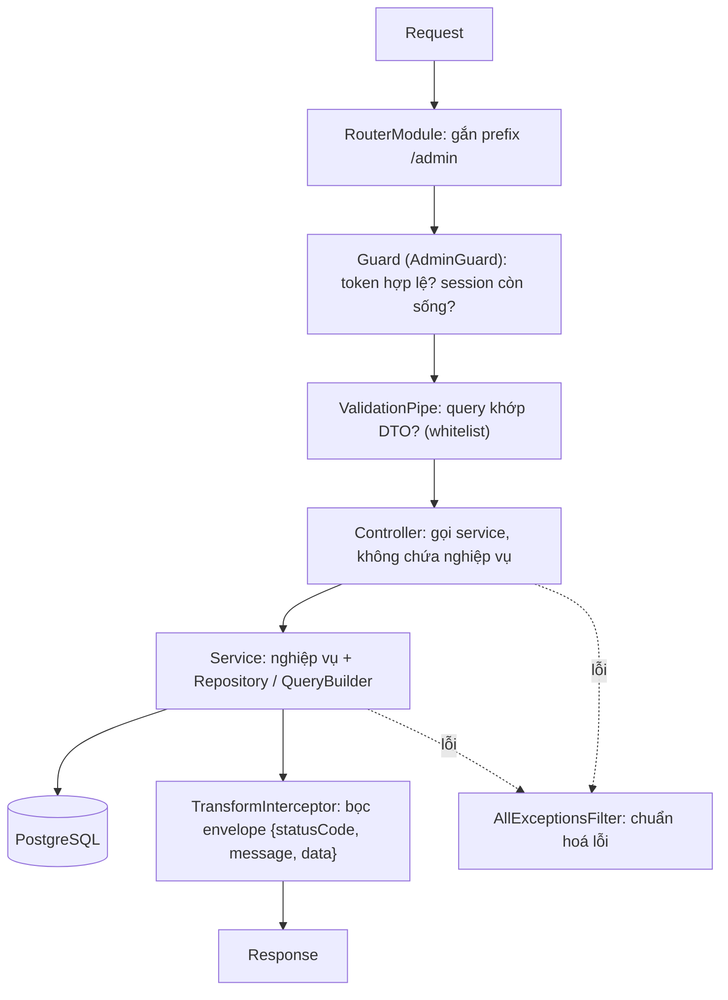

# es-kitchen-api — Patterns & Conventions

> Nguồn: `es-kitchen-api@4ca4dcd9` (branch `develop`) ngày 2026-10-16 · Cập nhật cuối: 2026-10-16 (đối chiếu lại SHA 2026-10-29: vẫn `4ca4dcd9`)

**File này nói gì:** các cách làm chuẩn của `es-kitchen-api` — mỗi mục theo khung Vấn đề → Cách làm → Ví dụ → Bẫy.
**Đọc khi nào:** trước khi viết code NestJS mới hoặc review PR. Follow pattern đang có — không tự refactor.
**Cần bản đồ thư mục trước?** Xem [structure.md](structure.md).

---

## Một request đi qua những lớp nào

Ví dụ: Admin gọi `GET /admin/orders?orderBy=createdAt`.



Giải nghĩa nhanh các từ khoá:

- **Guard**: người gác cổng, quyết định request có được vào controller không.
- **Pipe**: kiểm tra / đổi kiểu dữ liệu vào.
- **Interceptor**: bọc quanh controller, sửa kết quả trả ra.
- **Filter**: bắt lỗi và đổi thành response thống nhất.
- **DTO** (Data Transfer Object): class mô tả dữ liệu vào/ra.
- **Entity**: class đại diện một bảng DB.

## Tình huống → cách xử lý → file mẫu

| Tình huống | Cách xử lý | File mẫu |
|---|---|---|
| Thêm endpoint cho một role | Controller + service trong `modules/<role>/`, `@Controller('sub-path')` không lặp prefix | Mục Controller |
| Danh sách có sắp xếp | Whitelist `orderBy` ở DTO + `ORDER_BY_MAP` ở service | `admin/http/requests/admin-search-deliverer.request.ts` |
| Id dạng bigint ở URL | `@Param('id', BigIntValidationPipe)` | `discard.controller.ts` |
| Cho phép gọi không cần login (User) | `@Public()` | `src/auth/auth.controller.ts` |
| Chặn tài khoản khách (guest) | `@BlockGuest()` + `GuestRestrictionGuard` | feedback, product-review controllers |
| Job chạy định kỳ | `@Cron` + `@PostgreLock('cron:<tên>')` | `admin/delivery/services/shipping-plan-scheduler.service.ts` |
| Báo module khác sau khi commit | `EventEmitter2.emit` + `@OnEvent(..., { async: true })` | `plan-inputs-changed.listener.ts` |
| Gửi mail không được gửi trùng | Outbox + row lock | `MenuPublishMailSenderService` |
| Đổi schema DB | Migration mới, có `up()` + `down()` | `database/migrations/` |

---

## Module Pattern

**Vấn đề:** Nest cần biết module nào dùng entity, service, module khác nào.

**Cách làm trong dự án:** mỗi module tự khai báo entity nó dùng qua `TypeOrmModule.forFeature()`.

```typescript
// Ví dụ minh hoạ cấu trúc (không phải trích nguyên văn một file)
@Module({
  imports: [
    TypeOrmModule.forFeature([Order, OrderDetail, Company]),
    JwtModule.registerAsync({ global: true, useClass: JwtAdminConfigService }),
    MailModule,
  ],
  controllers: [OrderController, CompanyController],
  providers: [OrderService, CompanyService, AdminStrategy],
})
export class AdminModule {}
```

**Quy tắc:**

- Mỗi module khai báo entity dùng trong module đó — không dùng chung repository giữa modules.
- `JwtModule.registerAsync` với `global: true` — token valid trong toàn module.
- `MailModule` import khi cần gửi email (AWS SES).

**Bẫy:** lấy repository của module khác để "tiện" → khó theo dõi ai ghi bảng nào. Cần dữ liệu module khác thì import service/module tương ứng.

---

## Controller Pattern

**Vấn đề:** URL của 6 portal phải tách bạch, controller không được chứa nghiệp vụ.

**Cách làm:** prefix theo role đặt **một chỗ** — `RouterModule.register` trong `app.module.ts`. `@Controller()` chỉ ghi sub-path. Guard đặt ở cấp controller.

```typescript
// RouterModule.register trong app.module.ts đặt prefix thực tế
// @Controller() chỉ đặt sub-path (không lặp lại prefix module)
@Controller('orders')
@UseGuards(AdminGuard)                      // Guard ở controller level
@ApiTags('Admin / Orders')
export class OrderController {
  constructor(private readonly orderService: OrderService) {}

  @Get()
  @ApiUnifiedResponse(OrderResponse, true)  // true = data là MẢNG (xem mục @ApiUnifiedResponse)
  async getOrders(@Query() query: GetOrdersRequest) {
    return this.orderService.getOrders(query);
  }

  @Get(':id')
  @ApiUnifiedResponse(OrderResponse)
  async getOrderDetail(@Param('id') id: string) {
    return this.orderService.getOrderDetail(id);
  }

  @Post()
  @ApiUnifiedResponse(OrderResponse)
  async createOrder(@Body() body: CreateOrderRequest) {
    return this.orderService.createOrder(body);
  }
}
```

**URL prefix thực tế (xác nhận từ RouterModule.register trong app.module.ts):**

| Module | path trong RouterModule | Ví dụ URL thực tế |
|---|---|---|
| AdminModule | `'admin'` | `/admin/orders` |
| AdminCompanyModule | `'company-admin'` | `/company-admin/company-orders` |
| UserModule | `''` (rỗng) | `/auth/...`, `/products/...` (không có prefix) |
| SupplierModule | `'supplier'` | `/supplier/orders` |
| DriverModule | `'driver'` | `/driver/auth/login` |
| DelivererModule | `'deliverer'` | `/deliverer/auth/login` |
| AiProModule | `'ai-pro'` | `/ai-pro/dataset` |
| HubspotAgentModule | `'hubspot-agent'` | `/hubspot-agent/...` |

**Bẫy:**

- ⚠️ Company Admin prefix là `/company-admin/...` — không phải `/admin-company/...`.
- Ghi `@Controller('admin/orders')` trong module admin → URL thành `/admin/admin/orders`.

---

## Service Pattern

**Vấn đề:** nghiệp vụ và truy vấn DB cần một chỗ chung, test được.

**Cách làm:** service inject `Repository<Entity>` bằng `@InjectRepository`; truy vấn phức tạp dùng QueryBuilder.

```typescript
@Injectable()
export class OrderService {
  constructor(
    @InjectRepository(Order) private orderRepository: Repository<Order>,
    @InjectRepository(OrderDetail) private orderDetailRepository: Repository<OrderDetail>,
  ) {}

  async getOrders(query: GetOrdersRequest) {
    const qb = this.orderRepository
      .createQueryBuilder('order')
      .leftJoinAndSelect('order.company', 'company')
      .where('order.deleted_at IS NULL');

    // orderBy whitelist — BẮT BUỘC để tránh TypeError
    const ORDER_BY_MAP: Record<string, string> = {
      createdAt: 'order.createdAt',
      companyCode: 'company.companyCode',
    };
    const orderByField = ORDER_BY_MAP[query.orderBy] ?? 'order.createdAt';
    qb.orderBy(orderByField, query.order ?? 'DESC');

    return qb.getManyAndCount();
  }
}
```

**Bẫy — Known Bug (đã từng gây lỗi prod):** truyền thẳng `orderBy` từ query vào TypeORM.

```typescript
// ❌ KHÔNG làm — TypeORM orderBy với string từ query param
qb.orderBy(query.orderBy, 'DESC');
// → TypeError: Cannot read properties of undefined (reading 'databaseName')

// ✅ LUÔN dùng whitelist map
const ORDER_BY_MAP = { createdAt: 'order.createdAt', ... };
const field = ORDER_BY_MAP[query.orderBy] ?? 'order.createdAt';
qb.orderBy(field, 'DESC');
```

---

## Entity Pattern

**Vấn đề:** TypeORM không tự đổi tên cột sang snake_case, bigint trả về dạng chuỗi, enum dễ xung đột tên.

**Cách làm:** khai báo tường minh từng thứ.

```typescript
@Entity('orders')
export class Order {
  @PrimaryGeneratedColumn({ type: 'bigint' })
  id: string;                               // bigint → TypeScript string (TypeORM returns as string)

  @Column({ name: 'company_id', type: 'bigint' })
  companyId: string;

  @Column({ name: 'total_amount', type: 'decimal', precision: 12, scale: 2 })
  totalAmount: number;

  @Column({ name: 'status', type: 'enum', enum: OrderStatus, enumName: 'order_status_enum' })
  status: OrderStatus;                      // enumName bắt buộc để tránh conflict TypeORM

  @ManyToOne(() => Company, { eager: false })  // eager: false — tránh N+1
  @JoinColumn({ name: 'company_id' })
  company: Company;

  @CreateDateColumn({ name: 'created_at', type: 'timestamptz' })
  createdAt: Date;

  @UpdateDateColumn({ name: 'updated_at', type: 'timestamptz' })
  updatedAt: Date;

  @DeleteDateColumn({ name: 'deleted_at', type: 'timestamptz', nullable: true })
  deletedAt?: Date;                         // Soft delete — không DELETE cứng
}
```

**Conventions:**

- PK: `bigint` (TypeScript nhận về `string`) — `@PrimaryGeneratedColumn({ type: 'bigint' })` (dạng đang dùng ở entity mới, vd `company.entity.ts`, `delivery-block.entity.ts`).
- Column name: phải explicit `{ name: 'snake_case' }` — TypeORM không tự convert.
- Timestamps: `timestamptz` — không dùng `timestamp`.
- Soft delete (đánh dấu đã xoá, không xoá thật): `@DeleteDateColumn` với `deletedAt` — không DELETE cứng.
- Enum: dùng TypeScript enum + `type: 'enum'` + `enumName` explicit để tránh conflict.
- Relation: `eager: false` bắt buộc để tránh N+1 (cứ mỗi dòng lại bắn thêm 1 query) — join khi cần qua QueryBuilder.

**Bẫy:** so sánh `id` kiểu bigint bằng số (`id === 1`) sẽ sai vì giá trị là chuỗi (`'1'`).

---

## DTO / Request Pattern

**Vấn đề:** dữ liệu client gửi lên không đáng tin; field lạ, sai kiểu, `orderBy` bậy.

**Cách làm:** mọi request có một class DTO với decorator của `class-validator`; `ValidationPipe` toàn cục kiểm trước khi vào controller.

```typescript
// requests/get-orders.request.ts
import { IsOptional, IsString, IsEnum } from 'class-validator';

export class GetOrdersRequest {
  @IsOptional()
  @IsString()
  orderBy?: string;

  @IsOptional()
  @IsEnum(['ASC', 'DESC'])
  order?: 'ASC' | 'DESC';

  @IsOptional()
  @IsString()
  companyCode?: string;
}
```

**Quy tắc:**

- Tất cả request DTO dùng `class-validator` decorators.
- Đặt trong `modules/<m>/http/requests/` — không đặt inline trong controller; response DTO trong `http/responses/` (admin-company còn thêm `dtos/`).
- Request danh sách kế thừa `BaseSearchRequest` (`commons/abstracts/base-search.request.ts`: `page` mặc định 1, `limit` mặc định 10 / max 100, `q`, `order`, `orderBy`).
- `orderBy` từ query phải bị chặn bằng whitelist ngay ở DTO, ví dụ `src/modules/admin/http/requests/admin-search-deliverer.request.ts`:

  ```typescript
  const ALLOWED_ORDER_BY = ['id', 'delivererCode', 'status', 'createdAt' /* ... */] as const;
  @Matches(new RegExp(`^(${ALLOWED_ORDER_BY.join('|')})$`), { message: 'orderBy must be a valid field' })
  orderBy?: (typeof ALLOWED_ORDER_BY)[number] = 'createdAt';
  ```

- Validation toàn cục (`main.ts`): `ValidationPipe` `whitelist` + `forbidNonWhitelisted` + `transform`; lỗi trả `ApiStatusCode.VALIDATION_ERROR`, `data` là mảng message (nested DTO được flatten dạng `path.field: msg`).
- `BigIntValidationPipe` chỉ dùng cục bộ: `@Param('id', BigIntValidationPipe)`.

**Bẫy:**

- Quên decorator trên một field → do `whitelist`, field đó bị **bỏ** hoặc bị từ chối (`forbidNonWhitelisted`). Mọi field nhận vào đều phải có ít nhất một decorator.
- Client gửi thừa field → nhận lỗi `VALIDATION_ERROR`, không phải bị bỏ qua êm.

---

## Guard Pattern

**Vấn đề:** 5 portal có người dùng, bảng tài khoản và secret JWT khác nhau; token này không được dùng cho portal kia.

**Cách làm:** mỗi module role (admin, admin-company, supplier, driver, deliverer) có `guards/<role>.guard.ts` chứa **cặp** `XxxGuard extends AuthGuard('<name>-jwt')` + `XxxStrategy` (tên strategy unique để không conflict). Secret lấy từ `ConfigService` (`jwtAdmin`, `jwtDriver`, …) — không đọc `process.env` trực tiếp.

```typescript
// modules/admin/guards/admin.guard.ts (rút gọn)
const STRATEGY_NAME = 'admin-jwt';

@Injectable()
export class AdminGuard extends AuthGuard(STRATEGY_NAME) { /* handleRequest: map token hết hạn -> exception i18n */ }

@Injectable()
export class AdminStrategy extends PassportStrategy(Strategy, STRATEGY_NAME) {
  async validate(payload: JwtPayload) {
    // Session ledger: mỗi request đều kiểm payload.sid
    const check = await this.authSessionService.verifyAndTouch(payload.sid);
    if (!check.valid) throw buildAuthSessionException(check.reason, this.i18n);
    return payload;   // gắn vào request.user
  }
}
```

**Guard theo module:**

| Module | Guard class | Strategy name | Ghi chú |
|---|---|---|---|
| AdminModule | `AdminGuard` | `'admin-jwt'` | + session ledger (`sid`); socket push `session:ended` |
| AdminCompanyModule | `AdminCompanyGuard` | `'admin-company-jwt'` | + session ledger |
| UserModule (+ `src/auth`) | `JwtAuthGuard` / `OptionalJwtAuthGuard` / `GuestRestrictionGuard` | `'jwt'` | Strategy `JwtStrategy` ở `src/auth/strategies`, không có `user-jwt` |
| SupplierModule | `SupplierGuard` | `'supplier-jwt'` | + session ledger; decorator `@GetSupplier()` |
| DriverModule | `DriverGuard` | `'driver-jwt'` | + session ledger; `@GetDriver()` |
| DelivererModule | `DelivererGuard` | `'deliverer-jwt'` | + session ledger; `@GetDeliverer()` |
| AiProModule | `AiProApiKeyGuard` | — | Header `x-api-key`, so sánh constant-time, fail-closed nếu chưa cấu hình key |
| HubspotAgentModule | `HubspotAgentApiKeyGuard` + `HubspotAgentThrottlerGuard` | — | api-key + rate limit |
| Elepay webhook | `ElepayWebhookGuard` | — | `commons/utiliz/elepay/guards` |

**Decorator phân quyền (`src/auth/decorators`, `src/commons/decorators`):**

| Decorator | Dùng ở | Cơ chế |
|---|---|---|
| `@Public()` | User (`src/auth`, vd `auth.controller.ts`, `company-qr.controller.ts`) | `SetMetadata(IS_PUBLIC_KEY)`; **chỉ `JwtAuthGuard` (user) đọc** — các guard role khác không có `@Public` |
| `@BlockGuest()` | User controllers (feedback, product-review, payment-method…) | Dùng cùng `@UseGuards(JwtAuthGuard, GuestRestrictionGuard)`; `User.type = GUEST` -> 403 `GUEST_RESTRICTED_FEATURE` |
| `@Permissions('module.resource.action')` | Admin (`admin-stock.controller.ts`) | `SetMetadata(PERMISSIONS_KEY)`; format `[module].[resource].[action]` |
| `@GetUser('field')` | User | `createParamDecorator` đọc `request.user` |

!!! warning "Bẫy: `@Permissions(...)` hiện chưa chặn ai"
    `PermissionsGuard` (`modules/admin/guards/permissions.guard.ts`) chỉ được khai báo provider trong `AdminModule`, chưa có `@UseGuards(PermissionsGuard)` hay `APP_GUARD` nào → `@Permissions(...)` hiện chỉ là metadata, **chưa enforce**.
    `admin-delivery-block.controller.ts` ghi rõ "RBAC: PermissionsGuard deferred per project policy".
    **Không giả định quyền đã bị chặn ở BE.**

**Rate limit:** không dùng `ThrottlerModule.forRoot()` (module global). Throttler cấu hình cục bộ trong module (vd `SupplierRegisterThrottlerGuard`, `HubspotAgentThrottlerGuard`).

**Bẫy khác:** `@Public()` chỉ có tác dụng với `JwtAuthGuard` của User. Đặt `@Public()` ở controller Admin/Driver… sẽ **không** mở route đó ra. Route public của các module role (vd `forgot-password`) phải làm theo cách module đó đang làm — xem controller auth của module (chưa xác minh chi tiết cách gỡ guard từng route).

---

## Auth Session & Socket Pattern

**Vấn đề:** Admin cần bị "đá" ra khi session hết hạn hoặc đăng nhập nơi khác; JWT thuần không thu hồi được.

**Cách làm:** thêm **sổ session** (ledger) ở DB.

1. Mỗi lần login tạo một dòng trong bảng `auth_sessions`; JWT mang `sid`.
2. Mỗi request, guard gọi `AuthSessionService.verifyAndTouch(sid)` — áp idle timeout / absolute TTL (`config/session.config.ts`).
3. Cron dọn session cũ: `AuthSessionCleanupService`.
4. Khi session kết thúc → `EventEmitter2.emit(SESSION_ENDED_EVENT)` → `AuthSessionGateway` (namespace `/admin`, room `session:<id>`) đẩy `session:ended` cho System Admin.
5. Cross-instance: `PostgresSocketIoAdapter` (`@socket.io/postgres-adapter`, LISTEN/NOTIFY), cần sticky session nếu long-polling.

`AuthSessionModule` là `@Global` (`commons/auth-session`).

**Bẫy:** socket chỉ là kênh **thông báo**. Quyền vẫn do guard kiểm từng request — đừng dựa vào socket để chặn truy cập.

---

## @ApiUnifiedResponse Pattern (Swagger)

**Vấn đề:** mọi response đều bị bọc envelope, nhưng `@ApiResponse` thô của Swagger không mô tả được lớp bọc này.

**Cách làm:** dùng `@ApiUnifiedResponse(Model, isArray?)` (`commons/framework/decorators/ApiUnifiedResponse.ts`). Tham số thứ 2 là `isArray` (`data` là mảng), **không** phải cờ phân trang; `model` là bắt buộc.

```typescript
@Get(':id')
@ApiUnifiedResponse(OrderResponse)          // data = OrderResponse
async getOrder() {}

@Get('all')
@ApiUnifiedResponse(OrderResponse, true)    // data = OrderResponse[]
async getAll() {}
```

Danh sách có phân trang: không có wrapper chung — mỗi `*.response.ts` tự khai báo (vd `driver/http/responses/delivery-list.response.ts`: `items`, `total`, `page`, `totalPages`); dùng `@ApiUnifiedResponse(ListResponse)`.

**Response envelope** do `TransformInterceptor` (global) bọc, `BaseApiResponse`:

```json
{ "statusCode": "<ApiStatusCode.SUCCESS>", "message": "Request successful", "data": { } }
```

**Swagger:** 7 doc tách role (`config/swagger.config.ts` = User `/swagger`; `config/swagger-admin.config.ts` = 6 doc `/swagger/<role>`).

**Bẫy:** `include` của Swagger không đệ quy → sub-module admin mới (Invoice, Stock) phải thêm vào `include` trong `main.ts`, nếu không endpoint không hiện trên Swagger.

---

## Multi-module Auth Pattern

**Vấn đề:** Supplier, Driver, Deliverer cùng cần đăng nhập, refresh, quên mật khẩu.

**Cách làm:** cả 3 module làm giống hệt nhau, mỗi module có controller và service độc lập.

```
POST /<module>/auth/login              → cấp access_token + refresh_token
POST /<module>/auth/refresh            → refresh access_token (dùng refresh_token trong body)
POST /<module>/auth/logout             → invalidate refresh_token
POST /<module>/auth/forgot-password/request       → gửi OTP qua email
POST /<module>/auth/forgot-password/verify-otp    → verify OTP, trả về reset_token
POST /<module>/auth/forgot-password/reset-password → đổi password bằng reset_token
```

`request`, `verify-otp` và `reset-password` đều có trên cả 3 module (đã xác minh trong controller). Ví dụ: SupplierModule (`/supplier/auth/...`), DriverModule (`/driver/auth/...`), DelivererModule (`/deliverer/auth/...`).

**Nguyên tắc:**

- `request`, `verify-otp` và `reset-password` là public — không cần guard.
- `logout` cần guard (phải login trước).
- Mỗi login tạo session trong ledger (`auth_sessions`); guard kiểm `sid` mỗi request (xem Auth Session).
- `hashed_refresh_token` lưu hash trong DB, `@Exclude()` khỏi response (chưa xác minh thuật toán hash trong đợt cập nhật này).
- OTP lưu trong bảng `otps` dùng chung.

**Bẫy:** sửa flow ở một module thì phải rà 2 module còn lại — chúng giống nhau có chủ đích.

---

## Migration Pattern

**Vấn đề:** `synchronize: false` — sửa entity **không** làm đổi DB. Muốn đổi DB phải có migration.

**Cách làm:** tạo file bằng `npm run migration:create --name=...`, chạy bằng `migration:up`.

```typescript
// database/migrations/<timestamp>-AddPaymentMethod.ts
export class AddPaymentMethod1234567890 implements MigrationInterface {
  public async up(queryRunner: QueryRunner): Promise<void> {
    await queryRunner.query(`
      CREATE TABLE payment_methods (
        id BIGSERIAL PRIMARY KEY,
        name VARCHAR(255) NOT NULL,
        created_at TIMESTAMPTZ DEFAULT NOW(),
        deleted_at TIMESTAMPTZ
      )
    `);
  }

  public async down(queryRunner: QueryRunner): Promise<void> {
    await queryRunner.query(`DROP TABLE payment_methods`);
  }
}
```

**Quy tắc migration:**

- Mỗi schema change = 1 file migration riêng.
- Phải có cả `up()` và `down()`.
- Không sửa migration đã chạy trên STG/PROD.
- Tên file: `<timestamp>-<PascalCaseName>.ts` (tạo bằng `npm run migration:create --name=...`; chạy `migration:up`; `synchronize: false`).
- Migration mới nên viết bằng TypeORM API (`queryRunner.createTable`...) — commit gần đây có "rewrite ... migration with the TypeORM API".

**Bẫy:** sửa file migration cũ đã chạy → DB các môi trường lệch nhau. Cần đổi tiếp thì tạo migration mới.

---

## Event / Listener Pattern

**Vấn đề:** sau khi một việc xong (vd đổi ngày lễ), việc khác phải chạy (vd tính lại kế hoạch giao hàng) — nhưng không muốn nhét hết vào một service, và lỗi bên kia không được làm hỏng việc chính.

**Cách làm:** event định nghĩa ở `commons/events/*.event.ts` dạng hằng tên event + interface payload; emit **sau khi commit**; listener dùng `@OnEvent(..., { async: true })` và tự bắt lỗi (lỗi không được lan về nơi emit).

```typescript
// commons/events/plan-inputs-changed.event.ts
export const PLAN_INPUTS_CHANGED_EVENT = 'delivery.plan-inputs.changed';
export interface PlanInputsChangedEvent { contractIds: string[] | null; siteIds?: string[]; reason: string; }

// emit (admin/delivery/services/holiday.service.ts, contract-route.service.ts ...)
this.events.emit(PLAN_INPUTS_CHANGED_EVENT, { contractIds: null, reason: 'holiday-changed' });

// admin/delivery/services/plan-inputs-changed.listener.ts
@OnEvent(PLAN_INPUTS_CHANGED_EVENT, { async: true })
async handle(event: PlanInputsChangedEvent) { try { /* batches.rollout(...) */ } catch (e) { this.logger.error(...); } }
```

Event hiện có: `contracts-registered`, `menu-orders-opened`, `menu-publish-mail-queued`, `plan-inputs-changed`, `register-admin-company` (listener `admin-company.listener.ts` hiện rỗng), cộng `auth-session.ended`.

**Bẫy:**

- Emit **trước** commit → listener đọc dữ liệu cũ.
- Listener không `try/catch` → lỗi nuốt mất, hoặc làm hỏng luồng chính.

---

## Scheduler & Advisory Lock Pattern (thay Redis)

**Vấn đề:** cron chạy trên nhiều instance → cùng một job chạy 2 lần. Dự án **không dùng Redis** (xem structure.md) nên không có lock Redis.

**Cách làm:** advisory lock của PostgreSQL (khoá do ứng dụng tự đặt tên, không khoá bảng nào). Bọc cron bằng `@PostgreLock(key)` (`commons/decorators/postgre-lock.decorator.ts`): gọi `pg_try_advisory_lock`; instance không lấy được lock thì bỏ qua lượt chạy. Class phải inject `DataSource` (hoặc một `Repository`).

```typescript
// admin/delivery/services/shipping-plan-scheduler.service.ts
@Cron('0 0 2 * * *', { timeZone: 'Asia/Tokyo' })
@PostgreLock('cron:delivery-daily-chain')
async run() { /* chain: plan_rollout -> delivery_materialize -> order_finalize -> plan_recheck */ }
```

**Quy tắc:** key dạng `cron:<tên-job>`; mỗi cron giữ 1 connection pool suốt lượt chạy.

**Bẫy:**

- **Đừng thêm cron every-minute mới** — gắn vào tick sẵn có (xem `MenuSchedulerService` + `MenuPublishMailSchedulerService.runDue`, ESKITCHEN-2079).
- Class không inject `DataSource`/`Repository` → decorator log lỗi rồi chạy **không có lock** (có thể chạy trùng giữa các instance).

---

## Outbox / Mail Queue Pattern

**Vấn đề:** gửi mail không có Bull/Redis queue; vẫn cần retry và không gửi trùng.

**Cách làm:** outbox = ghi "việc cần làm" vào bảng DB trước, rồi bộ gửi lấy ra làm. Với mail menu-publish dùng bảng `menu_publish_mail`, `menu_publish_mail_delivery`:

1. Publish commit xong → emit `MENU_PUBLISH_MAIL_QUEUED_EVENT`.
2. `MenuPublishMailSchedulerService.onQueued` gửi ngay.
3. `runDue` quét lại các job `PENDING`, `SENDING` quá hạn (stale) và retry đến hạn.
4. Row lock (khoá dòng trong DB) ở `MenuPublishMailSenderService` đảm bảo không gửi 2 lần.

Mail dùng `MailModule` (`commons/utiliz/mail`, provider SES/SMTP/SendGrid chọn qua factory).

**Bẫy:** gửi mail thẳng trong service nghiệp vụ → lỗi SES làm hỏng cả giao dịch chính, và không có cơ chế retry.

---

## Test Pattern

**Vấn đề:** service cần test không phụ thuộc DB thật.

**Cách làm:** Jest + `@nestjs/testing`; mock repository bằng `getRepositoryToken`.

```typescript
// <service>.spec.ts — Jest + @nestjs/testing
describe('OrderService', () => {
  let service: OrderService;
  let orderRepository: jest.Mocked<Repository<Order>>;

  beforeEach(async () => {
    const module = await Test.createTestingModule({
      providers: [
        OrderService,
        {
          provide: getRepositoryToken(Order),
          useValue: { findOne: jest.fn(), save: jest.fn() },
        },
      ],
    }).compile();

    service = module.get(OrderService);
    orderRepository = module.get(getRepositoryToken(Order));
  });

  it('should return order', async () => {
    orderRepository.findOne.mockResolvedValue({ id: '1' } as Order);
    const result = await service.getOrderDetail('1');
    expect(result.id).toBe('1');
  });
});
```

- **Scope test bắt buộc:** `*.service.ts`, `*.guard.ts`, `*.interceptor.ts`.
- **Bỏ qua:** DTO, Entity files.
- Vị trí spec: cạnh source (`*.spec.ts`) hoặc `modules/<m>/__tests__/` / `services/__tests__/`.
- Chạy: `npm run test -- <file>`; coverage: `npm run test:cov`.

**Bẫy:** test không có `expect()` thì không chứng minh gì — mỗi test phải có ít nhất 1 assertion.
