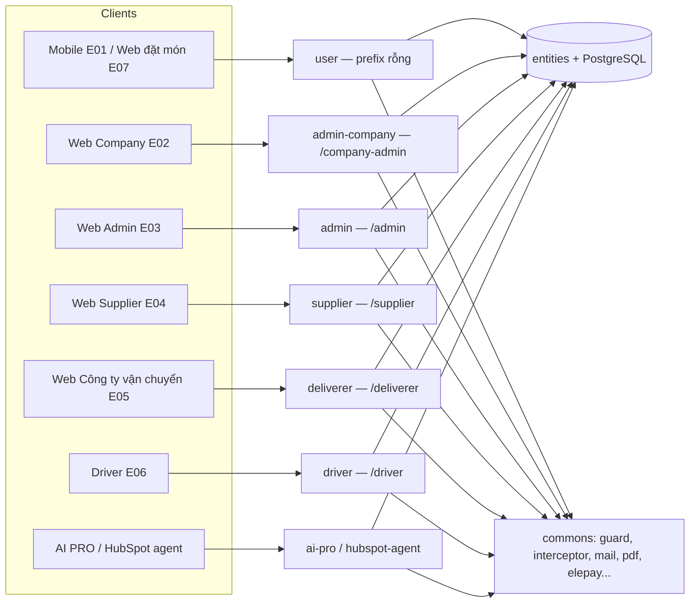
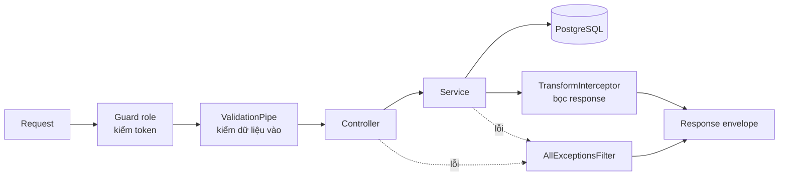

# es-kitchen-api — Cấu trúc Source

> Nguồn: `es-kitchen-api@4ca4dcd9` (branch `develop`) ngày 2026-10-16 · Cập nhật cuối: 2026-10-16 (đối chiếu lại SHA 2026-10-29: vẫn `4ca4dcd9`)
> Repo: `es-kitchen-api` · Stack: NestJS 11 / TypeScript 5.7 / PostgreSQL / TypeORM 0.3.28

**File này nói gì:** bản đồ của repo `es-kitchen-api` — hệ thống gồm những phần nào, đặt ở thư mục nào, và vì sao chia như vậy.
**Đọc khi nào:** ngày đầu vào dự án, hoặc khi chưa biết "code của màn X nằm ở đâu".
**Đọc tiếp:** cách viết code theo chuẩn của dự án → [patterns.md](patterns.md). Danh sách endpoint → `api-catalog.md`. Bảng DB → `erd.md`.

---

## 1. Hệ thống này là gì, vì sao chia như vậy

`es-kitchen-api` là **một** API duy nhất (NestJS) phục vụ **mọi** ứng dụng phía trước của ESKITCHEN: Mobile (E01), Web Company (E02), Web Admin (E03), Web Supplier (E04), Web Công ty vận chuyển (E05), Driver (E06), User Web Ordering (E07), cộng 2 dịch vụ bên ngoài gọi vào (AI PRO, HubSpot agent).

Cách chia: **mỗi loại người dùng = một module riêng**, có prefix URL, guard (người gác cổng kiểm tra đăng nhập) và cấu hình JWT riêng. Lý do:

- Admin không được gọi nhầm API của Driver, và ngược lại.
- Sửa màn của Supplier không làm vỡ Admin.
- Mỗi portal có Swagger riêng để FE đọc đúng phần của mình.



---

## 2. Tech stack

| Layer | Package | Version (package.json) |
|---|---|---|
| Framework | `@nestjs/*` (common/core/platform-express) | ^11.0.1 |
| Language | TypeScript | ^5.7.3 |
| ORM | TypeORM (`@nestjs/typeorm` ^11.0.0) | ^0.3.28 |
| Database driver | pg | ^8.22.0 |
| Runtime | Node (Dockerfile `NODE_VERSION`) | 22.15.1 |
| Auth | Passport / passport-jwt / `@nestjs/jwt` | ^0.7.0 / ^4.0.1 / ^11.0.2 |
| Cloud SDK | AWS SDK (Cognito, S3, SES), Firebase Admin | ^3.x / ^13.7.0 |
| Validation | class-validator / class-transformer | ^0.14.3 / ^0.5.1 |
| Documentation | @nestjs/swagger | ^11.2.5 |
| Rate limiting | @nestjs/throttler | ^6.5.0 |
| Scheduler | @nestjs/schedule (cron) | ^6.1.1 |
| Event | @nestjs/event-emitter | ^3.0.1 |
| i18n | nestjs-i18n (ja fallback, en) | ^10.6.0 |
| Realtime | socket.io + `@nestjs/websockets` + `@socket.io/postgres-adapter` | ^4.8.3 / ^11.1.28 / ^0.5.0 |
| Mail | nodemailer (provider: AWS SES / SMTP / SendGrid) | ^7.0.12 |
| File/Doc | pdf-lib (+ fontkit), pdf-poppler, qrcode, archiver, csv-parse, csv-parser | — |
| Test | Jest | ^30.0.0 |
| Payment | elepay (module nội bộ `commons/utiliz/elepay`, gọi HTTP, không SDK npm) | — |

!!! note "Không có Redis, không có queue"
    Dự án **không dùng Redis** và **không có** thư viện queue (Bull/BullMQ).

    - Socket.io chạy nhiều instance được nhờ **PostgreSQL LISTEN/NOTIFY** (`src/commons/auth-session/postgres-socket-io.adapter.ts`).
    - "Hàng đợi" = bảng outbox + scheduler. Ví dụ: bảng `menu_publish_mail`.
    - Cron chạy nhiều instance không bị trùng nhờ advisory lock của Postgres (xem patterns.md).

---

## 3. Scripts (package.json)

| Lệnh | Mục đích |
|---|---|
| `npm run start:dev` | Dev watch + debug (`nest start --debug 0.0.0.0 --watch`) |
| `npm run build` / `npm run start:prod` | Build; prod = chạy `migration:run` (dist) rồi `node dist/src/main.js` |
| `npm run lint` / `npm run format` | ESLint `--fix` / Prettier |
| `npm run test` · `test:cov` · `test:e2e` | Jest unit · coverage · e2e (`test/jest-e2e.json`) |
| `npm run migration:create --name=<Name>` | Tạo file migration trong `database/migrations/` |
| `npm run migration:up` / `migration:revert` | Chạy / rollback migration (`-d config/index.ts`) |
| `npm run migration:fresh` | `schema:drop` (chỉ local) |
| `npm run seed:holidays` | Seed ngày lễ Nhật (`database/seeds/seed-japanese-holidays.js`) |

---

## 4. Cấu trúc thư mục

Quy tắc nhớ nhanh:

- Code theo **người dùng** → `src/modules/<role>/`
- Bảng DB → `src/entities/` (một chỗ, dùng chung)
- Thứ dùng chung nhiều role → `src/commons/`
- Đăng nhập của End User → `src/auth/`

```
es-kitchen-api/
├── src/
│   ├── modules/                ← 9 module role/domain (179 controller toàn repo, 177 trong modules/)
│   │   ├── admin/              ← System Admin (E03) — 88 controllers; sub-module: collection, discard, invoice, stock; thư mục (không phải module): delivery (22 ctrl), change-request, export, import, menu-history, product-history
│   │   ├── admin-company/      ← Company Admin (E02) — 30 controllers (+ listeners/, dtos/)
│   │   ├── user/               ← End-user Mobile + Web Ordering (E01, E07) — 25 controllers
│   │   ├── supplier/           ← Supplier Portal (E04) — 10 controllers
│   │   ├── driver/             ← Driver App (E06) — 10 controllers
│   │   ├── deliverer/          ← Công ty vận chuyển (E05) — 11 controllers
│   │   ├── ai-pro/             ← API cho dịch vụ AI PRO (x-api-key) — 1 controller
│   │   ├── hubspot-agent/      ← API cho HubSpot agent (api-key + throttler riêng) — 1 controller
│   │   └── file-upload/        ← S3 upload (shared) — 1 controller
│   │   (mỗi module: http/{controllers,requests,responses}/ · services/ · guards/ · [decorators/ · __tests__/])
│   │
│   ├── entities/               ← TypeORM entities (224 files *.entity.ts, flat layout)
│   ├── auth/                   ← AuthModule (User E01/E07): controller + service, strategies, guards, decorators, interfaces
│   │   ├── strategies/         ← jwt.strategy, base-cognito, admin-cognito, company-cognito
│   │   ├── guards/             ← jwt-auth (hỗ trợ @Public), optional-jwt-auth, guest-restriction
│   │   └── decorators/         ← @GetUser, @Public, @BlockGuest
│   │
│   ├── commons/                ← Shared
│   │   ├── abstracts/          ← BaseApiResponse, BaseSearchRequest (page/limit/q/order/orderBy)
│   │   ├── auth-session/       ← AuthSessionModule (@Global): session ledger (entity auth_sessions), service, cleanup cron, Gateway socket namespace `/admin`, PostgresSocketIoAdapter
│   │   ├── decorators/         ← @Permissions, @PostgreLock, @IsCommaSeparatedEnum, transform.decorator
│   │   ├── events/             ← 5 event: contracts-registered, menu-orders-opened, menu-publish-mail-queued, plan-inputs-changed, register-admin-company
│   │   ├── framework/          ← interceptors/TransformInterceptor, filters + exceptions/AllExceptionsFilter, pipes/BigIntValidationPipe, decorators (@ApiUnifiedResponse, @ClientIp, is-email, is-int-non-negative), validators
│   │   ├── enums/ · constants/ · helpers/query.helper.ts
│   │   └── utiliz/             ← service dùng chung; 12 có module riêng:
│   │       ai-suggestion · aws (cognito, s3) · bill-one · code-generator · company-order-publish · driver-notify · elepay · fcm-firebase · hubspot · mail (SES/SMTP/SendGrid) · menu-publish-notify · private-attachment · stock
│   │       thư viện thuần (không module): csv · import-csv · pdf · qr · rocketchat · subsidy · history-logger · helpers (util tính phí/hợp đồng/giao hàng…)
│   │
│   ├── i18n/                   ← Locale files (ja, en)
│   ├── types/                  ← Ambient TS type augmentations
│   ├── assets/                 ← Static assets bundled với runtime
│   ├── app.module.ts           ← Root module (RouterModule, ScheduleModule, EventEmitterModule, I18nModule, ElepayModule.forRootAsync)
│   └── main.ts                 ← Bootstrap
│
├── database/
│   ├── migrations/             ← 303 migration files (timestamp naming)
│   ├── seeds/                  ← seed-japanese-holidays.js, seed-invoice-test-data.js
│   └── db.dbml                 ← ERD dạng DBML
│
├── config/
│   ├── index.ts                ← AppConfig (JWT/role, env parsing) + DataSource cho migration CLI
│   ├── database.config.ts      ← TypeORM connection
│   ├── jwt.config.ts · session.config.ts · aws.config.ts · elepay.config.ts · bill-one.config.ts · ai-suggestion.config.ts
│   ├── swagger.config.ts       ← Swagger User (`/swagger`)
│   └── swagger-admin.config.ts ← 6 doc: admin-company, admin, supplier, driver, deliverer, ai-pro (`/swagger/<role>`)
│
├── scripts/                    ← seed-admin.js
├── docs/ · es-kitchen-docs/    ← tài liệu local trong repo
├── test/                       ← e2e specs (unit spec đặt cạnh source / `__tests__/`)
├── Dockerfile · docker-compose.yml · ecosystem.config.js · entrypoint.sh
├── package.json
└── nest-cli.json
```

> **28 file `*.module.ts`** trong `src/`: `app` (1) + `auth` (1) + `commons/auth-session` (1) + 9 module role + 4 sub-module admin (collection, discard, invoice, stock) + 12 module `commons/utiliz`.

**Bên trong một module role** (ví dụ `driver/`):

| Thư mục | Chứa gì | Vai trò |
|---|---|---|
| `http/controllers/` | `driver-auth.controller.ts`, `driver-delivery.controller.ts`… | Nhận request, chỉ định route — không chứa nghiệp vụ |
| `http/requests/` | DTO đầu vào | Mô tả + kiểm tra dữ liệu client gửi lên |
| `http/responses/` | DTO đầu ra | Mô tả dữ liệu trả về (và để Swagger vẽ) |
| `services/` | Service | Nghiệp vụ + truy cập DB |
| `guards/` | `<role>.guard.ts` | Kiểm tra token của role đó |

---

## 5. Modules (src/modules/) — đếm bằng script (không tính `*.spec.ts`, `__tests__/`)

| Module | Portal / Actor | Router prefix | Controllers | Services | Request DTO | Response DTO |
|---|---|---|---|---|---|---|
| `admin/` | System Admin (E03) | `/admin` | 88 | 170 | 205 | 155 |
| `admin-company/` | Company Admin (E02) | `/company-admin` | 30 | 36 | 16 | 16 |
| `user/` | End User Mobile (E01) + Web (E07) | (rỗng) | 25 | 31 | 34 | 27 |
| `supplier/` | Supplier (E04) | `/supplier` | 10 | 13 | 22 | 17 |
| `driver/` | Driver (E06) | `/driver` | 10 | 11 | 14 | 12 |
| `deliverer/` | Công ty vận chuyển (E05) | `/deliverer` | 11 | 16 | 31 | 24 |
| `ai-pro/` | Dịch vụ AI PRO (x-api-key) | `/ai-pro` | 1 | 1 | 0 | 0 |
| `hubspot-agent/` | HubSpot agent (api-key) | `/hubspot-agent` | 1 | 2 | 1 | 1 |
| `file-upload/` | Shared | — | 1 | 1 | 1 | 1 |

Ngoài `modules/`: `auth/auth.controller.ts` (User auth) và `commons/utiliz/mail/mail.controller.ts` → tổng 179 controller.

!!! note "Hay nhầm"
    URL của Company Admin là `/company-admin/...`, còn thư mục là `admin-company/`. Đừng lẫn.

### Nested trong `admin/`

`admin/` quá lớn (88 controller) nên một số nhóm được tách thành sub-module hoặc thư mục con.

| Thư mục | Loại | Controllers | Ghi chú |
|---|---|---|---|
| `delivery/` | thư mục (thuộc AdminModule) | 22 | carrier/thomas integration, delivery-block, cycle, calendar, warehouse, relay-destination, special-delivery-rule, shipping-plan scheduler, listeners |
| `stock/` (`AdminStockModule`) | sub-module | 1 | Quản lý tồn kho theo chi nhánh × tháng (AW_STCK_*) |
| `invoice/` (`InvoiceModule`) | sub-module | 3 | bill-one, company-invoice, invoice-reconcile scheduler |
| `collection/` (`CollectionModule`) | sub-module | 1 | Collection management |
| `discard/` (`DiscardModule`) | sub-module | 1 | Disposal reports |
| `change-request/` `export/` `import/` `menu-history/` `product-history/` | thư mục | — | helper/service nội bộ admin |

### Tìm nhanh: cần làm gì → xem ở đâu

| Tình huống | Xem ở đâu |
|---|---|
| Thêm API cho màn System Admin | `src/modules/admin/http/controllers/` + `services/` |
| Thêm API cho App Driver | `src/modules/driver/` |
| Thêm bảng / cột | `src/entities/` + `database/migrations/` |
| Dùng lại mail / PDF / QR / S3 | `src/commons/utiliz/` |
| Thêm job chạy định kỳ | Service có `@Cron` (xem mục dưới + patterns.md) |
| Đổi định dạng response chung | `src/commons/framework/interceptors/transform.interceptor.ts` |
| Đổi cách xử lý lỗi chung | `src/commons/framework/filters/` (`AllExceptionsFilter`) |

### Scheduler / event / socket

- **Cron** (job chạy theo lịch; `@Cron` + `@PostgreLock`, TZ Asia/Tokyo): stocktake, shipping-plan, menu, menu-ranking, notice (+channel), survey, agency-commission, company-order-publish/lock, supplier-order-generator, subsidy-monthly-closing, contract-generation, invoice-reconcile, payment-expiry/reminder, supplier-purchase-order-alert, auth-session-cleanup.
- **Event emitter** (phát tín hiệu nội bộ để module khác phản ứng): listener ở `admin/delivery/services` (contracts-registered, plan-inputs-changed), `admin/services` (menu-orders-opened, menu-publish-mail), `admin-company/listeners`, `auth-session` gateway.
- **Socket**: chỉ 1 gateway — `AuthSessionGateway` namespace `/admin` (event `session:ended`) cho System Admin.
- **Không có** thư mục `queue/`/`batch/` riêng.

---

## 6. Entities

Entity = một class đại diện cho một bảng DB. Dự án để **phẳng** tại `src/entities/*.entity.ts` — **224 file**, không chia thư mục con theo module (nên nhiều module dùng chung được).

Nhóm chính:

- **Auth/User:** `user.entity.ts`, `admin.entity.ts`, `company-admin.entity.ts`, `auth-session.entity.ts`, `pending-user.entity.ts`
- **Business core:** `company.entity.ts`, `parent-contract.entity.ts`, `contract-route.entity.ts`, `contract-fee-line.entity.ts`, `order.entity.ts`, `menu.entity.ts`, `product.entity.ts`, `category.entity.ts`, `supplier.entity.ts`
- **Delivery/Logistics:** `delivery-company.entity.ts`, `deliverer.entity.ts`, `delivery-cycle.entity.ts`, `delivery-block.entity.ts`, `driver.entity.ts`, `shipment-detail.entity.ts`
- **Order/Invoice:** `company-order.entity.ts`, `supplier-order.entity.ts`, `payment.entity.ts`, `company-invoice.entity.ts`, `bill-one-api-log.entity.ts`
- **Inventory/Material:** `material.entity.ts`, `inventory-item.entity.ts`, `material-order.entity.ts`, `disposal-report.entity.ts`
- **Request/Workflow:** `change-request.entity.ts`, `quotation-request.entity.ts`, `trouble-report.entity.ts`
- **AI:** `ai-suggestion-job.entity.ts`, `ai-suggestion-chat.entity.ts`, `company-ai-preference.entity.ts`
- **RBAC:** `permission.entity.ts`, `role.entity.ts`, `admin-role.entity.ts`, `role-permission.entity.ts`
- **Mới từ ~2026-07:** delivery cycle/override/holiday (`delivery-cycle-*.entity.ts`, `delivery-override`, `holiday`), contract (`contract-route*`, `contract-fee-line`, `contract-billing-*`, `parent-contract*`), equipment (`equipment*`, `equipment-loan*`), stock (`branch-stock*`, `stock-setting`, `stock-reservation`, `inventory-stock-count`), survey (`survey*`), notice (`notice*`), allergen (`allergen`, `product-allergen`), agency (`agency*`), menu publish mail outbox (`menu-publish-mail*`), `audit-log`, `product-review`
- **Reference/Config:** `notification.entity.ts`, …

Chi tiết cột / quan hệ → `erd.md`.

---

## 7. Migrations

Migration = file mô tả một lần đổi cấu trúc DB (tạo bảng, thêm cột…), chạy lần lượt theo thời gian. DB **không** tự đồng bộ từ entity, nên mọi thay đổi schema đều phải qua migration.

- **Path:** `database/migrations/`
- **Số lượng:** 303 file (mới nhất `1792124634205-AddDeliveryBlocksShipmentNoIndex.ts`)
- **Convention:** `<timestamp>-<PascalCaseName>.ts` (ví dụ `1787128139346-AddAiSuggestionChatStatus.ts`)
- **Seed pattern:** file có prefix `Seed*` (ví dụ `SeedSuperAdmin1778385166498-SeedSuperAdmin.ts`)
- **Sync mode:** OFF (`synchronize: false`) — chỉ chạy qua migration.

Cách viết migration → patterns.md, mục "Migration".

---

## 8. Bootstrap — `src/main.ts`

Bootstrap = bước khởi động app. Đây là nơi gắn các "lớp bọc" áp dụng cho **mọi** request. `NestFactory.create` dùng `rawBody: true` (để kiểm chữ ký webhook).



Thiết lập global:

- **Versioning:** URI-based (`api/v1`, `api/v2`, …) với `VERSION_NEUTRAL` fallback
- **Trust proxy:** enabled
- **CORS:** enabled, credentials + `Content-Disposition` exposed
- **Socket.io adapter:** `PostgresSocketIoAdapter` (LISTEN/NOTIFY)
- **Global interceptors** (code chạy trước/sau controller):
  - `TransformInterceptor` → bọc response thành envelope chuẩn
  - `ClassSerializerInterceptor` → serialize DTO (vd ẩn field `@Exclude()`)
- **Global filter** (bắt lỗi): `AllExceptionsFilter`
- **Global pipes** (kiểm tra/chuyển đổi dữ liệu vào):
  - `ValidationPipe` (whitelist, forbidNonWhitelisted, custom `exceptionFactory` → `ApiStatusCode.VALIDATION_ERROR`)
  - `BigIntValidationPipe` **không** global — dùng cục bộ qua `@Param('id', BigIntValidationPipe)` (vd `discard.controller.ts`)
- **Swagger:** 7 tài liệu riêng (Admin gồm AdminModule + InvoiceModule + AdminStockModule; AdminCompany; User `/swagger`; Supplier; Driver; Deliverer; AiPro). `hubspot-agent` chưa có Swagger doc riêng.

**Không có global prefix** — prefix theo role đặt bằng `RouterModule.register` trong `app.module.ts` (xem patterns.md).

---

## 9. Auth

Auth = ai được gọi API nào. Mỗi role có JWT (token đăng nhập) cấu hình riêng nên token của Driver không dùng được ở Admin.

- **Passport strategies** (`src/auth/strategies/`):
  - `jwt.strategy.ts` — Bearer token extraction
  - `base-cognito.strategy.ts` — AWS Cognito base class
  - `admin-cognito.strategy.ts` — Admin pool
  - `company-cognito.strategy.ts` — Company pool
- **Multiple JWT config** per role (`jwtAdmin`, `jwtAdminCompany`, `jwtDriver`, `jwtSupplier`, `jwtDeliverer`) — định nghĩa trong `config/index.ts`.
- **Guards:** `JwtAuthGuard` (User, hỗ trợ `@Public`), `OptionalJwtAuthGuard`, `GuestRestrictionGuard` (`@BlockGuest`), `ElepayWebhookGuard` (`commons/utiliz/elepay/guards`); mỗi module role có guard riêng trong `modules/<m>/guards/` (xem patterns.md).
- **Session ledger:** `AuthSessionModule` (`commons/auth-session`) — mỗi request 5 phía back-office kiểm `payload.sid` qua `verifyAndTouch`; System Admin được push `session:ended` qua socket namespace `/admin`.

---

## 10. Database config

`config/database.config.ts`:

| Setting | Giá trị |
|---|---|
| type | postgres (configurable qua `DB_TYPE`) |
| synchronize | **false** — chỉ migration |
| logging | **true** — SQL query logging |
| autoLoadEntities | true |
| ssl | qua `DB_SSL` / `DB_SSL_REJECT_UNAUTHORIZED` env |
| migrations glob | `../database/migrations/*{.ts,.js}` |

Kết nối DEV/Staging: xem `.claude/workflows/db-connect-dev.md` và `db-connect-staging.md`.
