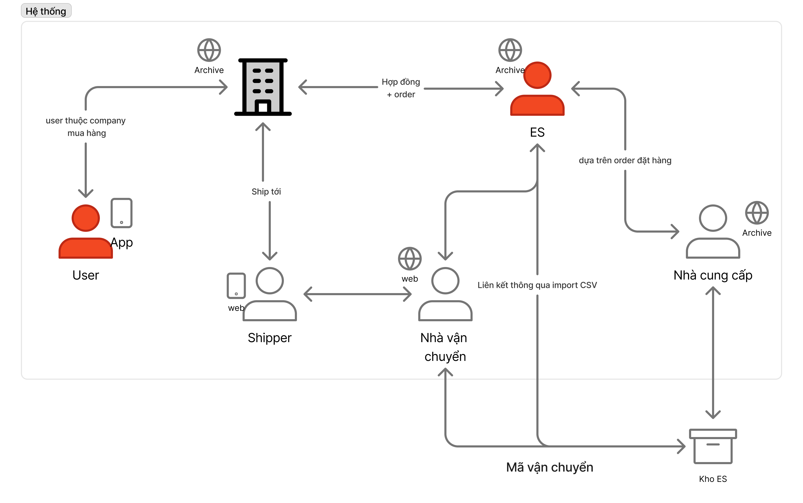
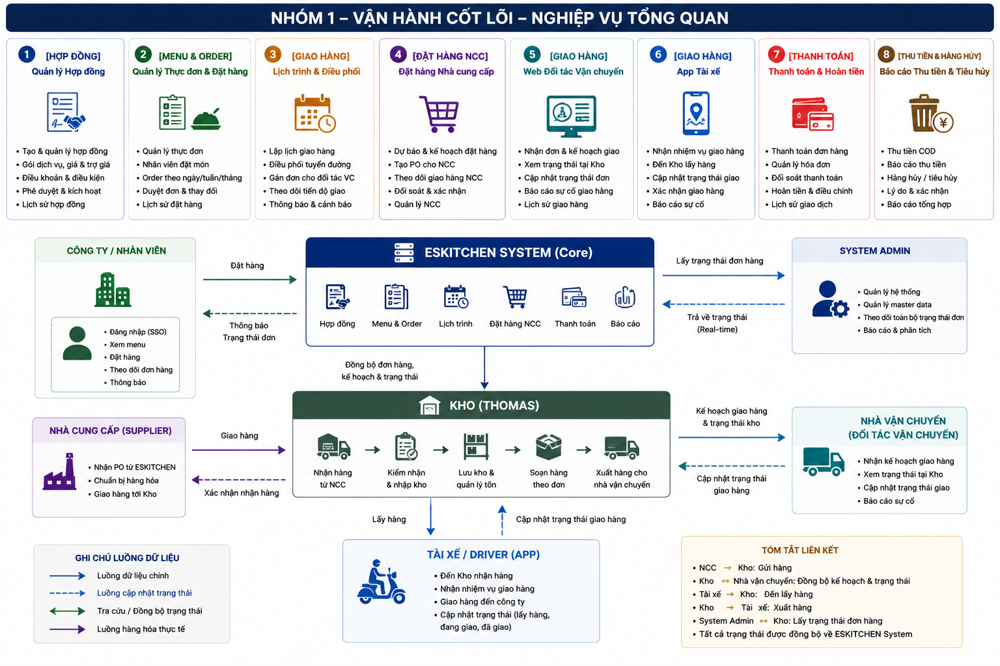
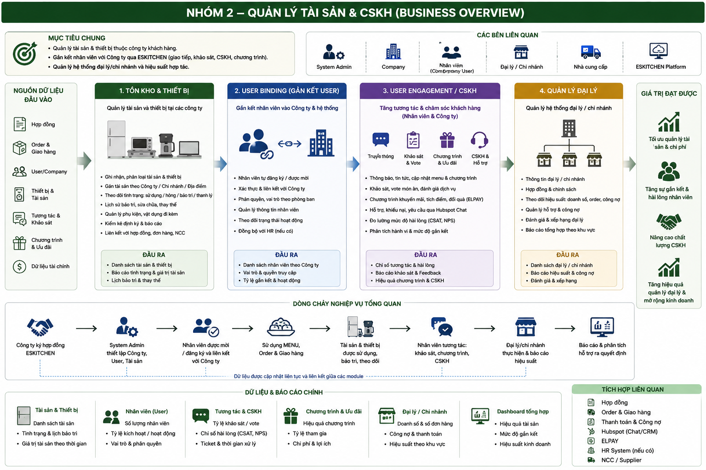

# ESKITCHEN Documentation

Tài liệu kỹ thuật và nghiệp vụ cho dự án **ESKITCHEN Phase 2** — hệ thống quản lý bếp doanh nghiệp cho client Nhật Bản.

## Hệ sinh thái — 9 repos

| Repo | Epic | Vai trò | Stack |
|---|---|---|---|
| `es-kitchen-api` | — | Core API · Business Logic · Database · Auth · Integrations | NestJS 11 / TypeScript / PostgreSQL / TypeORM 0.3 |
| `es-kitchen-payment-app` | E01 | User Mobile App — order, menu, delivery, payment | Flutter 3.10 / Dart / Riverpod 3 / Retrofit / auto_route |
| `es-kitchen-web-company` | E02 | Company Admin Web | React 19 / Vite 7 / Redux Toolkit / AntD 6.2 |
| `es-kitchen-web-admin` | E03 | System Admin Web (60+ pages) | React 19 / Vite 7 / Redux Toolkit / AntD 6.2 |
| `es-kitchen-web-supplier` | E04 | Supplier Web — menu, nhận đơn | React 19 / Vite 8 / Redux Toolkit / AntD 6.4 |
| `es-kitchen-web-outsource-web-private` | E05 | Outsource / Internal Private Admin Web | React 19 / Vite 8 / Redux Toolkit / AntD 6.4 |
| `es-kitchen-webapp-driver` | E06 | Driver Web App (mobile-first web) | React 19 / Vite 8 / **shadcn + Base UI** / **Zustand** |
| `es-kitchen-webapp-payment` | E07 | User Web Ordering (QR scan · cart · elepay) — parallel to E01 Mobile | React 19 / Vite 8 / **shadcn + Base UI** / **Zustand** / PWA |
| [`eskitchen-server-ai`](https://github.com/dipro-vn/eskitchen-server-ai) | — | Server AI — dịch vụ AI đề xuất thực đơn cho khách hàng doanh nghiệp | — |

## Nghiệp vụ ESKITCHEN

ESKITCHEN là hệ thống giúp **ES** cung cấp thực phẩm và đồ uống cho nhân viên của các công ty khách hàng (tủ lạnh, tủ đông, máy bán hàng đặt tại văn phòng).

1. **Ký hợp đồng:** ES ký hợp đồng với công ty, chọn gói dịch vụ, giá và thiết bị lắp đặt.
2. **Đặt hàng:** nhân viên công ty chọn món trên app; hệ thống gom thành đơn hàng theo tháng và theo cơ sở.
3. **Mua từ nhà cung cấp:** từ tổng đơn, ES đặt hàng nhà cung cấp; nhà cung cấp giao hàng về Kho ES và xác nhận.
4. **Giao hàng:** Kho ES soạn hàng, chuyển cho công ty vận chuyển; tài xế nhận hàng và giao tới công ty, cập nhật từng trạng thái giao.
5. **Thanh toán và thu tiền:** ES xuất hóa đơn hằng tháng, đối soát, thu tiền và xử lý hàng hủy.
6. **Quản lý sau bán:** theo dõi tồn kho và thiết bị, đại lý giới thiệu, khảo sát và chăm sóc khách hàng.

Có 4 nhóm người dùng chính: **khách hàng** (công ty và nhân viên), **ES** (quản trị hệ thống), **nhà cung cấp** và **bên vận chuyển** (công ty vận chuyển và tài xế).

### Bức tranh tổng quan

### Nhóm 1 — Vận hành cốt lõi

Hợp đồng, thực đơn và đặt hàng, lịch giao hàng, đặt hàng nhà cung cấp, giao hàng, thanh toán, thu tiền và hàng hủy.

### Nhóm 2 — Quản lý tài sản và chăm sóc khách hàng

Tồn kho và thiết bị, gắn kết nhân viên với công ty, chăm sóc khách hàng, quản lý đại lý.

## Sơ đồ luồng xử lý trong hệ thống

<a href="assets/flow-xu-ly-he-thong.html" target="_blank">Mở sơ đồ luồng xử lý (tab mới)</a>
